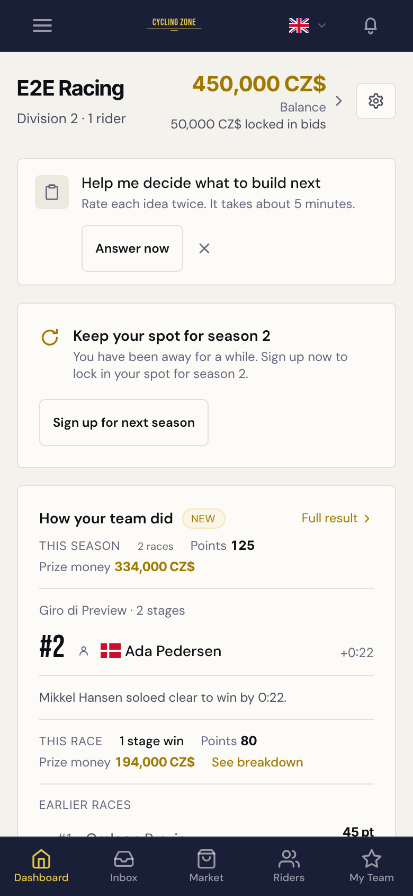
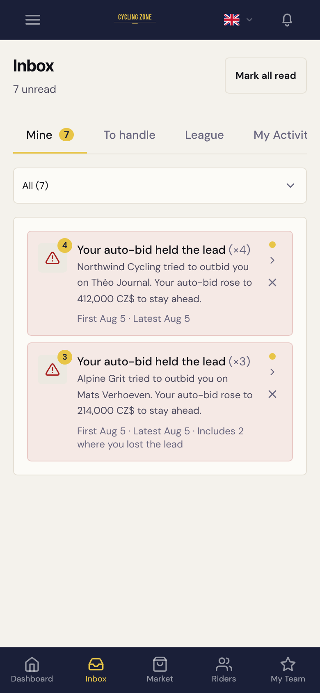
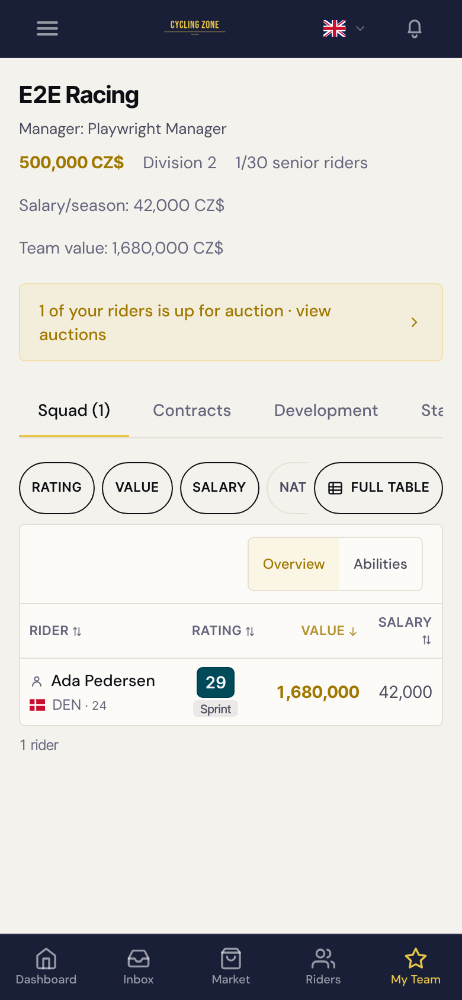
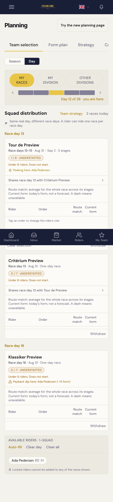
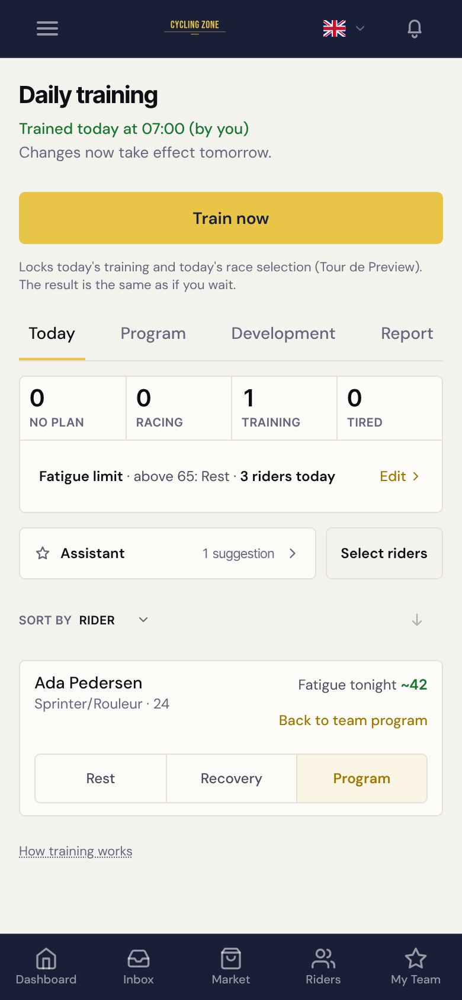
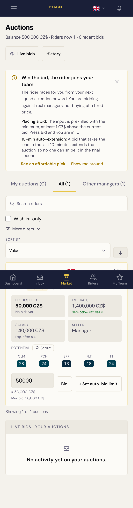
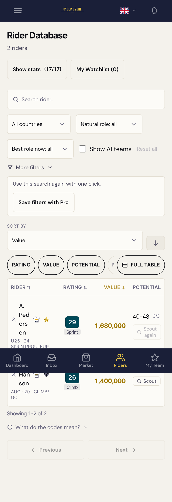
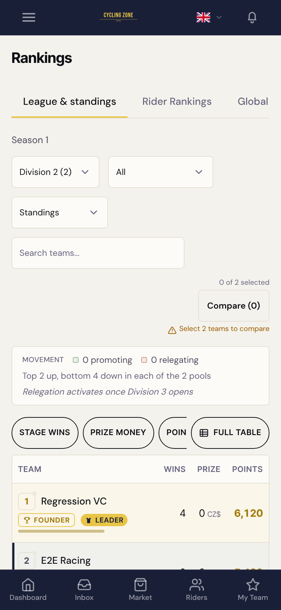
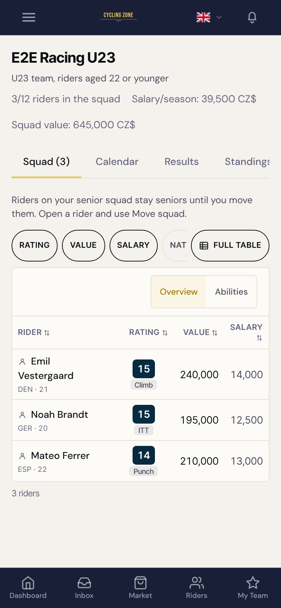
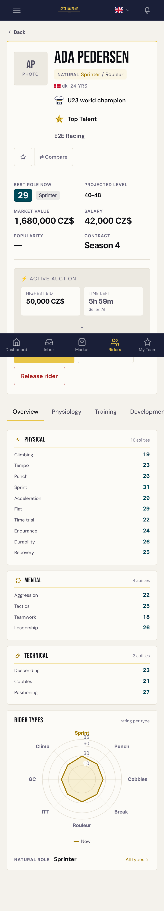

# Mobil-gennemgang: de 10 mest besøgte manager-sider ved 390 px (16/11/2026)

Refs #8073 · #7886 (tabeller på telefon) · #6916 (Mobil 10x). Kun rapport, ingen produktkode.

## Metode

- **Sidevalg:** PostHog web analytics, `Page`-opdeling med path cleaning, sidste 30 dage (hentet 16/11). Ikke-manager-sider er sorteret fra: `/login`, `/help`, `/patch-notes`, `/roadmap` og `/forum`.
- **Kørsel:** `VITE_PREVIEW_MOCK=1` plus de samme falske `VITE_SUPABASE_*` som `playwright.config` bruger. Uden dem crasher appen på `supabaseUrl is required`. Cookie-samtykke er sat i forvejen (`cz_consent_v1`), ellers dækker banneret billedet.
- **Billeder:** Playwright Chromium. 390 × 844 er taget med `isMobile`, `hasTouch` og DPR 2, og 1440 × 900 med DPR 1. Hver side har et billede af skærmen (`<side>-390.png` og `<side>-1440.png`) og et af hele siden ved 390 (`<side>-390-full.png`). Alle ligger i [`pr-screens/mobil-audit-16-11/`](../../pr-screens/mobil-audit-16-11/).
- **Script:** `pr-screens/mobil-audit-16-11/shoot.cjs` (kør med preview-serveren oppe på :5173).
- **Målinger** står i `metrics.json` i samme mappe: vandret rul på dokumentet, elementer der går ud over højre kant, rulle-bokse, afkortet tekst, y-position af første datarække og trykflader under 44 px.
- **Begrænsninger:**
  - Mock-seedet har kun 1-3 ryttere pr. hold, så rækketæthed og lange navne er kun delvist testet.
  - Mobilnavigationen ligger fast nederst og står derfor midt i billederne af hele siden. Det er en artefakt ved billedet, ikke en fejl i siden.
  - Det er uvist, hvilken gren af træningssiden mocken viser: beta-fladen bag `training_mobile_table` eller den almindelige. Ingen evidens, kun en antagelse om den almindelige.
- **Fold:** Ved 390 × 844 er der cirka 790 px synligt indhold, når bundnavigationen på 56 px er trukket fra. "Under folden" betyder, at første datarække starter under y ≈ 790.

## Resultat på tværs

| Kontrol | Fund |
|---|---|
| Vandret rul på dokumentet | **0 af 10** sider ved både 390 og 1440. D-047's `overflow-x: clip` holder. |
| Primære data under folden ved 390 | **5 af 10:** Auctions, Riders, Planning, Rider-profil og Standings. Team og Dashboard ligger på grænsen. |
| Trykflader under 44 px ved 390 | 3-25 pr. side. De fleste er tekst-knapper og -links på 16 px (Withdraw, See all, Reset all), der ikke får P16-gulvet. |
| Afkortede eller knækkede navne | **Riders:** rytternavnet knækker til "A. / Ped / ers / en", fordi navnecellen kun får cirka 25 px til tekst. |
| Faner der klippes uden at vise, at der er mere | 6 af 10 (Inbox, Team, Squad, Planning, Standings og Rider-profil) |
| Tabeller (D-047: navn + 3 kolonner) | Team, Squad, Riders og Standings følger standarden. Fejlen er navnecellens bredde, ikke antallet af kolonner. |

## De 10 sider, rangeret efter værdi

Rangeringen vægter visninger mod hvor alvorligt mobilproblemet er. Visningerne er fra de sidste 30 dage, og 63 % af sessionerne er mobil (Clarity 17-19/10, #6916).

### 1. Dashboard `/dashboard` (12.038 visninger)

1. **Data under to påmindelseskort.** Survey-kortet og "Keep your spot for season 2" fylder y 150-440, før den første rigtige data ("How your team did") starter ved y ≈ 457. Det strider mod P1 og forbuddet mod bannere øverst (#8070).
   **Forslag:** Foldes til én linje på 44 px pr. påmindelse ("Sign up for season 2 ›") under resultatkortet, eller ind i sidehovedets handlingsrække.
2. **25 små trykflader.** Det gælder "Full result", "See breakdown", "See all" ×3, "Calendar", "Details" og "Full standings", som alle er 16 px høje. "Customize" er 38 × 34.
   **Forslag:** Kortenes header-links får `min-h-11` via padding. Det visuelle er uændret (P16).
3. **Siden er 4.410 px lang (5,2 skærme)** med 10+ kort efter hinanden, ingen prioritering på mobil.
   **Forslag:** Brug den eksisterende "Customize" til en mobil-standard med 4 kort, så resten ligger bag "Show more".

### 2. Indbakke `/notifications` (11.277 visninger)

1. **Slet- og åbn-ikonerne er 24 × 24.** Kun cirka 28 px adskiller X og ›, så det er let at slette en besked ved et fejltryk.
   **Forslag:** 44 × 44 trykflader. X flyttes til swipe eller langt tryk (P16-arket), og › bliver hele kortet.
2. **En god nyhed vises som en fare.** "Your auto-bid held the lead" står i et rødt kort med et ⚠-ikon, men det er en positiv besked (P8: ét sprog for status).
   **Forslag:** Neutral tone for proxy-hævninger. Rød bruges kun, når føringen faktisk er tabt.
3. **Fanen "My Activit" klippes** uden tegn på, at der er mere.
   **Forslag:** Se rettelse 12 (fælles `Tabs`).

### 3. Mit hold `/team` (5.410 visninger)

1. **Ingen ordentlig stat-række i sidehovedet.** Saldo, division, ryttere, løn og holdværdi står som løse tekstlinjer over 4 rækker (y 120-440) i stedet for `HeroStats` i 2 kolonner.
   **Forslag:** Brug `HeroStats` (2 × 3 gitter på cirka 120 px).
2. **Guld-banner øverst.** "1 of your riders is up for auction" er et guld-banner, hvilket strider mod #8070 og den sparsomme brug af guld (P3).
   **Forslag:** Gøres til en linje i sidehovedets handlingsrække eller ligger kun i Indbakken.
3. **Første række først ved y ≈ 556.** Chip-rækken (y 390) og Overview/Abilities-vælgeren (cirka 70 px, alene inde i tabelkortet) skubber rækkerne ned. Ved 30 ryttere ses kun 1-2 rækker på første skærm. "SALARY ↑↓" knækker også over 2 linjer, fordi kolonnen er 62 px.
   **Forslag:** Overview/Abilities flyttes ind som det første element i chip-rækken, og sorteringsikonet står inline.

### 4. Planlægning `/planning` (2.714 visninger)

1. **Sidens handling ligger nederst.** Rytterpuljen "Available riders" ligger ved y ≈ 1.531 under alle løbskort, så hver udtagelse kræver rul ned og op igen. Det er ikke én-tommel (#6916).
   **Forslag:** Puljen i et bundark med "Add riders (n)" fast over bundnavigationen. Det er bottom sheet-flowet fra #6916.
2. **For små trykflader:** Withdraw, Clear selection, Auto-fill, Clear day, Clear all og Remove rider er 16 px høje. Season/Day er 24 px, og dagsstrimlen er 52 × 16.
   **Forslag:** Knapperne får P16-gulvet på 44 px (de er håndrullede tekst-knapper uden om de fælles knapper), og dagsstrimlen 44 px høj.
3. **Samme forklaring tre gange.** "Route match: average for the whole race… A dash means unavailable" gentages i hvert løbskort, så hvert kort bliver cirka 70 px højere.
   **Forslag:** Teksten kommer én gang som tooltip (P15) eller i Hjælp (P9).

### 5. Træning `/training` (2.379 visninger)

1. **557 px før første rytter:** titel, "Train now", forklaring, faner, 4 tal, træthedslinje, Assistant og "Sort by".
   **Forslag:** Træthedslinjen og Assistant lægges sammen i ét kort, og forklaringen under "Train now" bliver én linje.
2. **For små knapper:** Rest/Recovery/Program er 40 px høje, Edit er 36 px bred, og "How training works" er 14 px.
   **Forslag:** 44 px.
3. **Ellers den bedste af de 10:** én guld-knap, fanerne passer, og der er ingen klipning. Ingen yderligere fund.

### 6. Auktioner `/auctions` (2.332 visninger)

1. **Forklaringskort før auktionerne.** "Win the bid, the rider joins your team" er cirka 390 px forklaring over fanerne, og første auktion står ved y ≈ 766, altså helt under folden. Det strider mod P1, P9 og forbuddet mod bannere.
   **Forslag:** Kortet bliver til én linje "How auctions work ›" (Hjælp), eller det vises kun ved første besøg og huskes lukket.
2. **Løse knapper og ekstra filtre før listen.** "Live bids / History" er en løsreven knaprække (tjekliste 4), og "Wishlist only", "More filters" og "Sort by" ligger også før listen. Checkboksen er 16 × 16, "More filters" 16 px.
   **Forslag:** Søg plus "Filters"-knap med ark. Live bids/History flyttes til sidehovedets handlingsrække.
3. **"+ Set auto-bid limit" konkurrerer med "Bid" i samme række, og "Scout" er 21 px høj.**
   **Forslag:** Bud og auto-bud i én række med fuld bredde. Scout får 44 px.

### 7. Rytterdatabasen `/riders` (1.606 visninger)

1. **Rytternavnet knækker bogstav for bogstav ("A. / Ped / ers / en").** Rider-kolonnen er 104 px, men ikon, trøje og talentmærke står i samme linje, så der er cirka 25 px til navnet. Det strider mod P12 og #7886, og det er spillets centrale tabel.
   **Forslag:** På ≤640 px står mærkerne i underlinjen eller efter navnet med `flex-wrap`. Navnet får sin egen linje og knækker kun mellem ord. Rating-kolonnen strammes fra 85 til cirka 56 px (pladen er 32 px).
2. **Cirka 500 px filtre før tabellen:** søgning, 3 selects, AI-checkbox, More filters, Pro-upsell-kortet "Save filters with Pro" og "Sort by" (som er dobbelt, for kolonneoverskrifterne sorterer også). Første række står ved y ≈ 670.
   **Forslag:** Følg T2's mobilregel: søg plus to halve selects, resten i et "Filters (n)"-ark. Upsell flyttes under tabellen, og "Sort by"-select fjernes på mobil.
3. **For små trykflader:** "Scout" er 63 × 21, mærke-knapperne 20 × 20, og checkbox og "Reset all" er 16 px.
   **Forslag:** 44 px trykflade via padding.

### 8. Ranglister `/standings` (1.381 visninger)

1. **Første række ved y ≈ 669:** 3 selects på hver sin linje, en halvbred søgning, "Compare (0)", en advarsel og et forklaringskort om op- og nedrykning.
   **Forslag:** Søg plus to halve selects. Compare bliver en tilstand, der først viser sig, når en række er valgt. Op- og nedrykning bliver én linje i tabellens fod.
2. **"Select 2 teams to compare" står som en gul advarsel,** selvom ingen har gjort noget forkert (P8).
   **Forslag:** Teksten fjernes. Knappen er deaktiveret, til to hold er valgt.
3. **Sammenligningsboksene er 24 × 24.**
   **Forslag:** 44 px trykflade. Holdlinket er 20 px højt, så hele rækken gøres til link.

### 9. Trup U23/Junior `/squads/:squad` (1.184 + 1.114 = 2.298 visninger, samme komponent)

1. **Samme sidehoved-problem som Team:** stats som løse linjer, plus en introsætning over chip-rækken.
   **Forslag:** `HeroStats`, og sætningen flyttes til Hjælp eller et tooltip.
2. **Overview/Abilities fylder en hel række på 70 px** inde i tabelkortet.
   **Forslag:** Samme som Team, rettelse 13.
3. **Fanen "Standings" klippes.** "SALARY ↑↓" knækker over 2 linjer.

### 10. Rytterprofil `/riders/:id` (samlet antal ukendt: path cleaning slår ikke id'erne sammen; enkelte profiler har op til 93 visninger)

1. **Heroen er 952 px høj,** så fanerne og evnerne ligger helt under folden. Hver af "U23 world champion" og "Top Talent" fylder en egen række på 44 px, og auktionsboksen plus Extend/List/Release ligger også i heroen.
   **Forslag:** Mærkerne står inline efter navnet (P12-rækkefølgen). Auktionen bliver én linje med Bid, og kontrakt-handlingerne samles i én "Manage ›"-række.
2. **"Back" er 44 × 16, og "All types" er 57 × 23.**
   **Forslag:** 44 px.
3. **Nationen står som "dk" med små bogstaver** ved siden af flaget, mens tabellerne skriver "DEN" (P13: én skrivemåde).
   **Forslag:** Brug samme nationsformat som `RiderNameCell`.

## Desktop ved 1440

Ingen sider har vandret rul, og filtrene står på én linje (se `riders-1440.png`). Desktop-billederne er til før/efter-sammenligning, når rettelserne bygges. De rettelser, der foreslås nedenfor, er afgrænset til ≤640 px, så desktop er uændret.

## De 15 vigtigste rettelser, rangeret

Rangeringen vægter sidens visninger, hvor alvorligt problemet er, og om rettelsen rammer flere sider på én gang (fælles komponent).

| # | Rettelse | Sider | Hvor | Princip |
|---|---|---|---|---|
| 1 | Navnecellen på ≤640 px: mærker i underlinjen, navnet knækker kun mellem ord, Rating-kolonnen strammes til cirka 56 px | Riders, Team, Squad, Auctions | `RiderNameCell` / `DataTable` (delt) | P12, P10, #7886 |
| 2 | Påmindelseskort (survey, sæsontilmelding) foldes til 44 px-linjer under det første datakort | Dashboard | Dashboard | P1, #8070 |
| 3 | Forklaringskortet på Auktioner bliver én Hjælp-linje eller vises kun ved første besøg | Auctions | AuctionsPage | P1, P9 |
| 4 | P16-gulvet udvides til tekst-knapper og -links (Withdraw, See all, Reset all, Scout, Back), så 44 px opnås via padding uden visuel ændring | Alle 10 | Delt knap- og link-recipe | P16 |
| 5 | Planlægningens rytterpulje i et fast bundark ("Add riders"), så udtagelse sker med én tommel | Planning | PlanningPage | #6916, P10 |
| 6 | Mobil-filterlinje: søg plus to halve selects plus "Filters (n)"-ark. Pro-upsell flyttes under tabellen, og den dobbelte "Sort by" fjernes | Riders, Standings, Auctions | `FilterBar` (delt) | T2-mobilregel, P1 |
| 7 | Rytterprofilens hero strammes: mærker inline, auktion som én linje, kontrakt-handlinger samlet | Rider-profil | RiderStatsPage hero | P1, T3 |
| 8 | Team- og Squad-sidehovedet bruger `HeroStats` (2 kolonner), og auktions-banneret fjernes | Team, Squad ×2 | TeamPage, SquadPage | T2/T3, #8070, P3 |
| 9 | Indbakken: 44 px trykflader på X og ›, og slet flyttes til swipe eller ark, så fejlslet undgås | Notifications | NotificationsPage | P16 |
| 10 | Proxy-hævninger i neutral tone, ikke den røde fare-tone | Notifications | Notifikationstyper | P8 |
| 11 | Standings: Compare som valg-tilstand, ingen gul advarsel, og op- og nedrykning som fodlinje | Standings | StandingsPage | P1, P8 |
| 12 | Faner der klippes, får en tydelig "mere"-markør (opak chevron som i DataTable, ingen gradient) | 6 sider | `Tabs` (delt) | T3, §3 |
| 13 | Overview/Abilities flyttes ind i chip-rækken, så den ikke fylder en egen række på 70 px | Team, Squad ×2 | DataTable-værktøjslinje | P1, P5 |
| 14 | Planlægningens forklaring ("Route match…") vises én gang i stedet for i hvert løbskort | Planning | PlanningPage | P9 |
| 15 | Træningens chrome før første rytter: træthed og Assistant lægges sammen, Rest/Recovery/Program bliver 44 px | Training | TrainingPage | P1, P16 |

Rettelse 1, 4, 6 og 12 er fælles komponenter. Fire PR'er rammer dermed 8-10 af siderne. Kanal: Claude Code-bølge med ét spor pr. rettelse. Før merge kræves ejerens godkendelse af billederne ved 390/375 og 1440 (P16 og PAGE_TEMPLATES).

## Før/efter-skitser (ejer 16/11)

Ejeren bad om at se de større rettelser, før de bygges. Skitserne er én skærm pr. rettelse ved 390 px. De er bygget med appens egne tokens og Tailwind-klasser i `frontend/src/preview/sketches/mobil-top15/`, som kun er en dev-side og ikke en del af app-buildet. Hvert billede viser FØR (den rigtige app med preview-mock) og EFTER (skitsen) side om side med nummer, navn og én sætning. Rettelse 10 bygges allerede på PC1 (#8260) og er ikke med. Skitserne er forslag til retning, ikke færdigt design.

| # | Billede |
|---|---|
| 1 | [Navnecellen](../../pr-screens/mobil-audit-16-11/foer-efter/01-navnecellen.png) |
| 2 | [Påmindelseskort på forsiden](../../pr-screens/mobil-audit-16-11/foer-efter/02-forside-paamindelser.png) |
| 3 | [Forklaringskortet på Auktioner](../../pr-screens/mobil-audit-16-11/foer-efter/03-auktioner-forklaring.png) |
| 4 | [44 px-trykflader](../../pr-screens/mobil-audit-16-11/foer-efter/04-trykflader-44.png) |
| 5 | [Rytterpuljen i bundark](../../pr-screens/mobil-audit-16-11/foer-efter/05-planlaegning-bundark.png) |
| 6 | [Filterlinjen](../../pr-screens/mobil-audit-16-11/foer-efter/06-filterlinjen.png) |
| 7 | [Rytterprofilens hero](../../pr-screens/mobil-audit-16-11/foer-efter/07-rytterprofil-hero.png) |
| 8 | [HeroStats på Team/Squad](../../pr-screens/mobil-audit-16-11/foer-efter/08-team-herostats.png) |
| 9 | [Indbakkens trykflader](../../pr-screens/mobil-audit-16-11/foer-efter/09-indbakke-trykflader.png) |
| 12 | [Faner med mere-markør](../../pr-screens/mobil-audit-16-11/foer-efter/12-faner-mere-markoer.png) |

Genskab billederne: `npm run dev:preview --prefix frontend` med de falske `VITE_SUPABASE_*` fra `playwright.config.js`, og kør derefter `sketch.cjs` og `compose.cjs` i `pr-screens/mobil-audit-16-11/foer-efter/`.

## Anbefalet rækkefølge

1. **Fælles komponenter først (rettelse 1, 4 og 12).** De er billigst pr. side og rammer 8-10 af siderne på én gang.
2. **Derefter de mest besøgte sider (rettelse 2 og 9):** Forsiden og Indbakken står for 23.315 af 30 dages visninger.
3. **Dernæst sidehoveder og filtre (rettelse 8, 3, 6, 7 og 11):** her rykker data op over folden.
4. **Rytterpuljen i bundark (rettelse 5) til sidst af de store.** Den kræver et bundark-mønster, som også #6916 skal bruge, så den bør bygges sammen med den.
5. **De små rettelser (13, 14 og 15)** kan tages som oprydning i samme spor som deres side.

## Data

PostHog `query-web-stats`, `breakdownBy: Page`, `doPathCleaning: true`, `date_from: -30d` (hentet 16/11/2026):

| Side | Visninger | Besøgende |
|---|---:|---:|
| /dashboard | 12.038 | 237 |
| /notifications | 11.277 | 113 |
| /team | 5.410 | 73 |
| /planning | 2.714 | 54 |
| /training | 2.379 | 63 |
| /auctions | 2.332 | 54 |
| /riders | 1.606 | 57 |
| /standings | 1.381 | 50 |
| /squads/u23 | 1.184 | 45 |
| /squads/junior | 1.114 | 42 |
| /academy | 1.096 | 56 |
| /finance | 971 | 46 |

Opdelingen mobil/desktop pr. side er ikke hentet. 63 %-tallet er hele sitets andel fra Clarity.
