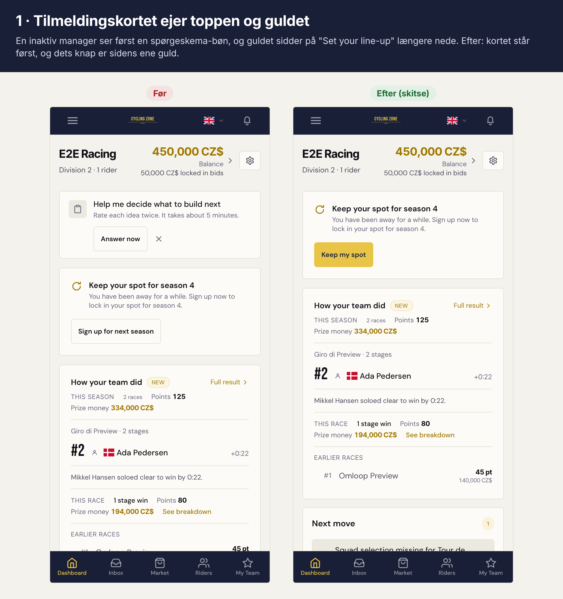
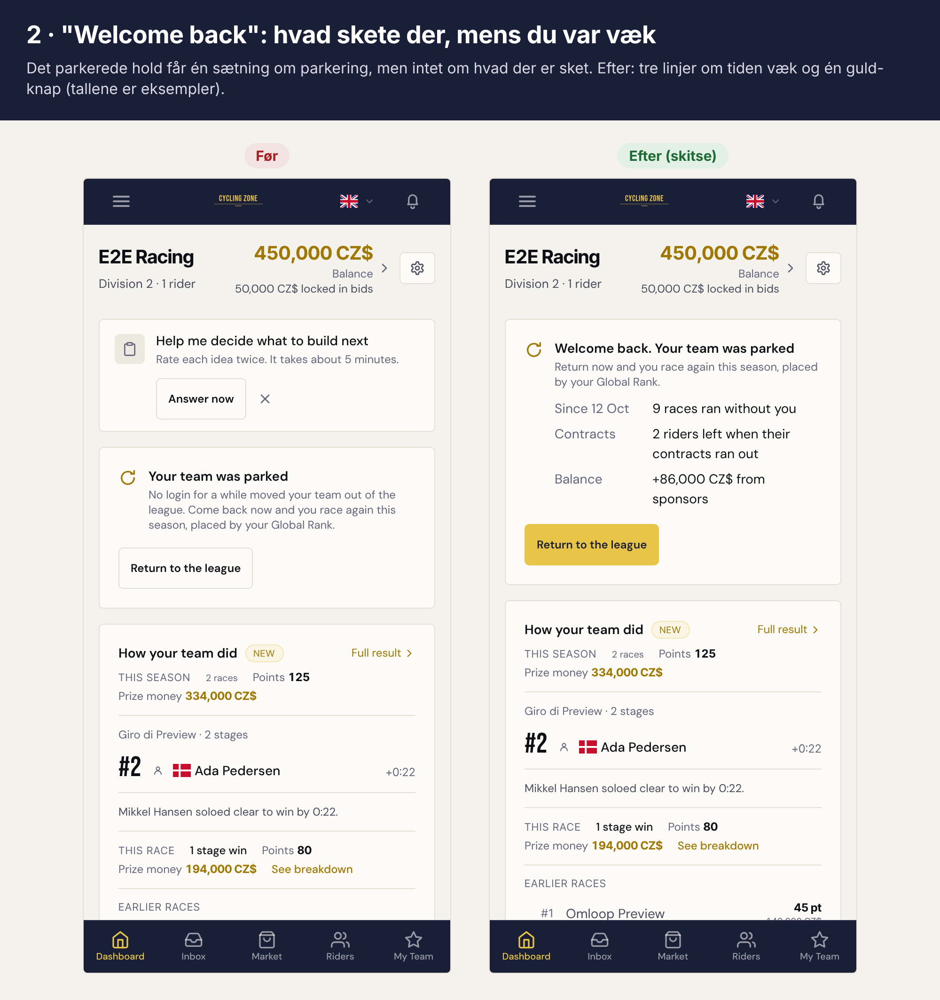
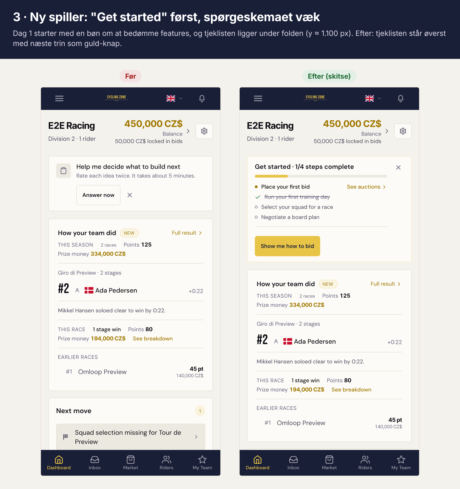
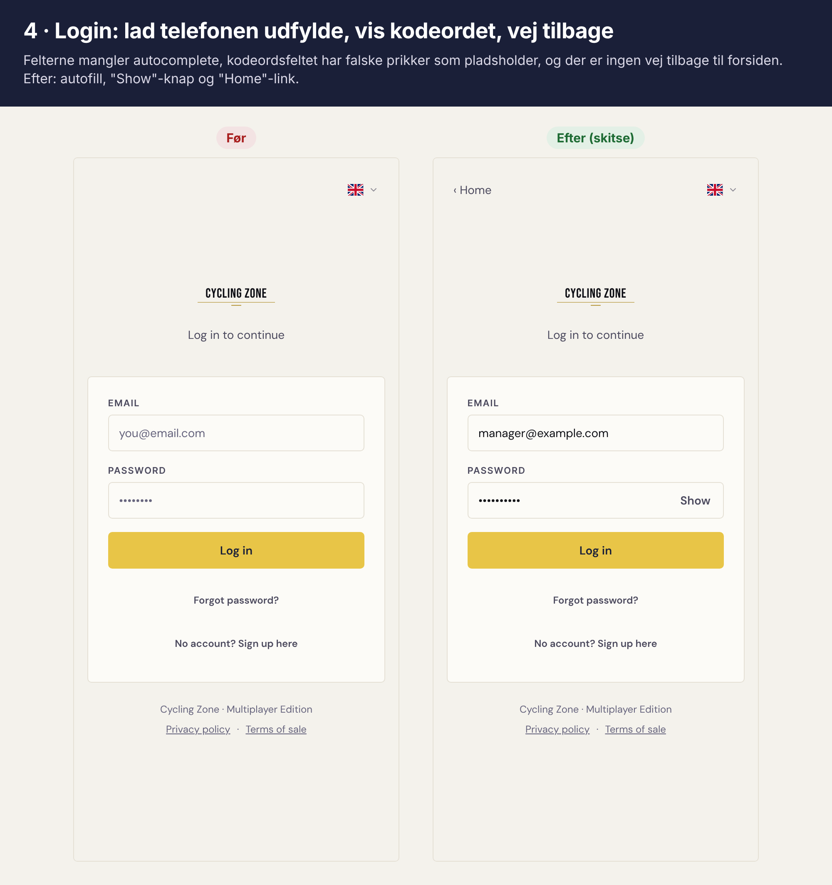
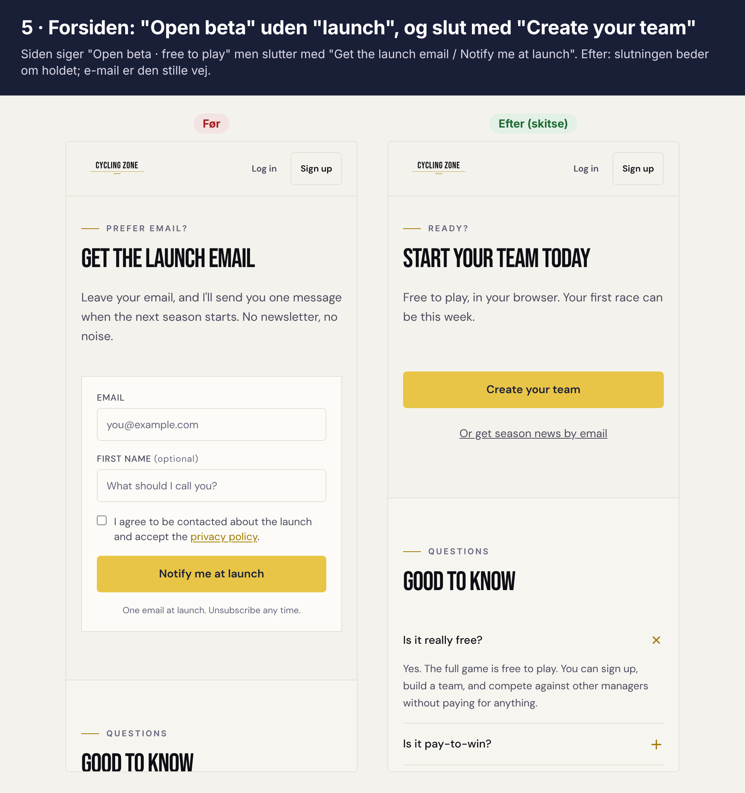

# UX-gennemgang 1/4: første oplevelse og tilbagevenden (16/11/2026)

Refs #8282 (spilleren vender tilbage) · bygger på [mobil-top10](2026-11-16-mobil-top10.md) (PR #8236) og [designsystem mod TASTE](2026-11-16-designsystem-taste.md) (PR #8235). Kun rapport, ingen produktkode.

**Område:** forsiden for anonyme, login/opret, sæsontilmelding, rundvisning, første dag (dashboard, første løbskort, første træning) og en manager, der kommer tilbage efter inaktivitet. Hvert flow er gået igennem som ny og som tilbagevendende spiller ved 390 px og 1440 px i lys og mørk tilstand.

> **Rå billeder:** `raw/` er taget ud ved merge (ejer 19/11) og ligger i commit `66b6a5603` på branchen `claude/quirky-galileo-k9rafu`.

## Metode

- **Kørsel:** `VITE_PREVIEW_MOCK=1` med de falske `VITE_SUPABASE_*` fra `frontend/playwright.config.js` og `cz_consent_v1` sat. Playwright Chromium, 390 × 844 (`isMobile`, DPR 2) og 1440 × 900, `locale en-US`, tidszone Europe/Copenhagen.
- **Prod-kontakterne 16/11:** en fetch-wrapper i `lib.cjs` lægger sig oven på preview-mocken og svarer `/api/feature-flags` med de 41 tændte kontakter. Alt andet er slukket, også `race_page_v6`. Produktkoden er ikke ændret.
- **Scenarier** (samme wrapper, `lib.cjs`):
  - *Ny:* ikke tilmeldings-berettiget, onboarding 1/4, `first-race-card` synligt.
  - *Inaktiv:* `eligible: true`, ikke tilmeldt. Viser "Keep your spot for season 4".
  - *Parkeret:* `parked: true`. Viser "Your team was parked".
- **Scripts:** `pr-screens/ux-16-11/1/shoot.cjs` (alle flows), `tour.cjs` (rundvisningen) og `sketch.cjs` (før/efter). Rå billeder og `metrics.json` (overskrifternes y-position, guld-knapper, trykflader under 44 px og antal ord) ligger i `raw/`. Før/efter-billederne ligger i `foer-efter/`.
- **Skitserne** er den rigtige app, hvor DOM'en er flyttet og omskrevet i browseren. De bruger derfor kittets egne komponenter, fonte og farver (P17, P20). Tal mærket "eksempel" er opdigtede.
- **Begrænsninger:**
  - Mockens hold er midt i sæsonen med resultater. Derfor lukker gaten for **første løbskort** (`firstRaceCardGateOpen`), og kortet kan ikke ses i mocken. Det er ikke dømt her.
  - SPA-skiftet fra dashboard til `/auctions` giver "Something went wrong" i mocken. Efter genindlæsning virker siden. Sentry har ingen tilsvarende hændelse de sidste 14 dage, så det regnes som en mock-artefakt og ikke som et fund. `tour.cjs` genindlæser derfor, før rundvisningen fotograferes.
  - Bekræftelsesskærmen efter oprettelse er kun læst i koden og locale-teksterne, ikke fotograferet.
  - Tilmeldingskortets placering er målt med mockens advarsler (ingen trup-/kontraktadvarsel). I prod kan advarslerne stå over kortet, se fund 1.

## Det vigtigste i én sætning

**Den spiller, vi helst vil have tilbage, møder en spørgeskema-bøn før sin plads i ligaen, og guldet sidder på en anden knap.** Den nye spiller møder det samme spørgeskema på dag 1, mens "Get started"-tjeklisten ligger under folden.

## Rangeret top 15 (værdi for spillerne mod indsats)

Værdi: 5 = rammer alle nye eller tilbagevendende spillere på første skærm. Indsats: S = én fil eller copy, M = en komponent eller flere filer, L = ny data eller backend.

| # | Fund | Flow | Værdi | Indsats | Kanal |
|---|---|---|---|---|---|
| 1 | Tilmeldingskortet ejer hverken toppen eller guldet | Tilbagevenden | 5 | S | Claude Code |
| 2 | Ingen "mens du var væk" for den tilbagevendende | Tilbagevenden | 5 | L | Ejer-design → Claude Code (#8282) |
| 3 | Ny spiller: spørgeskema først, tjeklisten under folden | Første dag | 5 | S | Claude Code |
| 4 | Login: ingen autofill, falske prikker, ingen "vis kodeord", ingen vej hjem | Login | 4 | S | Claude Code |
| 5 | Forsiden siger "open beta" og slutter med "Notify me at launch" | Forside | 4 | S | Claude Code (copy: ejer) |
| 6 | Forsidens sprogvælger findes ikke i toppen på mobil | Forside | 3 | S | Claude Code |
| 7 | Rundvisningen slutter blindt: "Done", og spilleren står midt på auktionssiden | Rundvisning | 4 | M | Claude Code |
| 8 | Den samme budforklaring tre gange og tre indgange til hjælp | Rundvisning | 3 | S | Claude Code |
| 9 | Udvikler-sprog i rundvisningen: "Couldn't find a tour target" | Rundvisning | 3 | S | Claude Code |
| 10 | Samme opgave tre gange på dag 1 (holdudtagelse) | Første dag | 3 | M | Claude Code |
| 11 | To forskellige "Balance"-tal på samme skærm | Første dag | 3 | S | Claude Code |
| 12 | "You're ready. The basics are done" kan ramme veteraner | Tilbagevenden | 2 | S | Claude Code |
| 13 | Første træning: guld-"Train now" efter træningen, fagord uden forklaring | Første dag | 3 | M | Claude Code + ejer |
| 14 | Onboarding-kortets "This week is already run." og "Show me how" som lille link | Første dag | 2 | S | Claude Code |
| 15 | Opret-formularen bruger udviklerens eget navn som eksempel | Opret | 1 | S | Claude Code |

### 1. Tilmeldingskortet ejer hverken toppen eller guldet

- **Spilleren oplever:** En manager, der har været væk, åbner dashboardet (390 px) og ser først "Help me decide what to build next" (y 150-270). "Keep your spot for season 4" kommer bagefter (y 285-440), og knappen "Sign up for next season" er en sekundær knap. Sidens eneste guld-knap er "Set your line-up" ved y ≈ 1.100, også for et **parkeret** hold, der ikke kan køre løbet (`raw/parked-dashboard-1440-dark.png`).
- **Hvorfor:**
  - Ejer-reglen i #8282 siger, at kortet SKAL ses hurtigst muligt.
  - `computeDashboardGoldCta` (`frontend/src/lib/dashboardGoldCta.js:28`) giver kun tilmeldingen guld, når holdudtagelsen *ikke* har det. Prioriteten står altså omvendt af, hvad pladsen er værd.
  - `SurveyInviteCard` står over kortet (`DashboardPage.jsx:589` mod `:672`).
  - I prod kan trup- og kontraktadvarslerne også stå over kortet. En tilbagevendende manager har typisk udløbne kontrakter, og så står kortet på mobil under folden. Det er en antagelse, men rækkefølgen står i koden (`DashboardPage.jsx:599-668`).
  - Brud på Nielsen #8 (fokus på det vigtige) og P3 (guld er rationeret til det vigtigste).
- **Forslag:**
  - (a) I `dashboardGoldCta.js`: `seasonSignupPrimary` vinder over `squadCtaActive`, når spilleren er berettiget og ikke tilmeldt.
  - (b) Kortet rykkes til lige under sidehovedet, over advarslerne.
  - (c) `SurveyInviteCard` skjules, så længe tilmeldingen venter.
  - (d) Knappen på "dormant"-kortet hedder "Keep my spot" (DA "Behold min plads") og matcher dermed titlen.
  - Kortet foldes **ikke** væk (#8282).

### 2. Ingen "mens du var væk" for den tilbagevendende

- **Spilleren oplever:** Det parkerede hold får én sætning om, hvorfor holdet er parkeret, og "How your team did" med et "NEW"-mærke på gamle resultater. Der står intet om, hvad der er sket i mellemtiden: løb kørt uden holdet, kontrakter der er udløbet, saldo og trup. Indbakken åbner med gamle autobud-beskeder fra august i rødt (`raw/dormant-notifications-390-light.png`; den røde tone er allerede mobil-top10 fund 2.2).
- **Hvorfor:**
  - #8282 beder netop om "hvad er sket siden sidst, trup/økonomi-status, første handling".
  - Nielsen #1 (systemets status): spilleren skal selv grave i fire sider for at forstå sit hold.
- **Forslag:** Ét "Welcome back"-kort i stedet for to: tilmeldingskortet får 3 linjer om tiden væk (dato, løb, kontrakter, saldo) og én guld-knap. Kræver et lille endpoint, der sammenfatter siden `last_seen`. Copy EN først: "Since 12 Oct · 9 races ran without you". Design og byg ligger i #8282.

### 3. Ny spiller: spørgeskema først, tjeklisten under folden

- **Spilleren oplever:** Det første kort på dag 1 beder spilleren om at bedømme idéer til nye features ("Rate each idea twice. It takes about 5 minutes."), før spilleren har spillet. "Get started · 1/4" ligger ved y ≈ 1.100 på mobil, under resultater, "Next move" og holdudtagelse. Med første løbskort tændt bliver tjeklisten desuden dæmpet med `opacity-75` (`DashboardPage.jsx:840`).
- **Hvorfor:**
  - Spørgeskemaet har ingen anciennitets-grænse (`frontend/src/data/dashboardCards.ts:118-138`: kun åben/lukket/besvaret). NPS har den (`NPS_MIN_RACE_DAYS`).
  - En ny spillers svar er støj, og kortet skubber spillets vigtigste vejledning ned.
  - Brud på P1 (data over folden) og Nielsen #8.
- **Forslag:**
  - (a) Spørgeskemaet vises først fra samme grænse som NPS.
  - (b) Så længe onboarding ikke er færdig, står "Get started" først, og dets næste trin er sidens guld-knap ("Show me how to bid"). Holdudtagelsen bliver sekundær, indtil tjeklisten når til "Select your squad".
  - (c) Ingen `opacity-75` på et kort, der er spillerens vejledning.

### 4. Login: ingen autofill, falske prikker, ingen "vis kodeord", ingen vej hjem

- **Spilleren oplever:**
  - Kodeordsfeltet viser "••••••••" som pladsholder (`LoginPage.jsx:727`), så det ligner et gemt kodeord.
  - Hverken e-mail eller kodeord har `autocomplete`, så telefonens nøglering foreslår ikke altid login.
  - Der er ingen "Show" til kodeordet.
  - Siden har intet link tilbage til forsiden; logoet er ikke et link.
- **Hvorfor:**
  - Den tilbagevendende spiller har oftest glemt kodeordet. 63 % er på mobil, hvor tastefejl i kodeord er dyre.
  - Guiden `autofill-sign-in-form` (modern-web-guidance) kræver `autocomplete="username"` på e-mail og `current-password` (opret: `new-password`) og anbefaler en "Show password"-knap.
  - Nielsen #3 (nødudgang) og #5 (undgå fejl).
- **Forslag:**
  - `autoComplete="username"`, og `current-password` eller `new-password` efter tilstand.
  - Pladsholderen fjernes.
  - "Show"/"Hide" med 44 px trykflade (P16) og `aria-pressed`.
  - "‹ Home" eller et klikbart logo til `/`.

### 5. Forsiden siger "open beta" og slutter med "Notify me at launch"

- **Spilleren oplever:** Toppen siger "OPEN BETA · FREE TO PLAY" og "Create your team". Under den står "Get the launch email". Siden er 5.287 px lang på mobil og slutter med "GET THE LAUNCH EMAIL … Notify me at launch". Der er ingen "Create your team" efter hero'en (`raw/landing-390-light-full.png`).
- **Hvorfor:**
  - Det er en selvmodsigelse (Nielsen #2, match med virkeligheden): spillet kører, så der er ikke noget "launch" at vente på.
  - Den, der har læst hele siden, er den mest interesserede besøgende. Den besøgende får tilbudt en e-mail i stedet for et hold.
  - Tre guld-knapper på siden ("Create your team" y 434, "Open the Discord" y 3.687, "Notify me at launch" y 4.310) fortynder guldet (P3; marketing-siden er ikke T1-T3, men guld-rationeringen gælder spillets look, P20).
- **Forslag:**
  - Slutsektionen bliver "Ready? · Start your team today" med "Create your team" som guld og "Or get season news by email" som stille link.
  - Hero'ens "Get the launch email" bliver "Get season news by email".
  - "Open the Discord" bliver sekundær.
  - Kræver `check-cdn-cache-headers.mjs` før merge (NOW: forsiden `/`).

### 6. Forsidens sprogvælger findes ikke i toppen på mobil

- **Spilleren oplever:** På 1440 står EN/DA/FR/ES/NL i menulinjen. På 390 er den skjult (`LandingPage.jsx:158`, `hidden sm:flex`) og findes kun i bunden af siden, cirka 5.200 px nede (`raw/landing-390-light.png`).
- **Hvorfor:** Vi bygger til international vækst, og 63 % er på mobil. En hollandsk besøgende skal rulle hele siden for at finde sit sprog. Nielsen #3 og #7.
- **Forslag:** En kompakt sprogvælger ("EN ▾", 44 px) mellem logo og "Log in" på mobil, samme komponent som i appens topbjælke.

### 7. Rundvisningen slutter blindt

- **Spilleren oplever:** "Show me how" sender spilleren til auktionerne. Trin 1 "Place a bid" og trin 2 "Time left and auto-extension" ender med "Done", og så står spilleren midt på siden. Der er ingen guld "Bid" og intet "Next: run your first training" eller tilbage til tjeklisten (`raw/tour-step1-390-light.png`, `raw/tour-step2-390-dark.png`, `raw/tour-after-done-390-light.png`). Pop-oppen i trin 1 dækker desuden auktionskortet, den forklarer.
- **Hvorfor:** Onboarding har 4 trin, men rundvisningen binder dem ikke sammen. Momentum forsvinder ved det første "Done". Nielsen #1 og #6.
- **Forslag:**
  - "Done" bliver "Next: training ›", og sidste trin bliver "Back to your checklist".
  - På mobil står pop-oppen som bundark (P18) over kortet, ikke oven på det.

### 8. Den samme budforklaring tre gange og tre indgange til hjælp

- **Spilleren oplever:**
  - Kortet "Win the bid, the rider joins your team" forklarer minimumsbud og 10-minutters forlængelse.
  - Rundvisningens trin 1 og 2 siger det samme igen.
  - Kortet har selv "Show me around" og "See an affordable pick", og dashboardet har "Show me how".
- **Hvorfor:** Tre ord-tunge lag (P9: ingen introtekst mellem hoved og indhold; mobil-top10 fund 6.1 dækker kortets plads). Spilleren kan ikke se, hvilken indgang der er den rigtige.
- **Forslag:** Første besøg via rundvisningen viser kun rundvisningen. Kortet vises ikke samtidig og bliver bagefter til én linje "How auctions work ›".

### 9. Udvikler-sprog i rundvisningen

- **Spilleren oplever:** Når målet mangler, står der "Tour active. Couldn't find a tour target on this page." (`auth.json` → `tour.fallback`).
- **Hvorfor:** TONE_OF_VOICE (spillersprog, ikke systemsprog) og Nielsen #9. Det ses netop, når noget allerede er gået galt.
- **Forslag:** "This step isn't on this page right now." med to knapper: "Go to auctions" (guld) og "End tour". EN først, DA "Trinnet findes ikke på denne side lige nu."

### 10. Samme opgave tre gange på dag 1

- **Spilleren oplever:** "Next move: Squad selection missing for Tour de Preview", kortet "Pick your race squad" med guld "Set your line-up" og onboardingens "Select your squad for a race" er tre kort om én handling (`raw/new-dashboard-1440-light.png`).
- **Hvorfor:** Fylder tre kort over folden (P1, fold-disciplinen) og får det til at se ud som tre opgaver.
- **Forslag:** Når holdudtagelsen er det næste træk, bærer "Pick your race squad" den alene. "Next move" springer den over, og tjeklisten linker til samme sted.

### 11. To forskellige "Balance"-tal på samme skærm

- **Spilleren oplever:** Sidebjælken siger "BALANCE 500,000 CZ$". Dashboardets hoved siger "450,000 CZ$ Balance · 50,000 CZ$ locked in bids", og auktionssiden "Balance 500,000 CZ$" (`raw/new-dashboard-1440-light.png`, `raw/tour-step1-390-light.png`).
- **Hvorfor:** Nielsen #4 (konsistens). En ny spiller, der lige har budt, kan ikke se, hvilket tal der gælder. P13: ét tal, én skrivemåde.
- **Forslag:** Ét begreb overalt. Enten "Available 450,000 CZ$" med "500,000 total" under, eller samme disponible tal i sidebjælken og på auktionssiden (#3508 har allerede beregningen i `availableBalance.js`).

### 12. "You're ready. The basics are done" kan ramme veteraner

- **Spilleren oplever:** Afslutningskortet vises, når alle 4 trin er gjort og `localStorage` ikke har lukket det (`DashboardPage.jsx:141, 879`). Serverens `dismissed`/`established` læses ikke for netop det kort. En veteran på en ny telefon kan derfor få begynderkortet.
- **Hvorfor:** Forkert tone for en tilbagevendende manager, og det tager plads fra fund 1-2. Antagelse: det er set i mocken med `established: true`, ikke verificeret i prod.
- **Forslag:** Kortet skjules, når serveren siger `established` eller `dismissed`, ligesom tjeklisten (#2439).

### 13. Første træning: guld efter træningen og fagord uden forklaring

- **Spilleren oplever:** "Trained today at 07:00 (by you)" står over en guld "Train now" med teksten "Locks today's training … The result is the same as if you wait". Lige under står "0 NO PLAN · 0 RACING · 1 TRAINING · 0 TIRED", "Fatigue limit · above 65: Rest" og "Back to team program". "How training works" er et link på 14 px i bunden (`raw/new-training-390-light.png`).
- **Hvorfor:** For en ny spiller er det 95 ord fagsprog uden en vej ind (P9, P15 fagord prikket understreget). Guld på en handling, der allerede er gjort, svækker guldet (P3).
- **Forslag:**
  - Efter dagens træning bliver knappen sekundær, eller den skjules til i morgen.
  - Første besøg får én linje "New here? Your riders train on their own. Change a plan when you're ready." plus "How training works" i sidehovedets handlingsrække.
  - Fagordene får P15's prikkede understregning.
  - Ejeren afgør, om "Train now" skal være guld efter træningen (#8031-reglen).

### 14. Onboarding-kortets "This week is already run." og "Show me how" som lille link

- **Spilleren oplever:** Under trinene står "This week is already run." uden sammenhæng, og "Show me how" er et lille tekstlink nederst i kortet (16 px højt).
- **Hvorfor:** Kryptisk for en ny spiller (TONE_OF_VOICE). Hoved-handlingen skal have 44 px (P16).
- **Forslag:** Linjen vises kun på trænings-trinnet ("Training for this week is done."). "Show me how" bliver kortets knap (se skitse 3).

### 15. Opret-formularen bruger udviklerens eget navn som eksempel

- **Spilleren oplever:** Pladsholderne er udviklerens eget holdnavn og fulde navn (`auth.json` → `field.teamName.placeholder`, `field.managerName.placeholder`).
- **Hvorfor:** Det ligner et udfyldt felt og røber et rigtigt navn i et internationalt produkt. Lille, men billigt.
- **Forslag:** Neutrale eksempler: "e.g. Northwind Cycling" og "e.g. Alex Morgan" (DA "fx Nordvind Cycling" og "fx Alex Hansen").

## Det, der virker (behold)

- **Bekræftelsesflowet efter oprettelse** (læst i `auth.json`): "Almost there. Confirm your email." med modtagerens adresse, spam-tip, "Send it again" med nedtælling, "Change your email" og "Your team name and manager name are saved". Det er verdensklasse.
- **Forsidens hero** er tydelig på 1440: én sætning, én guld-knap og et levende spil-udsnit med "Sample data".
- **Parkeret-kortets copy** forklarer årsag og konsekvens i én sætning.
- **Mørk tilstand** holder kontrasten i alle fotograferede flows. Ingen fund, der kun findes i mørk tilstand.
- **Ingen vandret rul** i nogen af flowene ved 390 eller 1440.

## Anbefalet rækkefølge

1. **Fund 1 + 3 i én PR** (dashboardets prioritet: guld og rækkefølge for tilmelding, onboarding og spørgeskema). Tre små ændringer i `dashboardGoldCta.js`, `DashboardPage.jsx` og `dashboardCards.ts` med unit-tests. Størst værdi pr. linje.
2. **Fund 4 + 15** (login/opret), én PR.
3. **Fund 5 + 6** (forsiden), én PR. Kræver cache-header-tjek.
4. **Fund 7 + 8 + 9 + 14** (rundvisningen som ét forløb), én PR.
5. **Fund 2** som design i #8282, med 11 og 12 i samme bølge (tilbagevenden og saldo).
6. **Fund 10 + 13** efter ejer-svar (se spørgsmålene i PR'en).

## Hvad gennemgangen ikke dækker

- Første løbskort (`FirstRaceCard`) kunne ikke ses i mocken (se begrænsninger). Det bør fotograferes på et rigtigt nyt testhold eller med en mock-variant uden resultater.
- E-mails (bekræftelse og påmindelse) og selve tilmeldings-POST'en mod en rigtig backend.
- Funnel-tal (landing → opret → bekræftet → første bud) er ikke hentet. Rangeringen bygger på flowet, ikke på målte frafald (ingen evidens; antagelse: fund 1, 3 og 5 rammer de største frafald).
