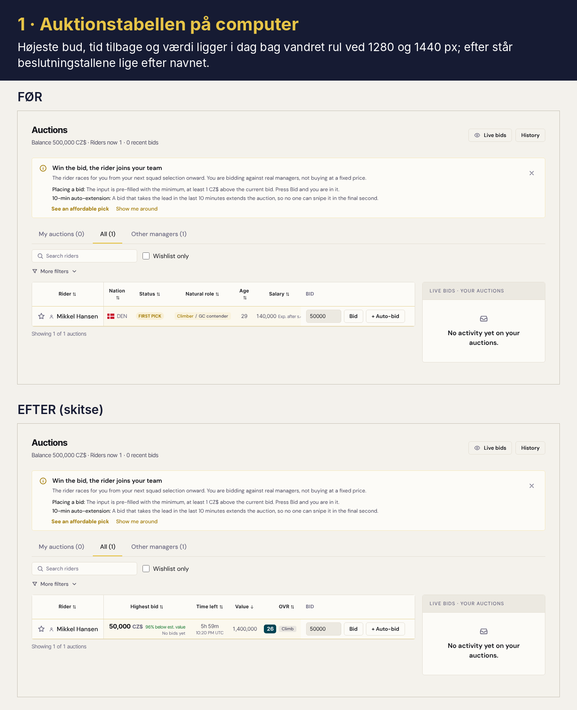
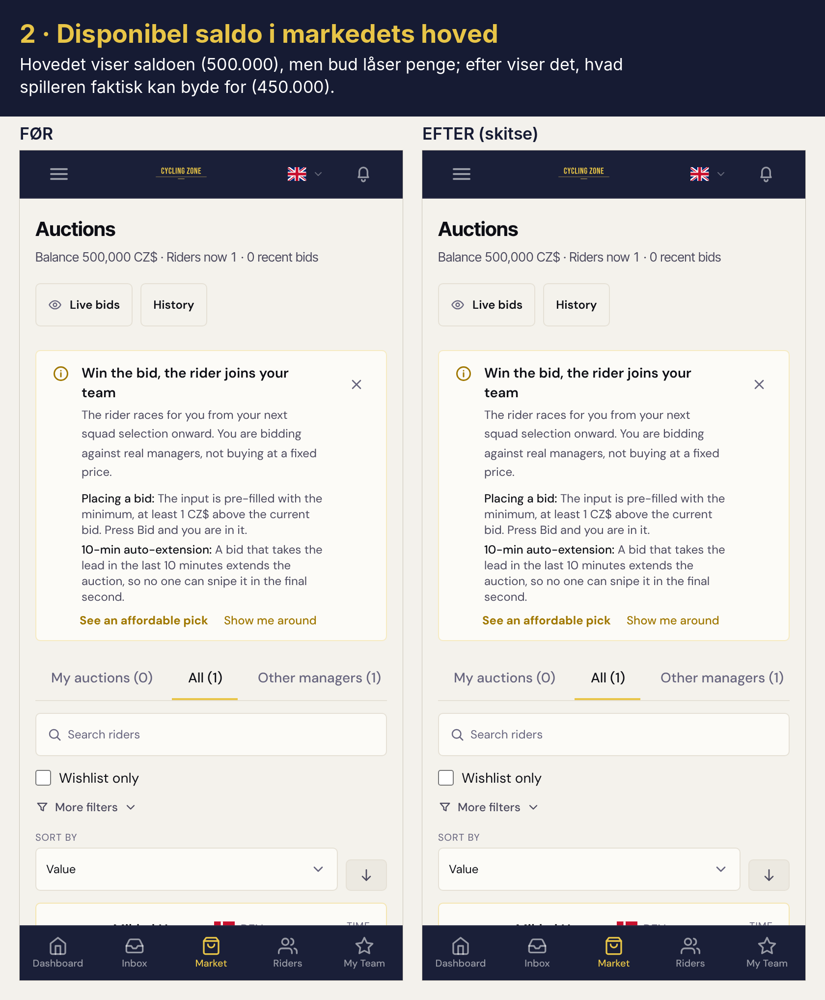
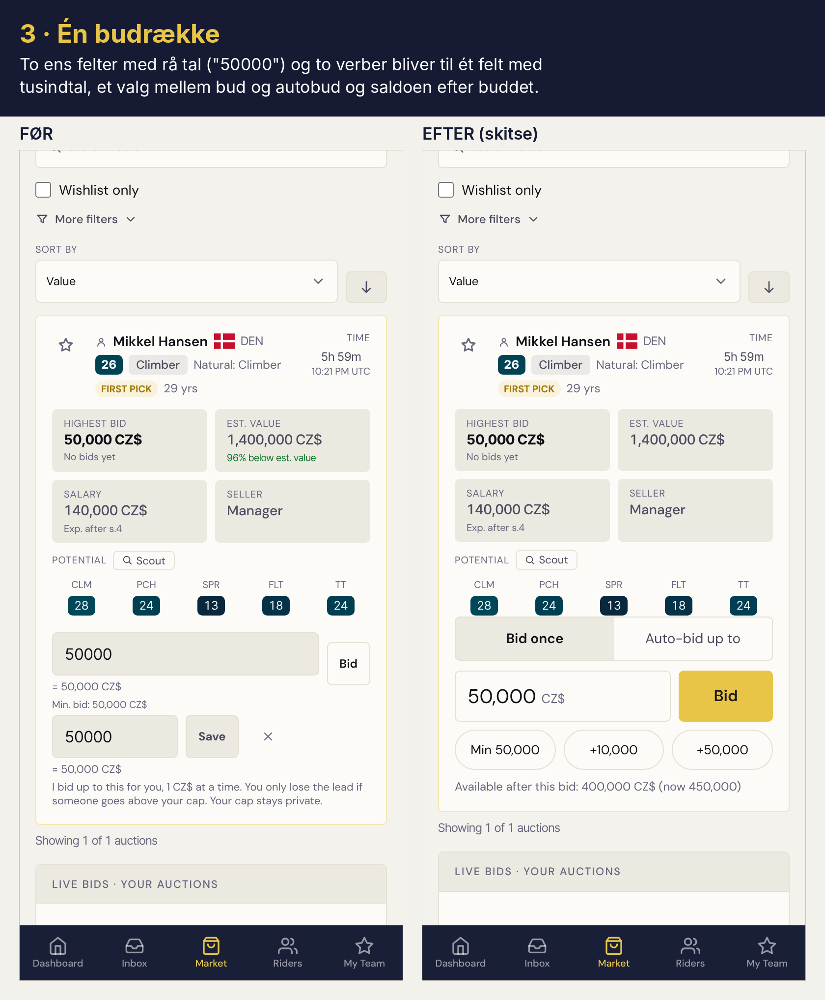
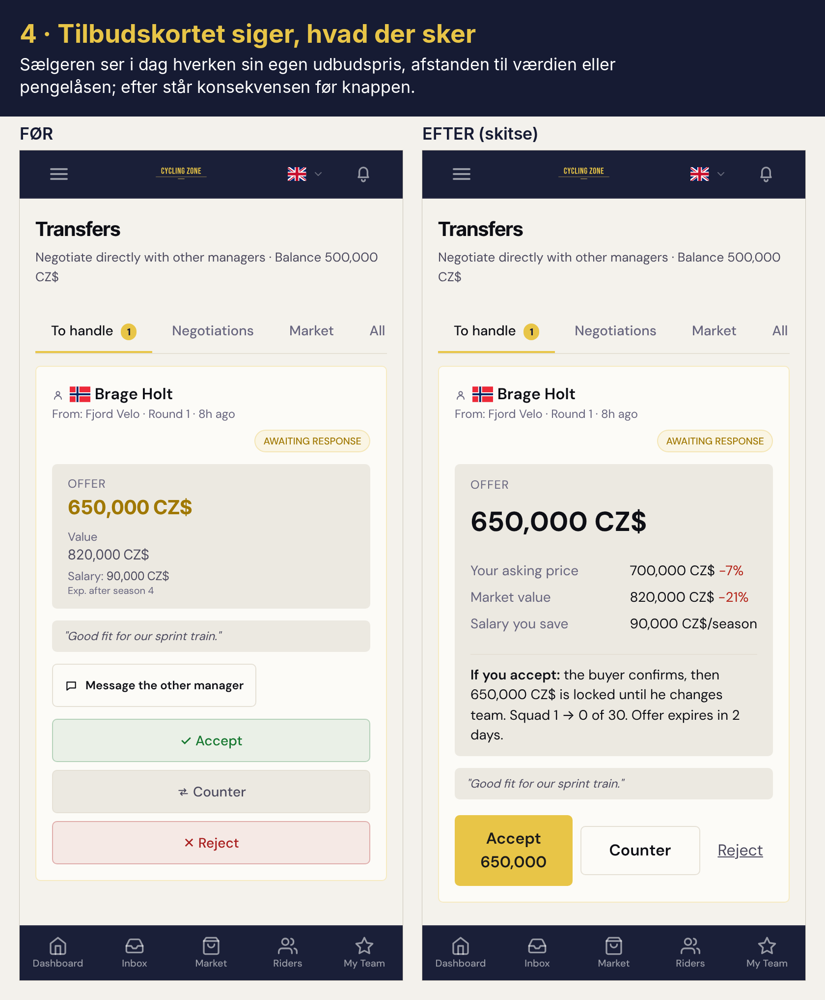
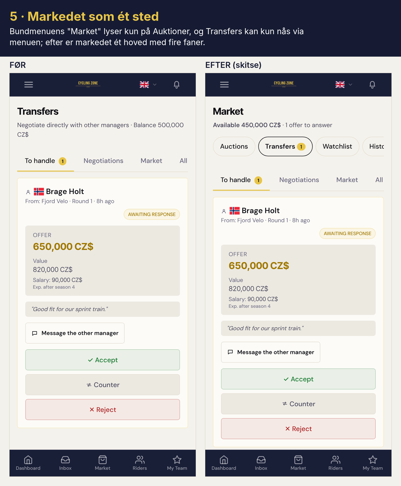

# UX-gennemgang 2/4: marked og økonomi (16/11/2026)

Refs #8073 · #6916 (Mobil 10x) · bygger videre på [`2026-11-16-mobil-top10.md`](2026-11-16-mobil-top10.md) (PR #8236) og [`2026-11-16-designsystem-taste.md`](2026-11-16-designsystem-taste.md) (PR #8235). Kun rapport, ingen produktkode.

**Spørgsmålet:** Hvor hurtigt kan en manager købe eller sælge den rette rytter, og forstår de pengene og konsekvenserne?

**Kort svar:** Køb på mobil virker, men tager for mange blikke. På computeren er det værre: auktionstabellen gemmer højeste bud, tid tilbage og værdi bag vandret rul. Salg er spredt over tre indgange med fire navne, og intet sted siger, hvad der sker med pengene, før man trykker. Økonomi-siderne forklarer meget, men i prosa over tallene i stedet for ved tallene.

## Metode

- **Sider:** Auktioner (`/auctions`, `/auctions/history`), Transfers (alle fire faner), Ønskeliste (`/watchlist`), Økonomi (`/finance`, alle faner), Sponsorer (`/sponsors`, alle faner), Bestyrelsen (`/board`, alle faner), Klub/faciliteter (`/klub`), Mit hold (Kontrakter og Transferhistorik) og rytterprofilen (egen rytter, rytter på auktion, rytter med ventende skifte).
- **Flows klikket igennem:** byd, sæt autobud, send tilbud, modtag tilbud, sæt til salg, forlæng kontrakt.
- **Kørsel:** `VITE_PREVIEW_MOCK=1` plus de falske `VITE_SUPABASE_*` fra `frontend/playwright.config.js`, cookie-samtykke `cz_consent_v1` sat. De 42 prod-kontakter, der var tændt 16/11, blev tændt i mockens spiller-svar (`/api/feature-flags`) med en lokal ændring, der ikke er committet. Alle andre stod slukket (også `race_page_v6`).
- **Data, der ikke findes i mocken:** Transfermarkedet og tilbud er tomme i preview-mocken. Til flowene blev tre opdigtede listinger og to tilbud sprøjtet ind med en fetch-krog i Playwright (fiktive navne). Ingen rigtige spillernavne.
- **Billeder:** 390 × 844 (`isMobile`, `hasTouch`, DPR 2) og 1440 × 900, lys og mørk. Fund-billeder i [`pr-screens/ux-16-11/2/fund/`](../../pr-screens/ux-16-11/2/fund/), før/efter i [`pr-screens/ux-16-11/2/foer-efter/`](../../pr-screens/ux-16-11/2/foer-efter/), målinger i `metrics.json`, scripts i `scripts/` (kør med preview-serveren på :5173).
- **Målestok:** TASTE P1-P20 og tjeklisten, PAGE_TEMPLATES (inkl. reglerne fra 12/11), Nielsens heuristikker (H1-H10), WCAG 2.2 AA, TONE_OF_VOICE.
- **Strøget efter kontrol i koden** (så de ikke bliver til falske issues):
  - Auktionens sluttid stod som "10:13 PM UTC". Det er containerens tidszone; `Countdown` bruger enhedens egen zone, så en dansk spiller ser CET.
  - "+412.000 CZ$" i mandatet med dansk tusindtalstegn i engelsk UI er mockens fixtur. `formatGoalValue` formaterer de rigtige tal korrekt (`boardroomFormat.js:109`).
  - Ingen sider i området har vandret rul på dokumentet ved 390 eller 1440.

## Allerede dækket andetsteds (gentages ikke)

| Fund | Hvor |
|---|---|
| Forklaringskortet over Auktioner (390 px før første auktion) | Mobil top 10, rettelse 3 |
| Filterlinjen på mobil (søg + to halve selects + ark, dobbelt "Sort by") | Mobil top 10, rettelse 6. Gælder også Transfers-markedet |
| 44 px-trykflader på "Scout", "Reset all" osv. | Mobil top 10, rettelse 4 |
| Rytterprofilens hero og Team-sidehovedets auktions-banner | Mobil top 10, rettelse 7 og 8 |
| Håndrullede guld-knapper i Transfers, Bestyrelsen og budpanelet | Designsystem, rettelse 2 |
| Emoji i markedets tekster ("⚡ Active auction", "✅ Listed for sale!", "✓ Accept", ⭐ i Ønskelistens tomme tilstand) | Designsystem, rettelse 6 |
| Økonomi: eget sidehoved, 768 px-bredde, første-besøgs-tip | Designsystem, rettelse 7 |
| Klub og Scouting: Bebas-sidehoved og kort-titler | Designsystem, rettelse 8 |

Fundene nedenfor er nye. Hvor de rører samme side som en af rettelserne ovenfor, bør de bygges i samme spor.

## Top 15, rangeret efter værdi for spillerne mod indsats

Indsats: **S** = én komponent eller tekst, under en dag · **M** = delt komponent eller flere sider · **L** = kræver backend eller en ejer-beslutning. Rækkefølgen vægter, hvor mange køb og salg fundet rammer, og hvor billigt det er.

| # | Fund | Sider | Princip | Indsats |
|---|---|---|---|---|
| 1 | Auktionstabellen på computer gemmer højeste bud, tid og værdi bag vandret rul | Auktioner | P1, P5, H6 | S-M |
| 2 | Markedet viser saldo, ikke det beløb spilleren kan byde for | Auktioner, Transfers, sidebar | H1, P11 | S |
| 3 | Budrækken: to ens felter med rå tal og to verber | Auktioner, rytterprofil | H5, P13, P3 | M |
| 4 | Et modtaget tilbud siger ikke, hvad et ja koster eller giver | Transfers | H1, H5, P1 | M |
| 5 | Markedet er fem menupunkter, og bundmenuen kender kun ét | Navigation | H4, H6, P20 | M |
| 6 | Salg har tre indgange og fire navne | Mit hold, rytterprofil | H4, P12 | M |
| 7 | "96 % below est. value" i grønt på en startpris | Auktioner, Transfers | P8, P11 | S |
| 8 | Egen rytters handlinger: tre guld på én skærm, salg tilbydes under aktiv auktion | Rytterprofil | P3, H5 | S |
| 9 | En handel kræver tre tryk fordelt på to managere | Transfers | H1, H8 | L (ejer) |
| 10 | Lønnen forklares på tre måder, der modsiger hinanden | Kontrakter, rytterprofil, Økonomi | H4, P11 | S |
| 11 | Penge skrives på fire måder | Økonomi, Klub, inputs | P13 | S |
| 12 | Bestyrelsen: guld-fyldte bjælker og en bonus der ligner en sidebemærkning | Bestyrelsen | P3, P8, WCAG 1.4.1 | S |
| 13 | Auktionshistorikken farver fire tal i fire farver | Auktionshistorik | P3, P8 | S |
| 14 | Kontrakt-fanens chip-række gemmer en chip bag "Full table" | Mit hold | P10, D-047 | S |
| 15 | Tomt transfermarked viser hele filterstakken over den tomme tilstand | Transfers | P1, P6 | S |

### 1. Auktionstabellen på computer gemmer beslutningstallene



- **Spilleren oplever:** Ved 1440 px ser rækken Rider, Nation, Status, Natural role, Age, Salary og et budfelt. Højeste bud, tid tilbage, værdi, OVR og potentiale ligger til højre i tabellen og kræver vandret rul. Ved 1280 px er det samme. Først ved 1920 px kommer "Time left" frem, og stadig uden OVR ([billede](../../pr-screens/ux-16-11/2/fund/auktioner-1440.png)).
- **Målt** (`scripts/m.cjs`): tabellen er 1.769 px bred i en beholder på 870 px (1440) og 710 px (1280). Budkolonnen er sticky til højre, så "Highest bid" (x 1.009) og "Time left" (x 1.207) ligger bag den.
- **Hvorfor:** P1 (det man kom for at se står over folden), P5 (hierarki: de tal man byder ud fra skal stå først), H6 (genkendelse frem for hukommelse). Det er 37 % af sessionerne, og auktioner er den største købskanal.
- **Forslag:** Kolonnerækkefølge Rider · Highest bid · Time left · Value · OVR · Age · Salary · Bid. Nation og status flytter ind i navnecellen (P12-rækkefølgen), Natural role i hover-kortet, de fem potentiale-tal bag "Fuld tabel". Skitsen er de rigtige celler flyttet i DOM'en.

### 2. Markedet viser saldo, ikke det spilleren kan byde for



- **Spilleren oplever:** Auktionernes hoved siger "Balance 500,000 CZ$", Transfers siger det samme, og sidebaren viser 500.000 i guld. Først på Økonomi står "450,000 CZ$ available · 50,000 CZ$ locked in bids".
- **Hvorfor:** H1 (systemets status) og P11: tallet er sandt, men det er det forkerte tal for en budbeslutning. En spiller, der byder for den viste saldo, rammer en fejl.
- **Forslag:** Ét ord og ét tal i markedets hoveder og i sidebaren: "Available 450,000 CZ$", med låst beløb som underlinje. Samme formatter som Økonomi bruger (`balance.lockedInBids`).

### 3. Én budrække



- **Spilleren oplever:** Budfeltet er forudfyldt "50000" uden tusindtalstegn og gentaget som "= 50,000 CZ$" under feltet. "+ Set auto-bid limit" åbner et andet felt med samme "50000", en grå "Save" og en tredje gentagelse, så der står to ens felter under hinanden med verberne "Bid" og "Save" ([billede](../../pr-screens/ux-16-11/2/fund/autobud-390.png)). Autobuddets loft er forudfyldt med minimumsbuddet, hvilket er et loft uden funktion. På auktionssiden er "Bid" en sekundær knap; på rytterprofilen er den guld.
- **Hvorfor:** H5 (fejlforebyggelse: et rå tal på syv cifre er let at taste forkert, og spillet har allerede et "Check your price"-modal som plaster), P13 (én skrivemåde for penge), P3 (sidens primære handling skal være den ene guld-knap, ens overalt).
- **Forslag:** Ét `MoneyInput` til bud, autobud, tilbud og salgspris: tusindtal mens man taster, hurtigknapper "Min · +10,000 · +50,000", og saldoen efter buddet. Bud og autobud bliver et valg over feltet ("Bid once / Auto-bid up to"), ikke to felter. Autobud starter tomt.

### 4. Et modtaget tilbud siger ikke, hvad et ja koster eller giver



- **Spilleren oplever:** Kortet viser buddet (650.000 i guld), værdien og lønnen. Det viser ikke sælgerens egen udbudspris (700.000), afstanden i procent, at `sale_escrow_enabled` låser pengene til rytteren skifter hold, hvad truppen går ned til, eller hvornår tilbuddet udløber. Accept, Counter og Reject er tre fuldbrede farvede knapper (grøn, grå, rød).
- **Hvorfor:** H1 og H5: konsekvensen står ikke før handlingen. P1: tallet sælgeren sammenligner med (egen pris) mangler. P8: grøn og rød bruges som knapfarver, ikke som status. Markedslisten viser allerede "% below est. value", så kortet er det eneste sted uden sammenligning.
- **Forslag:** Tre linjer under buddet (din pris, værdi, sparet løn) med delta, og én linje "If you accept: …" med pengelås, trup og udløb. Accept er sidens ene guld, Counter sekundær, Reject et tekstlink.

### 5. Markedet som ét sted



- **Spilleren oplever:** Sidebaren har fem markedspunkter: Riders, Auctions, Transfers, Transfer list og Watchlist. Bundmenuens "Market" går til `/auctions` og lyser kun dér (`MobileQuickNav.jsx:36`, aktiv via `pathMatches`), selvom kommentaren i koden kalder den "gateway til hele Market-sektionen". På `/transfers` lyser intet, og Transfers kan på mobil kun nås via burgermenuen. Ønskelisten hedder "Watchlist" i menuen og "Talent scout" på siden ([billede](../../pr-screens/ux-16-11/2/fund/oenskeliste-390.png)). Auktionshistorikken skifter med chips ("Active / History"), auktionssiden med knapper ("Live bids / History").
- **Hvorfor:** H4 (konsistens), H6, P20 (samme spil på alle skærme). Mest besøgte markedsside er Auktioner (2.332 visninger), Transfers har 918; forskellen kan delvist være navigationen (ingen evidens, antagelse).
- **Forslag:** Ét markedshoved med fire faner (Auctions · Transfers · Watchlist · History) og disponibel saldo; bundmenuen lyser på alle fire. Siden hedder det samme som menupunktet. "Transfer list" lægges ind under Transfers.

### 6. Salg har tre indgange og fire navne

- **Spilleren oplever:** På Mit hold hedder knappen "Sell / Auction" og åbner faner (Auction, Transfer, Release, Extend, Move). På rytterprofilen hedder det "List for sale", "Extend contract" og "Release rider" som tre løse knapper ([billede](../../pr-screens/ux-16-11/2/fund/rytterprofil-salg-390.png)). Teksterne bruger "Put up for auction", "Start auction" og "List for sale" om to forskellige mekanismer.
- **Hvorfor:** H4, H2 (spillets ord skal matche spillerens: "sælge" er ét valg med to måder), P12 (samme ting ens overalt).
- **Forslag:** Ét "Sell"-ark, samme komponent begge steder, med to valg øverst: "Fixed price (transfer list)" og "Auction", hver med én linje om forskellen og samme konsekvenslinje som i fund 4. Forlæng og frigiv bliver i "Manage"-rækken fra mobil-rapportens rettelse 7.

### 7. "96 % below est. value" i grønt på en startpris

- **Spilleren oplever:** En auktion med startpris 50.000 og værdi 1.400.000 viser "96% below est. value" i grønt ([billede](../../pr-screens/ux-16-11/2/fund/auktionskort-390.png)). Prisen ender ikke dér.
- **Hvorfor:** P8 (grøn betyder godt), P11 (et løfte, der ikke holder). Det lærer nye spillere at alle auktioner er røverkøb.
- **Forslag:** Vis kun delta, hvor prisen er endelig: transfer-listens udbudspris og tilbud. På auktioner står værdien neutralt ved siden af højeste bud.

### 8. Egen rytters handlinger: tre guld på én skærm

- **Spilleren oplever:** På egen rytter står "Extend contract" i fyldt guld, "List for sale" i guld-kant og, når salgsformen er åben, en tredje fyldt guld "List for sale". Formen kan åbnes, mens rytteren er i en aktiv auktion.
- **Hvorfor:** P3 (én guld pr. view), H5 (et salg der ikke kan gennemføres, bør ikke tilbydes).
- **Forslag:** Ingen guld i heroen; guld kun på formens indsend-knap. Under aktiv auktion er salgsknappen væk og erstattet af auktionens status. Hører sammen med fund 6.

### 9. En handel kræver tre tryk fordelt på to managere

- **Spilleren oplever:** Køber sender et bud. Sælger trykker "Accept", får "✅ Accepted · buyer must now confirm the deal", og køber skal derefter trykke "Confirm deal" (`backend/routes/api.js:9157`, status `awaiting_confirmation`). "Accept" betyder altså ikke, at handlen er sket.
- **Hvorfor:** H1 og H2 (ordet "Accept" lover mere end det gør), og målbar friktion: en ekstra runde ventetid på den anden manager, typisk timer.
- **Forslag (ejer-beslutning):** A: køberens bud er bindende, så sælgerens "Accept" lukker handlen (saldo-tjekket flytter til buddet). B: behold trinnet, men kald knappen "Accept and send for confirmation" og vis ventetiden. Anbefaling: A, fordi bekræftelsen gentager et valg køberen allerede har truffet.

### 10. Lønnen forklares på tre måder

- **Spilleren oplever:** Økonomi siger "A rider's wage is the price of what he delivers this season, not what he is worth on the market". Mit hold siger ved forlængelse "The salary is renegotiated from the rider's current value" (`team.json` `actionModal.extend.description`). Rytterprofilen siger "Follows what he's delivering this season".
- **Hvorfor:** H4, P11: holdets tekst modsiger de to andre, og spilleren kan ikke forudsige den nye løn.
- **Forslag:** Én sætning i alle tre (Økonomis), EN først. Det samme for frikøbsgebyret, der står med to forskellige formuleringer i `rider.json` og `team.json`.

### 11. Penge skrives på fire måder

- **Spilleren oplever:** "D1 1,200K · D2 900K" i Økonomis forklaring, "1,400,000 CZ$" i kortene, "13,000" og "Wages 950" uden valuta på Klub ([billede](../../pr-screens/ux-16-11/2/fund/klub-faciliteter-390.png)), og rå "50000" i alle input-felter.
- **Hvorfor:** P13: penge skrives `1,432,766 CZ$`, aldrig forkortet.
- **Forslag:** `formatCz` i locale-tekster via interpolation i stedet for hårdkodede tal, valuta på Klub, inputs fra fund 3.

### 12. Bestyrelsen: guld-fyldte bjælker og en bonus, der ligner en sidebemærkning

- **Spilleren oplever:** Tillids-bjælkerne er fyldt med guld (`rgb(232,197,71)`), "bagud" i en anden orange. I mørk tilstand er de to næsten ens: målt kontrast mellem gul og orange ca. 1,2:1, så status bæres kun af en farveforskel, man knap kan se ([billede](../../pr-screens/ux-16-11/2/fund/bestyrelse-390-moerk.png)). Bestyrelsens bonustilbud (+200.000 CZ$ for et ekstra mål) har "Accept offer" som grå knap og "Decline" som guld-link, mens "Enter annual meeting" har sidens guld. Citatet i "Last movement" har dobbelte anførselstegn (`""`).
- **Hvorfor:** P3 (aldrig guld-fyld uden for de fire steder), P8, WCAG 1.4.1 (farve alene) og 1.4.11. Bonussen er en økonomisk beslutning med konsekvens; den står svagest på siden.
- **Forslag:** Bjælker i neutral `--text-1` med statusfarve kun ved "At risk/Behind" plus tekst (findes allerede i Mandat-fanen). Bonustilbuddet får en konsekvenslinje ("Adds 1 target to your plan, judged at season end") og er sidens primære handling, når det er åbent.

### 13. Auktionshistorikken farver fire tal i fire farver

- **Spilleren oplever:** Bought i guld, Sold i blå, Spent i rød, Earned i grøn ([billede](../../pr-screens/ux-16-11/2/fund/auktionshistorik-390.png)). Et køb er ikke en fejl, men står rødt.
- **Hvorfor:** P3 (ingen guld-tal), P8 (rød kun ved fare).
- **Forslag:** Neutrale tal; fortegnet bærer retningen, som i Økonomis historik.

### 14. Kontrakt-fanens chip-række gemmer en chip

- **Spilleren oplever:** Ved 390 px står chips "Rating · Seasons · Salary · P…", og den fjerde ligger halvt bag "Full table"-knappen ([billede](../../pr-screens/ux-16-11/2/fund/kontrakter-390.png)). Gruppeoverskriften "Senior · At the limit" brydes over tre linjer ved siden af forklaringen.
- **Hvorfor:** P10/D-047 (chip-rækken skal kunne nås), P16.
- **Forslag:** "Full table" på egen linje under chip-rækken, eller chip-rækken rulbar med opak "mere"-markør (samme som mobil-rapportens rettelse 12).

### 15. Tomt transfermarked viser hele filterstakken

- **Spilleren oplever:** Med 0 listinger står søgning, tre selects, "Reset all", "More filters" og "Sort by" (ca. 550 px) over den tomme tilstand ([billede](../../pr-screens/ux-16-11/2/fund/transfers-tomt-marked-390.png)). Den tomme tilstand er god (handling + én knap).
- **Hvorfor:** P1, P6: der er intet at filtrere.
- **Forslag:** Skjul filtre ved 0 listinger uden aktive filtre.

## Hvad der virker (behold)

- Transfers' tomme tilstand og Sponsorernes "Next season" følger P6: handling + én knap ([billede](../../pr-screens/ux-16-11/2/fund/sponsor-naeste-saeson-390.png)).
- Økonomis prognose med interval ("Range: +3,090 to +87,090") er ærlig om usikkerhed (P11).
- Kontrakt-fanens bulk-forlængelse ("Tick the riders you want to extend", 1 eller 2 sæsoner) er den hurtigste salgs- og kontraktflade i området.
- Mørk tilstand har ingen egne fund ud over fund 12; guld-tal står stærkere i mørk, så P3-fundene vejer tungere dér.
- Ingen vandret rul på dokumentet ved 390 eller 1440 på nogen side i området.

## Tilgængelighed (WCAG 2.2 AA), målt

| Fund | Kriterium | Alvor | Hvor |
|---|---|---|---|
| Statusbjælker skelnes kun på farve (gul mod orange, ca. 1,2:1 i mørk) | 1.4.1, 1.4.11 | Mellem | Bestyrelsen, fund 12 |
| Budfeltet gentager værdien i en løs linje ("= 50,000 CZ$"), som skærmlæsere læser som separat tekst | 1.3.1 | Lav | Fund 3 (løses af `MoneyInput`) |
| 10 px tekst i hjælpelinjer ("Min. bid", "Exp. after") har 4,6-5,4:1 og består, men er systemets mindste trin | 1.4.3 | OK | Auktionskort |
| Trykflader under 44 px på markedssiderne | 2.5.8 (24 px) består; P16 (44 px) gør ikke | Se mobil-rapportens rettelse 4 | Alle |

Ikke testet: tastaturrækkefølge og skærmlæser. Kun computed styles og billeder.

## Anbefalet rækkefølge og kanal

1. **Fund 1, 2, 7 og 13 (S):** små, høj værdi, ingen designvalg. Ét Claude Code-spor.
2. **Fund 3 (M):** `MoneyInput` som kit-komponent; fund 11 og budpanelet på rytterprofilen bruger den bagefter. Claude Code.
3. **Fund 4 og 6 (M):** konsekvenslinjen er den samme komponent i tilbud og salg. Byg den én gang. Claude Code efter ejerens billede-go.
4. **Fund 5 (M):** markedshovedet; ejer vælger navn og faner. Claude chat (beslutning) → Claude Code.
5. **Fund 9 (L):** ejer-beslutning, derefter backend. Ejer → Codex eller Claude Code.
6. **Fund 8, 10, 12, 14, 15 (S):** oprydning i samme spor som sidens øvrige rettelser.

Hver rettelse er sit eget issue og sin egen PR med ét annoteret før/efter-billede (NOW-reglen). Ingen af dem er bygget her.

## Genskab

```bash
cd frontend && VITE_PREVIEW_MOCK=1 VITE_SUPABASE_URL=https://cycling-zone-e2e.supabase.co VITE_SUPABASE_ANON_KEY=e2e-anon-key npx vite --port 5173
```

Scripts i `pr-screens/ux-16-11/2/scripts/`: `shoot.cjs` (grundbilleder og metrics), `flow.cjs` (klik-flows med indsprøjtede tilbud), `m.cjs` (auktionstabellens bredder), `sketch.cjs` + `compose.py` (før/efter). Prod-kontakterne kræver den lokale ændring af `playerFlags()` i `frontend/src/preview/betaAccessMock.js`, som ikke er committet; scripts skriver til `/tmp/claude-0/aud`, ret stierne efter behov.
