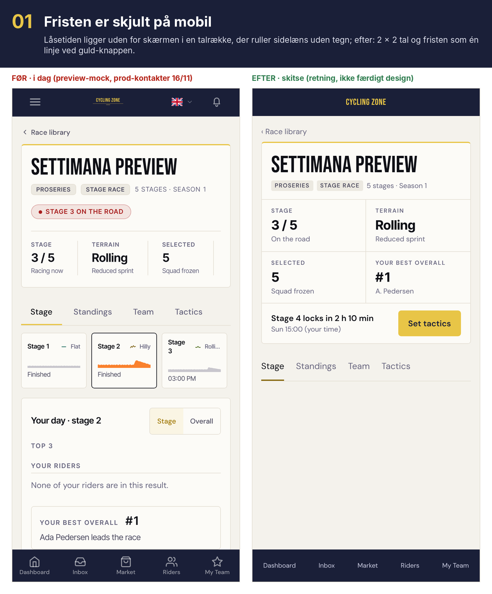
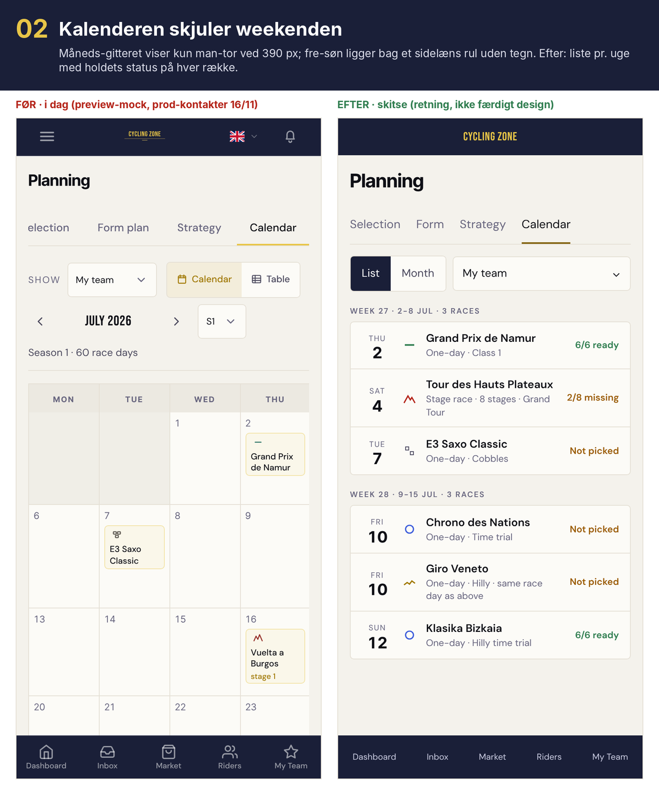
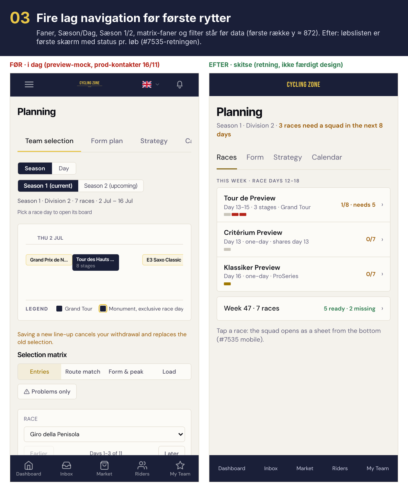
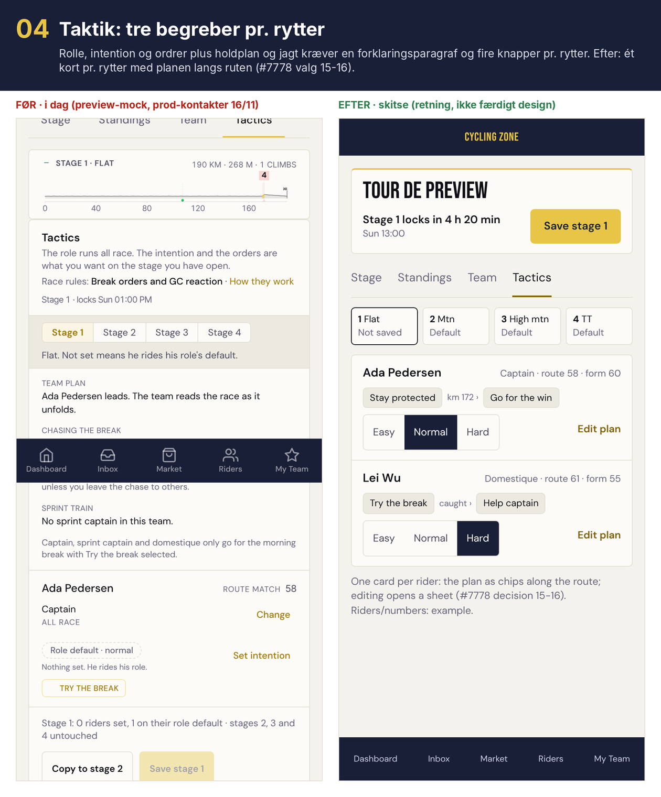
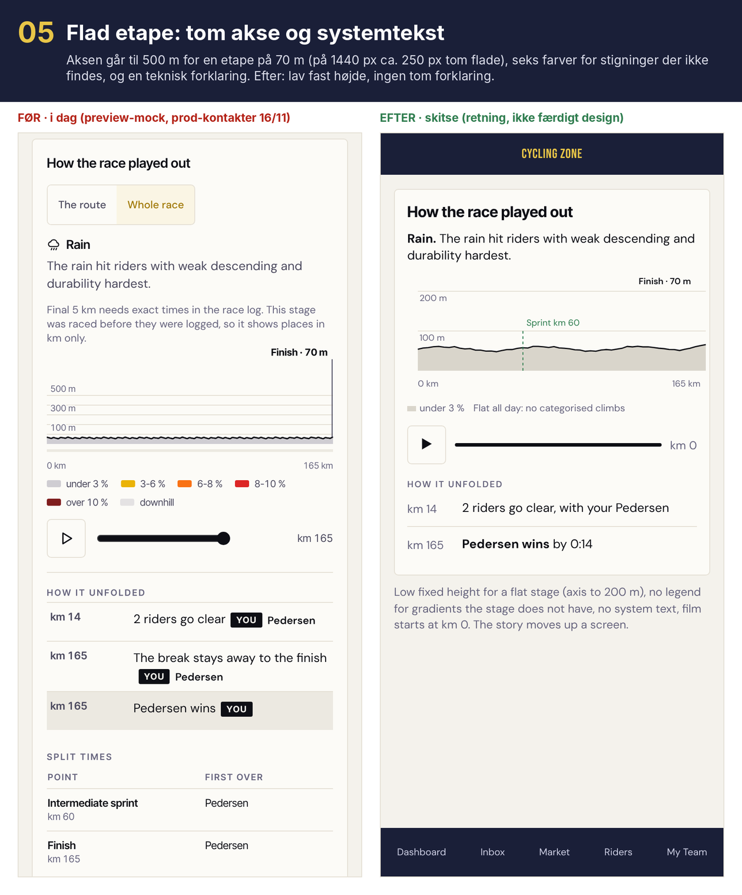

# UX-gennemgang 3/4: løb (16/11/2026)

Område 3 af 4: kalender, sæsonmatrix, planlægning og holdudtagelse, taktik, løbssiden, resultater, ranglister og trøjer samt løbsfilm. Fra "hvilke løb skal jeg køre" til "hvad skete der og hvorfor". Kun rapport, ingen produktkode.

Bygger videre på [mobil-top 10 (PR #8236)](2026-11-16-mobil-top10.md) og designsystem-gennemgangen i PR #8235 (TASTE F1-F8, P20). Fund, der allerede står der, gentages ikke: rytterpuljen nederst på Planlægning, de små tekst-knapper (P16-gulvet), den gentagne "Route match"-forklaring, de klippede faner og navnecellen. De nævnes kun, hvor løbsområdet har en ny vinkel.

## Metode

- **Kørsel:** `npm run dev:preview` med `VITE_PREVIEW_MOCK=1`, de falske `VITE_SUPABASE_*` fra `frontend/playwright.config.js` og **`VITE_API_URL=http://localhost:5173`**. Uden `VITE_API_URL` viser kalenderen "No active season" (`CalendarPage.jsx` stopper ved `if (!API)`). Det er en fejl i opsætningen, ikke i spillet, men de andre tre sessioner bør bruge samme variabel. Cookie-samtykke `cz_consent_v1` er sat.
- **Kontakter som prod 16/11:** `shoot.cjs` pakker mockens `fetch` ind, så `GET /api/feature-flags` svarer med de 41 tændte kontakter fra opgaven og alle andre slukket, herunder `race_page_v6` og `planning_workbench`. Man kan ikke overskrive `window.fetch` direkte, for mocken gemmer den som sin "rigtige" fetch. Det giver en løkke, og så indlæses oversættelserne aldrig (rå nøgler som `SCOPE.LABEL`). Scriptet undgår det.
- **Billeder:** Playwright Chromium. 21 skærme × 390 × 844 (`isMobile`, DPR 2) og 1440 × 900, i lys og mørk tilstand. Ved 390 i lys tilstand er hele siden også taget. Alle ligger i [`pr-screens/ux-16-11/3/raw/`](../../pr-screens/ux-16-11/3/raw/) med navnet `<nr>-<side>-<bredde>-<tema>.png`. Målingerne (dokumenthøjde, trykflader under 44 px, sidelæns rul, første datarække, ord på siden) står i `raw/metrics.json`.
- **Kontrast** er målt på de beregnede farver i browseren (WCAG 2.1-formlen).
- **Skills:** design-critique (rammen: første indtryk, brugbarhed, hierarki, konsistens, tilgængelighed), accessibility-review (WCAG 2.1 AA), modern-web-guidance (`scrollability-affordance-hints`, `tabs`). `frontend-design` findes ikke i denne session og er ikke brugt.
- **Grænser:**
  - Mock-data er ikke prod. Datoer og tilstande modsiger hinanden flere steder: kalenderen viser juli og matrixen august, og "Tour de Preview" står både som "Starting now" og "Squad frozen". De fund, der kan skyldes mocken, er markeret **(verificér i prod)**.
  - Trafik pr. løbsside er ukendt. Path cleaning slår `/races/:id` sammen pr. id; det mest viste enkelte løb har 315 visninger på 30 dage (#8235). `/planning` har 2.714 og `/standings` 1.381 (#8236). Rangeringen bygger derfor på alvor og på, hvor mange skærme fundet rammer. Ingen evidens for løbssidens samlede trafik; antagelse: den ligger over `/planning`.
  - Skitserne er bygget som selvstændig HTML med appens tokens og fonte i [`pr-screens/ux-16-11/3/sketches/`](../../pr-screens/ux-16-11/3/sketches/). Der er ikke tilføjet noget i `frontend/`. Tal og status i skitserne er eksempler (P17).

## Top 15, rangeret

Rangeringen vægter, hvor alvorligt problemet er for spilleren, hvor mange løbsskærme det rammer, og om det rammer mobilen (63 % af sessionerne). Hvert fund har: **Oplever** (hvad spilleren ser), **Hvorfor** (princip eller målt friktion), **Forslag** og **v6/Workbench** (om det nye allerede løser det).

### 1. Låsefristen er skjult på mobil



- **Oplever:** På løbssiden ved 390 px viser hovedet Stage, Terrain og Selected. Det fjerde tal, "Stage 3 locks 03:00 PM", ligger ved x = 369 px i en talrække, der ruller sidelæns uden tegn på mere indhold (målt i DOM; `overflow-x-auto`). Spilleren ser aldrig fristen. På et afsluttet etapeløb ses kun "SE…" af det fjerde tal ([12-loeb-slut-etape-390-light.png](../../pr-screens/ux-16-11/3/raw/12-loeb-slut-etape-390-light.png)).
- **Hvorfor:** Fristen er sidens vigtigste tal før start. Det bryder ejerbeslutning 12/11 nr. 3 ("frist og guld-knap i hovedets handlingsrække") og Nielsen 1 (systemets status skal være synlig). Skjult indhold uden tegn er netop det, `scrollability-affordance-hints` advarer imod.
- **Forslag:** Ved 640 px og derunder står tallene i et 2 × 2-gitter, som aldrig ruller. Fristen er én linje i hovedets handlingsrække med relativ tid ("Stage 4 locks in 2 h 10 min", "Sun 15:00") ved siden af sidens ene guld-knap. Skygger og fades er ikke løsningen, for TASTE forbyder gradienter, og talrækken bør ikke rulle i det hele taget.
- **v6:** Delvist. Beslutning 20 lægger fristen og guld-knappen i talrækken, men v6 er slukket. Rettelsen er lille og kan tages i den nuværende hero nu. Se spørgsmål 4.

### 2. Frister og tilstande modsiger hinanden (verificér i prod)

- **Oplever:** Samme etape har to låsetider. Hovedet siger "Stage 1 locks 03:00 PM · Starting now", og taktik-kortet under det siger "Stage 1 · locks Sun 01:00 PM" ([08-loeb-kommende-taktik-1440-light.png](../../pr-screens/ux-16-11/3/raw/08-loeb-kommende-taktik-1440-light.png)). Forsiden beder om at "Pick your race squad … Set your line-up" til Tour de Preview, mens løbssiden siger "Squad frozen" og "Stage 1 on the road" ([21-dashboard-390-light-full.png](../../pr-screens/ux-16-11/3/raw/21-dashboard-390-light-full.png)). "Locks … Starting now" om en etape, der allerede er i gang, giver heller ikke mening.
- **Hvorfor:** Nielsen 4 (konsistens) og tillid. En manager, der ser to frister, tror på ingen af dem. Mocken kan forklare forskellige *datoer*, men to formateringer af samme frist på samme side tyder på to kilder (12-timers "03:00 PM" mod "Sun 01:00 PM").
- **Forslag:** Én funktion leverer låsetiden til hoved, taktik, forside og indbakke, og den skrives på én måde: relativt plus dag og 24-timers tid i spillerens zone. Kør først en kontrol i prod: står fristen ens i hovedet og på taktik-fanen for et kommende løb?
- **v6:** Kun hvis v6 læser fristen ét sted. Det bør være et krav i #7778.

### 3. Kalenderen skjuler weekenden på mobil



- **Oplever:** Måneds-gitteret har 7 kolonner, men ved 390 px ses kun man-tor. Fre-søn ligger bag et sidelæns rul uden tegn. I juli i mocken er 3 af 7 løb på en fredag eller lørdag og ses ikke ([01-kalender-390-light-full.png](../../pr-screens/ux-16-11/3/raw/01-kalender-390-light-full.png)). Hvert løb har samme guld-chip, og intet viser, om holdet er udtaget.
- **Hvorfor:** P10/D-047 (ingen skjult vandret rul på mobil; tidsakse-undtagelsen 12/11 gælder tabeller med én kolonne pr. dag, men så skal hver dag kunne ses). Kalenderen svarer heller ikke på spillerens spørgsmål: "hvilke løb mangler jeg at udtage til?".
- **Forslag:** Ved 640 px og derunder åbner kalenderen som liste pr. uge (dag, terræn-ikon, navn, klasse, "6/6 ready" eller "2/8 missing"). Måned er et valg ved siden af. Status-ordet skal bruge samme ord og farver som planlægningen (P8).
- **Workbench:** Ja. #7535 gør løbslisten til første skærm på mobil og holder måneds-gitteret som en separat visning. Indtil Workbench tændes, er en liste som standard på mobil en lille rettelse.

### 4. Fire lag navigation før første rytter på Planlægning



- **Oplever:** Sæson-visningen har faner (Selection/Form/Strategy/Calendar), Season/Day, Season 1/Season 2, en tidslinje, en advarsel, matrix-faner (Entries/Route match/Form & peak/Load), "Problems only" og en løbs-select. Første rytter står ved y ≈ 872, under folden ([03-saesonmatrix-390-light-full.png](../../pr-screens/ux-16-11/3/raw/03-saesonmatrix-390-light-full.png)). Dag-visningen har faner, Season/Day, tre scope-piller og en dagsstrimmel uden datoer, før første løb ([02-udtagelse-dag-390-light-full.png](../../pr-screens/ux-16-11/3/raw/02-udtagelse-dag-390-light-full.png)).
- **Hvorfor:** P1 (data over folden) og tjekliste-spørgsmål 3 (sidehoved + faner + højst 2 kort før 1000 px). Mørkt udfyldte Season- og "Season 1 (current)"-knapper ligner to primære knapper.
- **Forslag:** Først nu: Season/Day bliver en fane, Season 1/2 en select i hovedet, og advarslen "Saving a new line-up cancels your withdrawal" vises kun, når et løb er trukket. På sigt: løbslisten med status pr. løb som første skærm, så holdet åbnes i et ark.
- **Workbench:** Ja, det er kernen i #7535 (én side i stedet for fire faner; løbsliste først på mobil; holdet i et bundark). Det samme bundark er rettelse 5 i #8236.

### 5. Taktik: tre begreber pr. rytter



- **Oplever:** Taktik-fanen forklarer sig selv med "The role runs all race. The intention and the orders are what you want on the stage you have open." og "Race rules: Break orders and GC reaction · How they work". Hver rytter har rolle (Captain, All race, Change), intention (Role default · normal, Set intention) og ordre (Try the break). Hertil kommer holdplan, "Chasing the break" og sprinttog. Ved 390 er det fire knapper pr. rytter, altså 32 med 8 ryttere ([08-loeb-kommende-taktik-390-light-full.png](../../pr-screens/ux-16-11/3/raw/08-loeb-kommende-taktik-390-light-full.png)). Etapen vælges to steder på siden (etapestriben og Stage 1-4-knapperne).
- **Hvorfor:** Nielsen 6 (genkendelse frem for hukommelse) og 8 (minimalt design). Når en model kræver en forklaringsparagraf øverst, er modellen for tung til fladen (P9: forklaring hører til i Hjælp).
- **Forslag:** Ét kort pr. rytter med planen som chips langs ruten (fx "Stay protected → km 172 → Go for the win") og én Easy/Normal/Hard-indstilling. Al redigering sker i ét ark. "Intention" og "ordre" bliver til trin i planen, ikke to ekstra begreber. Én etapevælger: etapestriben.
- **v6:** Ja for udseendet (#7778 valg 15 og 16: kort pr. rytter, chips langs ruten, ark nederst, forud definerede indstillinger som i v5). Antallet af begreber er ikke afgjort. Se spørgsmål 2.

### 6. Guld-tekst i lys tilstand klarer ikke AA

- **Oplever:** Alle guld-links i løbsområdet ("Team strategy", "Race day 13", "Full result", "See breakdown", "Why?", "How they work") er `--accent-t` = `rgb(160 120 0)` i 12 px.
- **Hvorfor:** Målt kontrast er **3,62:1** mod siden (`#f4f2ec`), **3,34:1** mod rækkernes tone (`#ece9e1`, "Why?" på løbssiden) og 3,91:1 mod kort. WCAG 1.4.3 kræver 4,5:1 for tekst under 18,66 px fed. `--text-3` blev rettet af samme grund i #6681, men `--accent-t` blev ikke. I mørk tilstand er guld-teksten fin (13-14:1).
- **Forslag:** `--accent-t` i lys tilstand sættes til `#806000` (5,22:1 / 4,82:1 / 5,65:1 mod de tre baggrunde). Det er én token-linje i `index.css` og rammer hele spillet. Se spørgsmål 3.
- **v6:** Nej, det er et token.

### 7. Systemtekst og rå nøgler foran spilleren

- **Oplever:**
  - Ranglisten over ryttere viser kolonne-chips med råt navn: "TOTAL_WINS" og "PRIZE_EAR…" ([17-rangliste-ryttere-390-light.png](../../pr-screens/ux-16-11/3/raw/17-rangliste-ryttere-390-light.png)).
  - Resultater skriver "0 results imported" på afsluttede løb ([14-resultater-390-light-full.png](../../pr-screens/ux-16-11/3/raw/14-resultater-390-light-full.png)).
  - Filmen skriver "Final 5 km needs exact times in the race log. This stage was raced before they were logged, so it shows places in km only." og "Every time, gap and sentence here comes from this stage's race log.".
  - Ruten skriver "Kilometre-by-kilometre gradients come with the real stage profile." og "Drawn from the climbs and the total climbing. Gradients between the climbs are approximate.".
- **Hvorfor:** TONE_OF_VOICE (spillets stemme, ikke systemets) og Nielsen 2 (tal brugerens sprog). "Imported" og "race log" er admin-ord.
- **Forslag:** Kolonne-chips bruger samme oversættelse som kolonneoverskrifterne. "0 results imported" fjernes, for resultatet står over den. Forklaringer om datakilder flyttes til Hjælp eller væk: "Gap times for the final 5 km start from season 2" er nok, hvis det overhovedet skal stå.
- **v6:** Delvist (#7861 samler filmen til én afspiller med ét referat). Chips og resultatlisten er uden for v6.

### 8. Ruteprofilen spilder plads på flade etaper



- **Oplever:** Y-aksen går til 500 m, også når etapen topper ved 70-90 m. Ved 1440 er profilen ca. 400 px høj, og etapen er en streg i bunden ([13-loeb-slut-endags-1440-light-full.png](../../pr-screens/ux-16-11/3/raw/13-loeb-slut-endags-1440-light-full.png), [06-loeb-kommende-1440-light.png](../../pr-screens/ux-16-11/3/raw/06-loeb-kommende-1440-light.png)). Forklaringen viser seks stigningsfarver for en etape uden stigninger. Filmens skyder starter ved km 165, altså slutningen.
- **Hvorfor:** P1 (data over folden: referatet og "How it unfolded" skubbes en skærm ned) og P19 (én profil, rigtig højde). Tom akse giver ingen information.
- **Forslag:** Fast højde (ejerbeslutning 3 i #7778) med en akse, der følger etapen: et loft på mindst 200 m og ellers den højeste top + 10 %. Forklaringen viser kun farver, der findes på etapen. Filmen starter ved km 0.
- **v6:** Delvist. Beslutning 3 giver fast højde, men skalaen på flade etaper står ingen steder.

### 9. "Your day" har tomme overskrifter og modsiger sig selv (verificér i prod)

- **Oplever:** Live-etapen viser "TOP 3" uden rækker, "None of your riders are in this result." og lige under "Your best overall #1 · Ada Pedersen leads the race" ([09-loeb-live-etape-390-light-full.png](../../pr-screens/ux-16-11/3/raw/09-loeb-live-etape-390-light-full.png)). Det afsluttede endagsløb siger "Ada Pedersen won … Your rider Ada Pedersen won the stage." (to gange "won" og "stage" om et endagsløb). Referatet nævner "Pedersen" fire gange på tre sætninger.
- **Hvorfor:** Tjekliste-spørgsmål 7-8 (tomme tilstande) og Nielsen 8. "Hvad skete der og hvorfor" er netop det, området skal svare på, og her gør teksten det svært.
- **Forslag:** En overskrift uden rækker skjules. Sætningen skrives ud fra spillerens synsvinkel: "Your Ada Pedersen won by 0:14." Endagsløb siger "race", ikke "stage". Referatet bruger stedord og varierer navnet. Mocken mangler måske etaperesultater, så kontrollér live-etapen i prod.
- **v6:** Delvist. Beslutning 11 flytter "plan mod det der skete" til Taktik, og #7861 samler referatet. Teksterne skal stadig skrives om.

### 10. Resultater: "Completed" indeholder et live løb, og detaljepanelet er tomt

- **Oplever:** Listen "Completed" viser "Settimana Preview · LIVE". Under den står et stiplet panel "Select a race to see details", ved 390 omkring y ≈ 1.900 nederst på siden ([14-resultater-390-light-full.png](../../pr-screens/ux-16-11/3/raw/14-resultater-390-light-full.png)). Samme løb kan åbnes tre steder på siden: kortet øverst, "Full result" og listen. "More in Results" gentager menuen. Holdnavne står med versaler øverst og i almindelig skrift længere nede, og eget hold har intet "YOU"-mærke, som løbssiden ellers har.
- **Hvorfor:** Nielsen 4 og P13 (én skrivemåde). Master-detail fungerer ikke på mobil, hvor detaljen står under listen.
- **Forslag:** Listen hedder "This season" og sorteres live → kørt. Et tryk åbner løbssiden direkte, og det tomme panel fjernes. Eget hold får samme "YOU"-mærke som løbssiden. "More in Results" fjernes, for menuen dækker det.
- **v6:** Nej.

### 11. Formplan: to bannere før rytterne, og vigtig tekst klippes

- **Oplever:** "Season 2 is open for planning" og "The assistant drafted 1 peak for 1 rider" står før rytterne. Første rytter står ved y ≈ 835. Siden har 829 ord ved 390 og er 2.386 px lang. Rytternes topform-select klipper teksten: "20 Apr · Coastal Sprint · fit 72 · locks i" ([04-formplan-390-light-full.png](../../pr-screens/ux-16-11/3/raw/04-formplan-390-light-full.png)). "fit" bruges uden forklaring.
- **Hvorfor:** Forbuddet mod bannere øverst (#8070) og P1. Den klippede select skjuler netop låsedatoen.
- **Forslag:** Sæson 2 bliver valget S1/S2 i hovedet, som allerede står der. Assistentens forslag bliver én linje med "Review 1 peak" i hovedets handlingsrække. Selecten viser løb og dato, og "fit 72 · locks 12 Jun" står som en linje under. Konsekvens-teksten ("+20 form, then −14 for 7 days") er god og bør blive.
- **Workbench:** Delvist. #7535 gør Peak form til en tabel med løb og dato i hver sin kolonne.

### 12. Stillingen på løbssiden bruger halv bredde og har sin egen etapevælger

- **Oplever:** Ved 1440 står "Overall (GC)" i et kort på ca. 575 px, og resten af bredden er tom. Fanen har sin egen etapevælger (miniprofiler med "1", "2"), mens Stage-fanen har kort med navn, terræn og tid ([10-loeb-live-stilling-1440-dark.png](../../pr-screens/ux-16-11/3/raw/10-loeb-live-stilling-1440-dark.png)). Et forklaringskort "Standings after stage 2 · The race is still in progress …" står før tabellen. Kolonnen hedder "PRIZE POINTS", men værdien er "20 pt". Egen række har en venstre-bjælke.
- **Hvorfor:** Ejerbeslutning 12/11 nr. 1 (detaljeside med tabeller bruger op til 1600 px), P2 (én etapestribe) og TASTE's liste over automatiske fund (venstre-accent-bjælker).
- **Forslag:** Tabellen fylder bredden. Der er én etapestribe for hele siden. Forklaringskortet bliver en linje i tabellens fod. Egen række markeres med "YOU" og en tone, ikke en bjælke.
- **v6:** Ja (beslutning 21: etapestriben over fanerne for hele siden; beslutning 3: bred side).

### 13. Sæsonmatrixen: bogstaver uden forklaring, afkortede kolonner og en usynlig farve i mørk tilstand

- **Oplever:** Cellerne viser "D", "C" og "F" uden forklaring. Ved 1440 er kolonneoverskrifterne afkortet ("28…", "Tour of South Austra…", "I 0/6"), selvom ca. 180 px af kortet står tomt ([03-saesonmatrix-1440-light.png](../../pr-screens/ux-16-11/3/raw/03-saesonmatrix-1440-light.png)). I mørk tilstand har Grand Tour-farven i forklaringen og på løbs-chippen **1,09:1** mod kortet ([03-saesonmatrix-390-dark.png](../../pr-screens/ux-16-11/3/raw/03-saesonmatrix-390-dark.png)). Ved 390 har siden 41 trykflader under 44 px.
- **Hvorfor:** Nielsen 6, WCAG 1.4.11 (ikke-tekst-kontrast 3:1) og P16.
- **Forslag:** Forklaringen viser rollerne ("C Captain · D Domestique · F Free role"). Matrixen bruger hele bredden og viser fulde navne i et tooltip (P18). Grand Tour får en token med mindst 3:1 mod kortet i mørk tilstand, fx en kant i `--border-strong`.
- **Workbench:** Delvist (Tactics-visningen har rytter × etape med fulde rolle-navne i cellerne).

### 14. Race Centre er en blindgyde

- **Oplever:** "No races for your team today. Your next race day is on the calendar. Check the planning hub to line up your squad." Der er ingen knap, intet næste løb og ingen nedtælling ([19-race-centre-390-light.png](../../pr-screens/ux-16-11/3/raw/19-race-centre-390-light.png)). Appen advarer selv i konsollen: "EmptyState kraever en `action`-prop". I mocken er et af holdets løb samtidig "on the road" **(verificér i prod)**.
- **Hvorfor:** PAGE_TEMPLATES' tomme tilstand (ikon + titel + én sætning + én knap) og Nielsen 3 (en udgang).
- **Forslag:** Den tomme tilstand viser næste løb ("Next: Tour de Preview · Sat 4 Jul · 2/8 picked") og én knap, "Go to planning". Er et løb i gang, står det her.
- **v6:** Nej.

### 15. Guld bruges som fyld og på tal

- **Oplever:** Point og præmier i guld ("20 pt", "1,840", "6,120 pt"), en guld-tonet formel-boks på "Points & prizes", guld-fyldte piller ("MY RACES", "OVERALL", "Grand Tour") og samme guld-chip på alle løb i kalenderen ([16-resultater-point-390-light-full.png](../../pr-screens/ux-16-11/3/raw/16-resultater-point-390-light-full.png), [10-loeb-live-stilling-390-light.png](../../pr-screens/ux-16-11/3/raw/10-loeb-live-stilling-390-light.png)).
- **Hvorfor:** TASTE (ejer 2/9, fork 3): guld må stå fire steder, "aldrig guld-tal, aldrig guld-tint på egen række". Når alt er guld, peger intet.
- **Forslag:** Tal i `--text-1` med tabular figures. Aktive piller og segmenter følger fanernes regel (mørk kant eller guld-tekst, aldrig fyld). Kalender-chips bliver neutrale med status-ord.
- **v6:** Delvist (beslutning 22: den valgte etape markeres aldrig med guld). Resten af området er uændret.

## Andre fund (ikke i top 15)

| Fund | Hvor | Princip |
|---|---|---|
| "STAGE 1 ON THE ROAD" som rød pille. Ejeren har kaldt den "AI slop" (#7778 beslutning 22) | Løbssiden, alle løb | P8 (rød = fejl) |
| Endagsløb viser "STAGE WINS 1 · St 1" og både "FINISHED"-pille og "Status Completed"; "SEASON 1" står to gange | Løbssiden, endagsløb | Nielsen 8, P13 |
| "Kilometre-by-kilometre gradients…": en udviklerbesked i "The climbs" | Løbssiden | TONE |
| Strategy-fanen er 896 px bred, og de andre faner i samme hub er 1168 px | Planlægning, 1440 | Ét breddesystem (12/11 nr. 2) |
| "Next move: Squad selection missing" og "Pick your race squad" står lige efter hinanden med samme besked | Forsiden | Nielsen 8 |
| Tidsformat "03:00 PM" med foranstillet nul i 12-timers format | Løbssiden | TONE (tider) |
| Tomme felter skrives som lange sætninger ("No winner recorded", "Route not recorded") over tre linjer i smalle kolonner | Resultater › Race history | P10, brug "—" |
| Løbsnavnet mangler i Race history-rækken (kun "ONE-DAY RACE") **(verificér i prod)** | Resultater › Race history | Nielsen 1 |
| Ikoner ved rytternavnet (trøje, stjerne, diamant) har ingen tekst på mobil, hvor man ikke kan holde musen over | Ranglister | P18, WCAG 1.1.1 |
| Op/ned-pilene i "Captains by terrain" og "A-chain" er ca. 16 px | Strategy | P16 |

## Hvad virker

- **Konsekvenser står ved valget.** Formplanen siger "+20 form · Then −14 form for 7 days after · The dip covers Midsummer Criterium, 3 days later". Den slags "hvorfor" bør resten af området også have.
- **"Why?"-knappen** (`rider_why_button`) ved egne ryttere på resultatet svarer direkte på "hvorfor".
- **"How it unfolded"** med km, hændelse og "YOU"-mærke er spillets bedste fortælling. Den skal bare højere op (fund 8).
- **Mørk tilstand holder hierarkiet** på løbssiden og planlægningen. Undtagelsen er Grand Tour-farven (fund 13).
- **Ingen sidelæns rul på dokumentet** på nogen af de 21 skærme ved 390. Problemet er de indre rulle-bokse (fund 1 og 3).

## Hvad v6 og den nye planlægningsside allerede løser

| Fund | Løbsside v6 (#7778, #7861, #7862) | Planning Workbench (#7535) |
|---|---|---|
| 1 Frist skjult | Delvist: frist i talrækken (beslutning 20). Mobil-gitteret skal med i specen | – |
| 2 Modstridende frister | Kun hvis fristen læses ét sted (tilføj som krav) | Samme krav |
| 3 Kalender på mobil | – | Ja: løbsliste først |
| 4 Navigationslag | – | Ja: én side, ark på mobil |
| 5 Taktik | Ja for layout (valg 15-16); antallet af begreber er åbent | Ja: samme plan begge steder |
| 7 Systemtekst | Delvist: én afspiller og ét referat (#7861) | – |
| 8 Profilens akse | Delvist: fast højde, men skalaen mangler | Samme profil-komponent |
| 9 "Your day" | Delvist (beslutning 11) | – |
| 12 Stilling og etapevælger | Ja (beslutning 3 og 21) | – |
| 13 Matrix | – | Delvist: rolle-navne i Tactics-cellerne |
| 15 Guld | Delvist (beslutning 22) | Ja: "one gold primary" i specen |
| 6, 10, 11, 14 | Nej | 11 delvist |

Beslutning 23 i #7778 ("løbssiden skal ikke være ringere end den nuværende side på noget punkt, før den tændes for beta") gør fund 1, 2, 8 og 9 til tjekpunkter for v6-betaen.

## Anbefalet rækkefølge

1. **Små rettelser på det, der kører i dag, uafhængigt af v6** (Claude Code-bølge, ét spor pr. punkt): fund 1 (2 × 2-gitter og fristlinje), 6 (én token), 7 (chips, "imported" og datakilde-teksterne) og 14 (tom tilstand med knap).
2. **Kontrol i prod først** (Claude Code eller ejeren, 10 minutter): fund 2 og 9. Står fristen ens i hovedet og på taktik-fanen? Er "TOP 3" tom på en kørt etape?
3. **Ind i v6-specen** (#7778): mobil-gitteret til talrækken, én kilde til fristen, profilens skala på flade etaper og ingen tomme overskrifter i "Your day".
4. **Workbench** (#7535) løser 3, 4 og det meste af 11 og 13. Indtil den tændes, kan kalenderen åbne som liste på mobil (fund 3), som en lille rettelse.
5. **Taktik-begreberne** (fund 5) afventer ejerens svar på spørgsmål 2.

## Genskab

```bash
VITE_API_URL=http://localhost:5173 VITE_SUPABASE_URL=https://cycling-zone-e2e.supabase.co VITE_SUPABASE_ANON_KEY=e2e-anon-key npm run dev:preview --prefix frontend -- --port 5173
```

```bash
node pr-screens/ux-16-11/3/shoot.cjs pr-screens/ux-16-11/3/raw
```

```bash
node pr-screens/ux-16-11/3/sketches/render.cjs && python3 pr-screens/ux-16-11/3/sketches/compose.py
```
