# UX-gennemgang 4/4: hold og udvikling (16/11/2026)

Refs #8073 · bygger på [mobil-top10 (PR #8236)](2026-11-16-mobil-top10.md) og [designsystemet mod TASTE (PR #8235)](2026-11-16-designsystem-taste.md). Kun rapport, ingen produktkode.

**Område:** Mit hold, U23- og juniortrup, ungdomsløb, rytterprofil (Overblik, Træning, Udvikling, Scouting), træning (Today, Program, Development, Report, Træn nu, kvittering), akademi og Graduation Day, scouting, indbakke, forum, Hjælp, patch notes, roadmap og indstillinger.

## Metode

- **Kørsel:** `npm run dev:preview` med de falske `VITE_SUPABASE_*` fra `playwright.config` **og `VITE_API_URL=http://localhost:5173`**. Uden `VITE_API_URL` svarer trup-siderne "Could not load your squad" i mocken (#8236 nævner det ikke; det er en mock-fælde, ikke en prod-fejl). Cookie-samtykket `cz_consent_v1` er sat i forvejen.
- **Prod-kontakterne 16/11 er spejlet i mocken.** `prodflags.cjs` pakker `window.fetch` ind og omskriver svaret fra `/api/feature-flags` og `/api/display-flags`: de 41 tændte kontakter er `true`, alle andre `false`. Kontakter, som mocken styrer med egne URL-parametre, er sat i hånden, hvor det betyder noget: `training_train_now_instant` kræver `?trainNow=instant` i mocken (ellers vises den gamle "låse"-tekst).
- **Skærme:** 390 × 844 (isMobile, touch, DPR 2) og 1440 × 900, lys og mørk, 22 visninger = 88 billeder. Script: `pr-screens/ux-16-11/4/shoot.cjs`. Klik-flows (Træn nu, kvittering): `flow.cjs`. Målinger pr. side: `metrics.json` (trykflader under 44 px, Bebas-elementer, guld-knapper, emoji og pile i teksten, vandret rul). Tilgængelighed: axe-core WCAG 2.1 AA ved 390, lys og mørk, 13 sider: `axe.cjs` og `axe.json`.
- **Skills brugt:** design-critique (opbygning af fundene), accessibility-review (WCAG-tjek), modern-web-guidance (faner der ikke kan være der, dialog/ark, støjreduktion). Frontend-design-skillen findes ikke i denne session; TASTE og PAGE_TEMPLATES er brugt som målestok i stedet.
- **Begrænsninger:** Mocken har 1 rytter på seniorholdet og syntetiske navne. Tal som "45 riders trained" og "3 riders today" kommer fra mockens faste svar og passer ikke til holdet; de er ikke talt som fund. Trafik pr. side er fra #8236 (PostHog, 30 dage); Hjælp, roadmap og indstillinger har ingen tal der (ingen evidens).

## Resultat på tværs

| Kontrol | Fund |
|---|---|
| Vandret rul | 0 af 22 sider ved 390 og 1440, lys og mørk |
| Guld-tekst under AA (lys) | **10 af 13 sider.** `--accent-t` (#a07800) giver 3,5-3,9:1 mod kort og guld-tint. Kræver 4,5:1 for tekst under 18 px. Se fund 4 |
| Mørk tilstand | Ens udseende og ingen kontrastfejl, undtagen evnetallene på rytterprofilen (teal 3,6-3,9:1, 15 noder) og en `select` uden label på Scouting |
| Bebas uden for hero-navnet | Rytterprofilens 4 faner og Scouting (allerede i #8235). **Nyt:** Træn nu-bekræftelsens titel (fund 8) |
| Én guld-knap pr. view | Holdt på alle 22 visninger, men Træn nu står guld også efter, at dagen er trænet (fund 1) |
| Unicode-tegn i UI | `⚡` i "Active auction" og `→` i udviklingsloggen og "Today's story" (P7) |
| Små trykflader ved 390 | Patch notes 199, forum-tråd 19, roadmap 15, forum 9, træning 7 |

## Top 15, rangeret

Rangeringen vægter sidens trafik, hvor tit spilleren møder problemet (træningen er spillets daglige løkke) og hvor meget det koster i forståelse. Fund, som #8235, #8236 eller et igangværende byg allerede dækker, er ikke gentaget; de står samlet til sidst.

### 1. Træn nu: siden fortæller ikke, hvad der skete (Træning, 2.379 visninger)

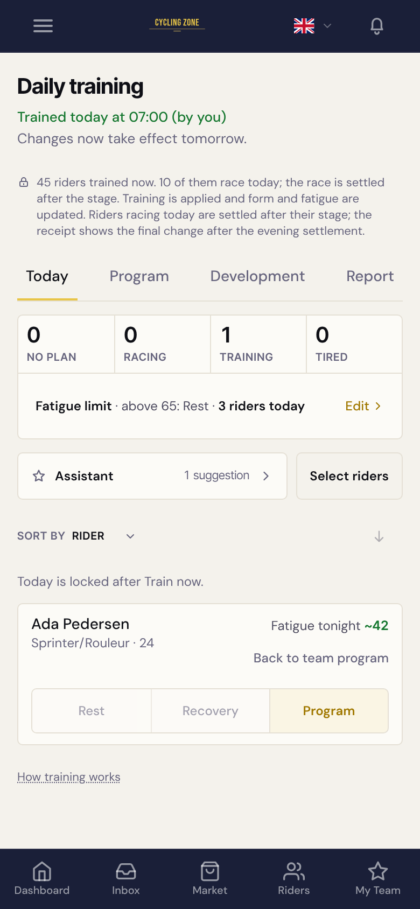

**Spilleren oplever:** Efter trykket står "Trained today at 07:00 (by you)" uændret, selvom der lige er trænet. Under den står en ny blok på fire sætninger (cirka 50 ord), hvor "settled after the stage" står to gange. Rytterrækken siger stadig "Fatigue tonight ~42", selvom `training_train_now_instant` er tændt og trætheden er opdateret nu. Der er intet link til kvitteringen, som teksten selv henviser til. Før trykket står den store guld-knap og en forklaring på to linjer, og på desktop står "Trained today at 07:00" to gange (hovedet og statuskortet, `f01-traening-1440.png`). Hovedet med knap og forklaring fylder cirka 450 px på **alle fire faner** ved 390, også Program, Development og Report (`f01-traening-program-fane-390.png`).
**Hvorfor:** Nielsen 1 (systemets status skal kunne ses), P1 og P9 (forklaring er chrome), "Gemt"-reglen fra 12/11. Målbart: 50 ord og 0 nye tal efter en handling, som spilleren laver dagligt.
**Forslag:** Efter trykket viser hovedet én linje "Trained today at 09:16 by you" med flueben og et "Receipt ›"-link i guld-tekst. Guld-knappen og forklaringen forsvinder for resten af dagen. Én linje resultat ("45 riders trained. 10 race today and settle after their stage."). Rækkerne viser "Fatigue 42 (was 38)" og en lås. Hovedet uden knap er det samme på alle fire faner. **Før/efter: [01](../../pr-screens/ux-16-11/4/foer-efter/01-traen-nu-efter-tryk.png).** Kanal: Claude Code, i spor med #8248.

### 2. Kvitteringen taler systemsprog (Træning > Report)

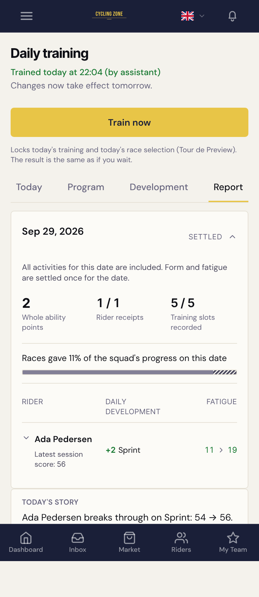

**Spilleren oplever:** De tre store tal er "Whole ability points", "Rider receipts 1/1" og "Training slots recorded 5/5". På en ældre dato står "Older reports may not contain full progress or settlement evidence" og "No whole point recorded" (`f02-rapport-aeldre-dato-390.png`). Træthed, der stiger fra 11 til 19, er **grøn**. Den natlige afregning, som spillet selv laver, står som "Trained today at 22:04 (by assistant)", selvom spilleren aldrig har tændt assistenten. Det gode, "Today's story" ("breaks through on Sprint: 54 → 56"), står nederst under folden.
**Hvorfor:** P9 (systemets regnskab er ikke spillerens sprog), P8 (grøn må kun betyde noget godt), P11 (afsenderen af en handling skal være sand), P7 (`→` som tegn).
**Forslag:** Én sætning øverst ("2 ability points today. Races gave 11 % of the progress."), én række pr. rytter med evnen fra og til ("Sprint 54 → 56" med stroke-pil) og trætheden i advarselsfarve, når den stiger. Tælleværket flyttes til Hjælp eller væk. Afsenderen hedder "Settled by the game at 22:04". **Før/efter: [02](../../pr-screens/ux-16-11/4/foer-efter/02-kvitteringen.png).** Kanal: Claude Code (copy EN først, ejer godkender DA).

### 3. Udvikling står fire steder med tre forskellige potentialtal (Træning + rytterprofil)

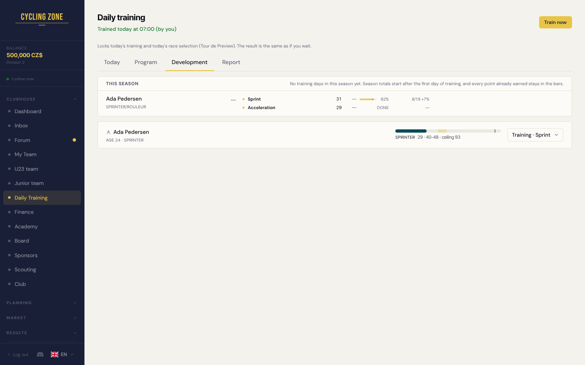

**Spilleren oplever:** "Bliver min rytter bedre?" besvares fire steder: Træning > Development, profilens Training-fane, profilens Development-fane og profilens Scouting-fane. Samme rytter vises som "29 · 40-48 · ceiling 93" (træningssiden), "Projected level 40-48" (heroen), "To target ~5+ seasons, target age ~29+" (Development) og "Potential 40-48" (Scouting). Ingen steder står, at 40-48 og 93 er to forskellige ting. Profilens Training-fane har en tabel med 17 evner, hvor 15 rækker er tre tankestreger, og en kolonne uden overskrift ("8/19 +7%", `f05-profil-traeningsfane-390.png`). Udviklingsloggen siger "+20 ability points" og samtidig "no training recorded" (`f03-udvikling-profil-390.png`; kan være mock-data, men begge tekster findes).
**Hvorfor:** P11 og P13 (ét tal, én skrivemåde), Nielsen 4 (konsistens), P12 (samme slags indhold ser ens ud). `potential_single_number` er tændt i prod, men fladerne viser stadig flere tal.
**Forslag:** Én komponent "Where the rider is heading" bruges alle fire steder: rating nu, ét skøn for retningen (fra spejderen), "+5 this season", næste point pr. trænet evne og "Training now ›". Utrænede evner viser "Not trained" i stedet for tankestreger. "ceiling" vises kun i Hjælp eller i hover-kortet. **Før/efter: [03](../../pr-screens/ux-16-11/4/foer-efter/03-udvikling-et-sted.png).** Kanal: ejer-valg (hvilket tal er "det ene"), derefter Claude Code.

### 4. Guld-tekst er under AA i lys tilstand (10 af 13 sider)

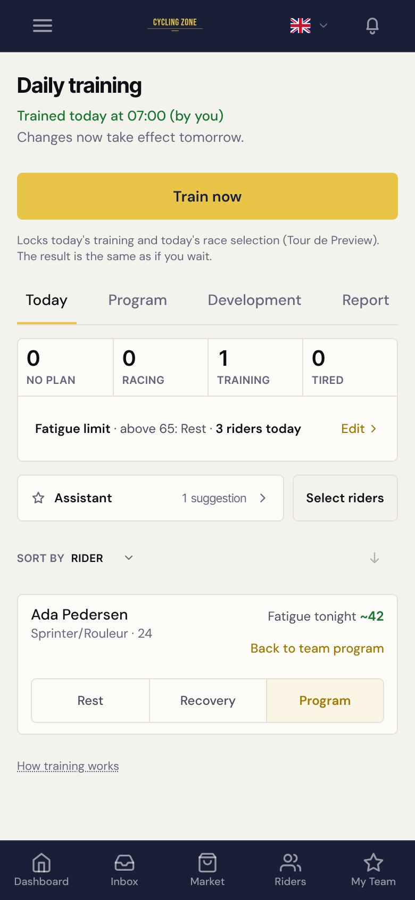

**Spilleren oplever:** Aktiv fane, "Back to team program", "Edit ›", forumets "PINNED/POLL", Hjælps nummerering og mærker som "SERIOUS PROSPECT" står i `--accent-t` #a07800. axe måler 3,49-3,91:1 (kræver 4,5:1 under 18 px). Mørk tilstand er i orden (#ffd966).
**Hvorfor:** WCAG 1.4.3. P3 giver netop guld-tekst rollen som "quiet action" og aktiv fane, så den bruges overalt.
**Forslag:** Ét token-skift i lys tilstand: `--accent-t` til **#866400** giver 4,71-5,29:1 på alle fem målte baggrunde (kort, side og de tre guld-tints) og er stadig tydeligt guld. Ingen komponent skal ændres. Kanal: ejer-valg (farven er brand), derefter Claude Code med `contrastTokens`-testen.

### 5. Rytterprofilens faner på mobil starter under 750 px hero

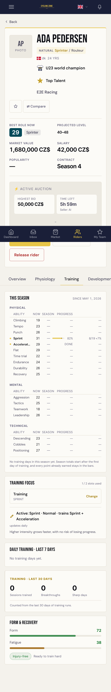

**Spilleren oplever:** Profilen har 9 faner. Ved 390 starter fanebjælken cirka 800 px nede, og efter et fanetryk bliver siden stående, så det nye indhold ligger under heroen. For at se tre faner skal spilleren rulle op og ned tre gange. Fanebjælken klipper "Developmen" uden mere-markør.
**Hvorfor:** P1, P10 og fold-disciplinen. #8236 (rettelse 7) og #8281 gør heroen lavere. Dette fund er det, der sker **efter** et fanetryk, og løses ikke af en lavere hero alene.
**Forslag:** En fast, smal rytterbjælke (initialer/foto, navn, rating, "Manage") og fanebjælken klæber under topbaren, når heroen er rullet forbi. Et fanetryk ruller til fanens start. Faner der ikke kan være der, får en "More ›"-knap uden for fanelisten (modern-web-guidance `tabs`, strategi 2). **Før/efter: [04](../../pr-screens/ux-16-11/4/foer-efter/04-profilfaner-paa-mobil.png).** Kanal: Claude Code sammen med #8281.

### 6. Indstillinger: tre navne og tre gem-knapper

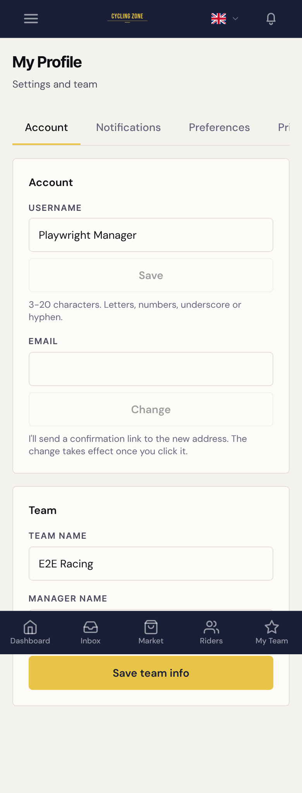

**Spilleren oplever:** Menupunktet hedder "Settings", siden "My Profile" (DA "Min Profil"), og menuen har desuden "My Manager Profile". På Account-fanen gemmes brugernavn med én knap, e-mail med en anden ("Change"), og hold- og managernavn med en tredje i guld ("Save team info"). De deaktiverede knapper ser ud som tomme felter. Fanen "Pri…" klippes ved 390.
**Hvorfor:** Nielsen 4 (samme ting, samme navn), Nielsen 6 (genkend frem for husk), P3 (deaktiveret skal ligne en knap).
**Forslag:** Siden hedder "Settings" ("Indstillinger") som menuen. Ét formular-flow med én "Save changes" i en fast bund over bundmenuen, som viser antal ændringer. Link til den offentlige managerprofil fra Team-kortet. **Før/efter: [05](../../pr-screens/ux-16-11/4/foer-efter/05-indstillinger.png).** Kanal: Claude Code.

### 7. Profilens evner er rene tal, ikke evne-firkanter, og de fejler kontrast i mørk

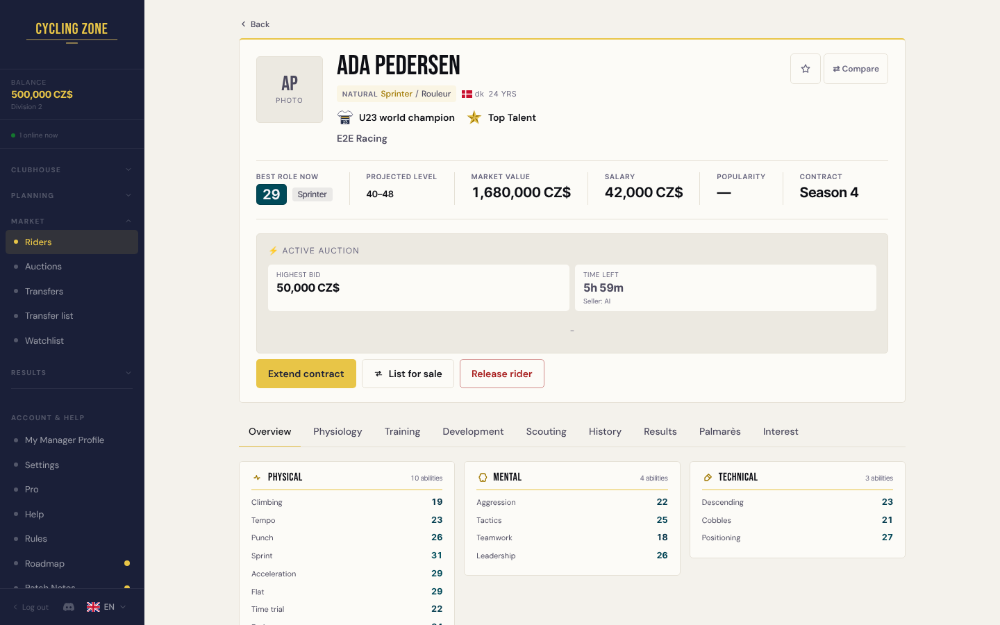

**Spilleren oplever:** Overblikkets 17 evner står som teal-tal i en liste. Hold, trup og hover-kortet viser evner som `statColor`-firkanter. I mørk tilstand måler axe evnetallene til 3,57-3,93:1 (`f07-profil-overblik-1440-moerk.png`).
**Hvorfor:** P5, ejer 7/11: "evner vises altid som `statColor`-firkanter med tallet indeni". WCAG 1.4.3.
**Forslag:** Brug den fælles evne-firkant i profilens tre evnekort. Det løser kontrasten i mørk, fordi firkanten har sin egen tekstfarve. Kanal: Claude Code.

### 8. Træn nu-bekræftelsen er en centreret modal med Bebas-titel

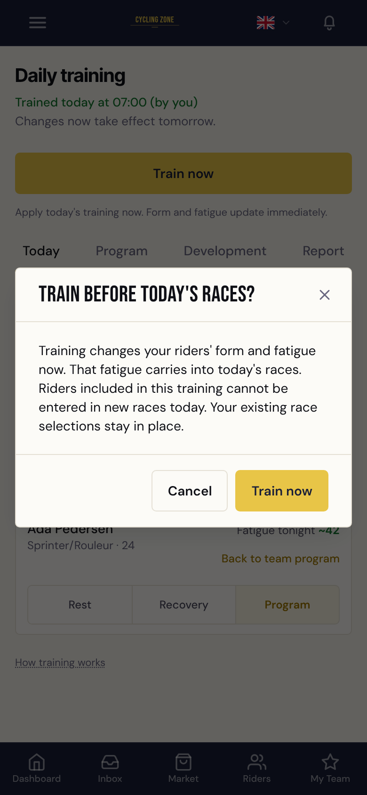

**Spilleren oplever:** "TRAIN BEFORE TODAY'S RACES?" i Bebas i en modal midt på skærmen. Knappen "Train now" står både i modalen og nedtonet bag den.
**Hvorfor:** P4 (Bebas aldrig i overlays), P18 (på telefonen et ark fra bunden).
**Forslag:** Bekræftelsen bliver et bundark ved ≤640 px med kortets titel (15/600) og knapperne inden for tommelfingeren. Med `training_train_now_instant` tændt kan teksten blive to linjer: "Training changes form and fatigue now. Riders who train cannot be added to races today." Kanal: Claude Code.

### 9. Scouting: valg, guld og forklaring før handlingen (917 visninger)

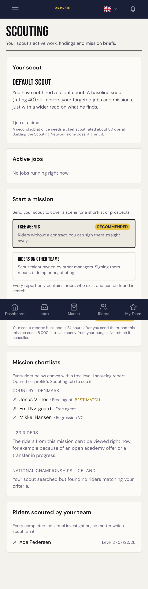

**Spilleren oplever:** Den valgte mission markeres med en tyk sort ramme (hvid i mørk). "RECOMMENDED" er en guld-fyldt pille. Knappen, der sender spejderen af sted, ligger under folden efter tre forklaringslinjer. "Your scout"-kortet bruger 7 linjer på at forklare standardspejderen. Tomme tilstande er beskrivende ("No jobs running right now."). Missionsvalget er en `select` uden label (axe).
**Hvorfor:** P3 (aktiv tilstand er guld-tekst på 10 % guld, ikke en ramme; ingen guld-fyld uden for knappen), P6, P9, WCAG 4.1.2. Bebas-titlerne er allerede #8235 rettelse 8.
**Forslag:** Missionerne som `Segmented`/radio-kort med P3's aktive tilstand. "Recommended" som almindeligt `StatusBadge`. Sendeknappen direkte under valget. Standardspejderen på én linje med et Hjælp-link. Tomme tilstande som handling ("Send your scout on a mission"). Label på `select`. Kanal: Claude Code.

### 10. Egen rytters Scouting-fane læser som et fremmed skøn

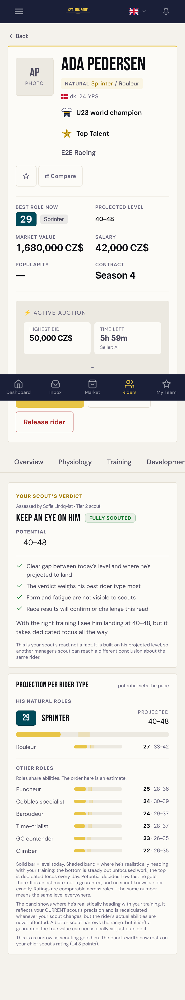

**Spilleren oplever:** På sin egen rytter ser spilleren "Your scout's verdict: KEEP AN EYE ON HIM" og en liste med grønne flueben, hvor to punkter er neutrale fakta ("Form and fatigue are not visible to scouts"). Under projektionen står to afsnit på i alt cirka 15 linjer forklaring.
**Hvorfor:** P8 (flueben betyder "godt" eller "gjort"), P9 (manual på fladen), Nielsen 2 (match med virkeligheden: man holder ikke øje med sin egen rytter).
**Forslag:** På egne ryttere hedder kortet "Where he can go" uden dom. Fakta står som almindelig tekst uden flueben. De to afsnit flyttes til Hjælp med ét "How the range works ›"-link (P15). Kanal: Claude Code (copy EN først).

### 11. Alder og datoer skrives på seks måder

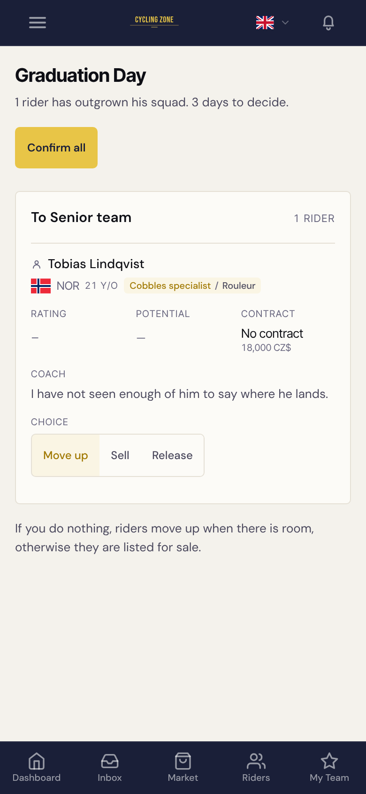

**Spilleren oplever:** Alder: "24 YRS" (profil), "17 y/o" (akademi), "21 Y/O" (Graduation Day), "DEN · 21" (trup), "AGE 24" (træning). Datoer: "07/22/26" (scouting), "Aug 19, 2026" (rapport), "SINCE MAY 1, 2026" (profil), "3 AUG, 12:15" (forum), "Monday 16 Novem…" (patch notes). Graduation Day viser desuden en tankestreg for rating og potentiale uden grund og "No contract 18,000 CZ$".
**Hvorfor:** P13 (én skrivemåde pr. slags tal; manglende værdi = kort grund).
**Forslag:** Én alders-formatter (tabeller "24", tekst "24 years") og én dato-formatter (dato "16 Nov", dato med år "16 Nov 2026", relativ "3 months ago"). Tankestregen bliver "Not scouted yet". "No contract 18,000 CZ$" bliver "New contract: 18,000 CZ$/season". Kanal: Claude Code (formatter først, siderne bagefter).

### 12. Title Case i menu og sidetitler

**Spilleren oplever:** Menuen skriver "Daily Training", "My Manager Profile", "Patch Notes", "Race Centre", "Season Snapshot" og "Hall of Fame", mens siderne skriver "Daily training" og "Patch notes". DA: "Min Profil", "Min Managerprofil".
**Hvorfor:** TASTE §3 (sentence case altid, begge sprog), P12.
**Forslag:** Sentence case i `common.json` (en+da) og `profile.json`. En lille tone-vagt mod Title Case i locale-nøgler med `nav.` og `title`. Kanal: Claude Code.

### 13. Forum-listen er luftig og støjende (1.190 visninger)

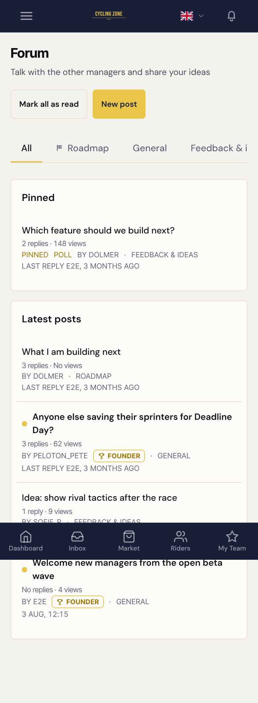

**Spilleren oplever:** Hver tråd fylder 4-5 linjer, de tre sidste i versaler ("BY PELOTON_PETE · FOUNDER · GENERAL", "LAST REPLY E2E, 3 MONTHS AGO"). Ved 390 ses 3 tråde på første skærm. Trådvisningen skriver "NO VIEWS" på den tråd, man læser, og "Report" står lige så tydeligt som "Quote" ved hvert indlæg (`f13-forum-traad-390.png`, 19 små trykflader).
**Hvorfor:** P5 (tæthed med hierarki), P11 (0 visninger er ikke sandt, når man ser den), Nielsen 8 (minimalistisk design).
**Forslag:** To linjer pr. tråd: titel + "Peloton_Pete · 3 replies · 3 mo" i normal skrift, kategori som ét mærke. Visningstallet tæller den aktuelle visning med. "Report" flyttes i en "…"-menu på 44 px. Kanal: Claude Code.

### 14. Akademiet: teksten peger på en kolonne, der ikke findes på mobil (1.096 visninger)

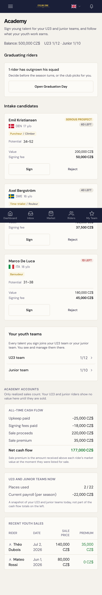

**Spilleren oplever:** "U23 and junior teams now" siger "not part of the cash flow totals on the left". Ved 390 står kortene under hinanden, så der er intet til venstre. "Sign" og "Reject" er lige store under hvert kandidatkort, og prisen står over knappen, ikke på den.
**Hvorfor:** Nielsen 2 (sproget skal passe til det, man ser), P10.
**Forslag:** "…not part of the cash flow totals above" (DA "ovenfor"), eller ingen retning. "Sign · 50,000 CZ$" som knap og "Reject" som stille tekstknap. Regnskabet i øvrigt hører til #8081. Kanal: Claude Code (copy) og #8081 (resten).

### 15. Roadmap: 1-6-skalaen har ingen ankre

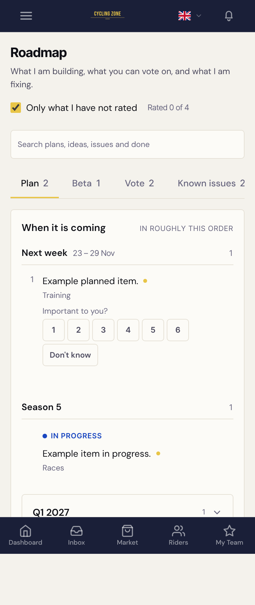

**Spilleren oplever:** "Important to you?" med knapperne 1-6 og "Don't know" på en linje for sig. Det står ingen steder, om 1 er vigtigst eller mindst vigtigt. Filteret "Only what I have not rated" er slået til fra start, så en spiller, der har stemt, ser en tom fane.
**Hvorfor:** Nielsen 6 og 5 (forebyg fejl), P6. Fejlstemmer går direkte i ejerens prioriteringsdata.
**Forslag:** Ankre under skalaen ("1 Not for me · 6 Must have"), "Don't know" i samme række, og tom fane med handling ("You have rated everything. Show all"). Kanal: Claude Code.

## Før/efter-skitser af de 5 vigtigste

Skitserne er statisk HTML med spillets tokens og fonte i `pr-screens/ux-16-11/4/sketches/` (ingen produktkode). FØR er den rigtige app i preview-mocken med prod-kontakterne. Nummer, navn og én sætning er brændt ind øverst.

| # | Billede |
|---|---|
| 1 | [Træn nu: efter trykket](../../pr-screens/ux-16-11/4/foer-efter/01-traen-nu-efter-tryk.png) |
| 2 | [Kvitteringen i spillerens sprog](../../pr-screens/ux-16-11/4/foer-efter/02-kvitteringen.png) |
| 3 | [Udvikling ét sted med ét skøn](../../pr-screens/ux-16-11/4/foer-efter/03-udvikling-et-sted.png) |
| 4 | [Rytterprofilens faner på mobil](../../pr-screens/ux-16-11/4/foer-efter/04-profilfaner-paa-mobil.png) |
| 5 | [Indstillinger: ét navn og én Gem](../../pr-screens/ux-16-11/4/foer-efter/05-indstillinger.png) |

Genskab: start preview-serveren som under Metode og kør `node compose.cjs` i `pr-screens/ux-16-11/4/`.

## Dækket andetsteds (ikke gentaget)

| Hvad | Hvor | Hvad det løser i dette område |
|---|---|---|
| Samlet træningsdesign, 5 felter pr. dato | **#8248** (draft-PR) | Program-fanens ugeplan med 42 ens "Normal"-celler og forkortelsen "RD 1-5" uden forklaring ([billede](../../pr-screens/ux-16-11/4/x-program-ugeplan-390.png)); "Save plan" under folden; Today-kortet viser ét valg (Rest/Recovery/Program), mens modellen har fem felter pr. dato |
| Akademiet udgave A | **#8081** | Regnskabet nederst på akademisiden og optagets flow |
| Patch notes-siden | **#8049** | Siden er 14.371 px lang ved 390 (17 skærme) med 199 små trykflader; datoerne i overskrifterne afkortes ("Monday 16 Novem…"); "NOW LIVE FOR ALL"-mærket brækker titlen ([billede](../../pr-screens/ux-16-11/4/x-patch-notes-390.png)) |
| Rytterprofil med billede | **#8281** | Heroens højde, mærker inline, auktionsboks og kontrakt-handlinger. Fund 5 her er det, der sker efter et fanetryk |
| Indbakken | **#8280** | Gruppering, trykflader og tone (#8236 fund 9-10) |
| Team/trup-sidehoved, chip-række, Overview/Abilities | #8236 rettelse 8 og 13 | Mit hold, U23 og junior |
| Bebas-korttitler, venstre-accent-bjælken, Scouting-sidehovedet | #8235 rettelse 5 og 8 | Rytterprofilen og Scouting |

Mørk tilstand ved 390 for 12 af siderne: [oversigt](../../pr-screens/ux-16-11/4/moerk-390-oversigt.png). Ud over fund 7 og `select`-labelen i fund 9 ingen egne fund.

## Anbefalet rækkefølge

1. **Fund 4 (ét token)** og **fund 12 (locale-tekster)**: billigst, rammer alle sider.
2. **Fund 1 og 2** i samme spor som #8248, fordi de er træningens daglige løkke.
3. **Fund 3** efter ejerens valg af "det ene tal"; derefter fund 7 og 10, som bruger samme komponenter.
4. **Fund 5** sammen med #8281.
5. **Fund 6, 8, 9, 11, 13, 14, 15** som enkeltstående spor i trafikorden.

## Data

- Billeder: `pr-screens/ux-16-11/4/` (fund-billeder `fNN-*`, før/efter i `foer-efter/`).
- Målinger: `metrics.json` (88 visninger), `axe.json` (26 kørsler).
- Scripts: `prodflags.cjs`, `shoot.cjs`, `flow.cjs`, `axe.cjs`, `compose.cjs`.
