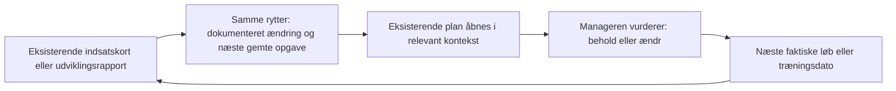

# Del B: samspil og varig motivation

4. november 2026 · Refs #7495 · **Forslag til ejerens og Claudes gennemgang. Intet build-go.**

## Valgt retning til konkretisering

Gør det lettere at bruge et afsluttet løb og en udviklingsrapport til næste valg i en eksisterende plan. Færdiggør først det sandfærdige grundlag i motor, taktik og Udvikling 2.0. Afprøv derefter en lille forbindelse mellem rapport og plan, før der bygges en ny mekanik eller en ny oversigt.

Ejeren har valgt sammenhængen til konkretisering, men dens effekt er endnu ikke påvist. Spillet har allerede resultater, næste handling, ugeplaner, udviklingsrapporter, sæsonafslutning og bestyrelsesmål. Undersøgelsen peger på forbindelser mellem dem. [Evidens og spillerforløb](audit-durable-motivation-2026-11-04.md) skelner mellem observeret kode, aktuelle SELECT-data, daterede spillerudsagn og hypoteser. [Spilsammenligningen](manager-game-sources-2026-11-04.md) bruger officielle kilder, ikke påståede retentioneffekter.

## Hvad er valgt, og hvad er åbent?

| Status | Indhold |
|---|---|
| Ejer-valgt | Fastholdelse først: nye managers skal forstå deres første løb. Permanent værdi for både nye og erfarne managers. Flere besøgende parallelt; Pro bagefter. |
| Ejer-valgt | Motor og løbsfilm sande, taktik synlig og forståelig, Udvikling 2.0 er de tre loft-områder. #7535 er i bero. #6950 drøftes med ejeren og Claude senere i ugen. |
| Ejer-valgt | God planlægning skal kunne bære en konkurrencedygtig klub med få ugentlige besøg. Talentfabrik og købeklub er legitime veje. Styrke straffes ikke. |
| Ejer-valgt 4/11 efter konkret eksempel | Sammenhængen i A er nyttig og skal konkretiseres: fra en rytters løbsrapport til den allerede gemte næste opgave og den eksisterende plan. Ejerens svar: "Nyttig sammenhæng — konkretisér den". Dette er retning til skitse, ikke godkendelse af hele specifikationen. |
| Stadig åbent | Konkret placering og afgrænsning, tilstande uden en kommende opgave, afstemte wireframes, spillerfeedback, succesgrænser, prioritet og indsats. Det første spørgsmål var for abstrakt; valget blev taget efter et konkret spillerforløb. |
| Særskilt gate | Endeligt design, testplan og eksplicit build-go. Derefter normal preview-, release- og mergegodkendelse. Denne PR giver ingen af disse. |

Mandat: [ejerens opgave 4/11](https://github.com/NicolaiDolmer/CyclingZone/issues/7495#issuecomment-6633690957). Del A i #7652 er uændret. Dens eksperiment- og Pro-valg vurderes særskilt; valget af del B's sammenhæng vælger ikke del A's A/B-wireframes eller det endelige udseende af Claudes indsatskort.

## De tre vigtigste huller at afprøve

Rækkefølgen er Codex' vurdering af relevans for den valgte plan og styrken i beviserne. Det er ikke en målt rangering af frafaldsårsager eller en ny MASTERPLAN.

### 1. Fra forstået resultat til næste meningsfulde valg

Dashboardet sætter seneste resultat ved siden af næste handling. Handlingskortets input handler om udtagelse, træning, bestyrelsesplan, tilbud og auktioner; det modtager ikke løbets observerede hændelser eller udviklingsrapportens ændringer. Træningssidens rytterkort samler allerede kvittering, træthed, prognose, dagsændring og direkte adgang til samme rytters ugeplan (`TrainingPage.jsx`, `renderRiderCard` og `riderCardFooter`). Det er en eksisterende integration, ikke blot fanenavigation. Den snævre rest, som A skal afprøve, er overgangen fra en løbsrapport eller historisk rapport til næste gemte opgave. Behovet for den rest er endnu ikke brugertestet.

Det er det stærkeste designspor, fordi det ligger direkte efter ejerens prioriterede løbsforståelse og genbruger Udvikling 2.0. #931 efterspørger allerede, at planer genbesøges efter løb, udviklingsændringer og sæsonmål. De private målinger viser brugbare planer og resultater, men ikke om manageren læste, forstod eller brugte dem sammen.

**Forankring:** #5101 og #7266 ejer indsatsforklaringen; #7638 ejer træthed før valg; #5950 og #6110 ejer udbytte og potentiale. Del B foreslår kun overgangen til næste beslutning. Korrekthed kommer fra #6350/#7643. Ingen konkurrerende indsatskort eller prognosemodel.

### 2. Planlægningsarbejdet på tværs af en uge

Spillerudsagn på #6952 beskriver stor tidsbyrde ved overlap, men spillerne er uenige om selve overlappet. #7456 beskriver en konkret konflikt mellem faste programmer og behovet for hvile. Aktuel kode har ugeplaner, grupper, træthedsregler og sæsonmatrix; ingen af disse må omtales som manglende.

Det uafklarede er den samlede belastning: kan manageren holde styr på løb, restitution, kontrakter, transfer og akademi med den aftalte besøgskadence? Planrækker og klik besvarer ikke spørgsmålet. Vi har ikke målt en hel nutidig spilleruge. Det er derfor et veldokumenteret undersøgelsesbehov, ikke et bevist brud på tidsaftalen.

**Forankring:** #7535 er det allerede valgte Workbench-design og forbliver i bero. #6952/#6739 og #931/#7456 ejer de relevante rester. Afprøv den samlede uge, før kalender, programrotation eller nye frister ændres. A nedenfor er ikke en genvej til at bygge Workbench.

### 3. Synlig fremgang for klubbens valgte vej over flere sæsoner

Sæsonafslutning med højdepunkter og bestyrelsesdom, handels- og karrierehistorik samt mandater findes allerede. Det åbne spørgsmål er, om en talentfabrik, en købeklub eller et hold under genopbygning kan se sin egen fremgang og bruge den til næste sæsons valg, også uden store sejre.

Ejerretningen findes i BOARD_RULES §0.4, YOUTH_RULES og SOCIAL_RULES. Spillerudsagn på #6950/#6951 beskriver bekymringer om udvikling og marked, men beviser ikke, at mangel på historik er årsagen. Ønsket om rytter-milepæle i #5180 stammer fra staff-chat og vægtes som en designidé, ikke som et repræsentativt spillersignal. Dette er den svagest dokumenterede af de tre hypoteser.

**Forankring:** #7167 for bestyrelsens rolle, #2490/#1148/#1106 for karriere og klubhistorie, #6951 for markedets faktiske likviditet. #6950s aktuelle beslutning genåbnes ikke. Ingen nye penge, royalties, statbonusser, manager-XP eller tvungen ungdomsstrategi foreslås.

## Reelle alternativer for det vigtigste hul

| Retning | Hvad manageren får | Fordel | Ulempe og stopgrund |
|---|---|---|---|
| **A: valgt retning til konkretisering** | Ved en egen rytters dokumenterede forløb kan manageren se den relevante kommende opgave og åbne den eksisterende plan med den samme rytter i fokus. | Lille omfang; både nye og erfarne kan bruge det. Kæden kan undersøges uden ny spiløkonomi. | Kan være overflødig navigation. Stop, hvis spillerne allerede kan gøre det lige så let, eller hvis forbindelsen kræver gættet historik. |
| **B: færdiggør grundlaget og mål uden ny visning** | Claudes indsatskort og kerneforbedringer fungerer sammen med den eksisterende integrerede træningsvisning: kvittering, tilstand, prognose, dagsændring og rytterens ugeplan. | Mindst ekstra overflade og arbejde. Kan vise, at det eksisterende scope er nok. | Overgangen fra løbsrapport til kommende opgave kan stadig kræve rekonstruktion. Vælg B, hvis de færdige visninger allerede løser opgaven let. |
| **C: vedvarende klubprojekt som ny mekanik** | Et selvvalgt flerårigt projekt forbinder udvikling, rekruttering og sæsonmål med egne milepæle. | Kunne give tydelig retning uafhængigt af ligaplacering. | Overlap med bestyrelse, vision, #1148 og #5180. Kræver nye regler, mere vedligehold og stærkere bevis. Fravælges nu; ingen opgave eller byggebestilling oprettes. |

A er valgt som designretning til konkretisering. B bevares som sammenligningsgrundlag i afprøvningen: A skal give klar nytte i den samme opgave. Ellers forelægges det konkrete resultat for ejeren; valget ændres ikke stiltiende. Mere brug eller flere ændringer er ikke i sig selv et bedre spil.

**Et konkret, tænkt eksempel:** Manageren læser om en hjælper, som blev træt under løbet. I A kan manageren ved samme rytter se den allerede gemte næste løbsopgave og gå til den eksisterende plan. I B forklarer rapporten det afsluttede løb, og manageren finder selv næste udtagelse via den nuværende navigation. Ingen af retningerne siger, at rytteren skal tages ud. Historisk træthed må ikke fremstilles som den aktuelle tilstand; den aktuelle tilstand skal hentes og tidsmærkes særskilt.

### Samme rytter og samme opgave i begge retninger

Illustrativt strukturudkast med **Rytter A**, **afsluttet løb X** og **kommende løb Y**; ingen rigtige spillerdata, færdig spillertekst eller releasebilleder. B forudsætter Claudes færdige indsatskort, som endnu ikke er verificeret som samlet live-forløb her.

| Trin | B: eksisterende forløb plus Claudes kernearbejde | A: den foreslåede tilføjelse |
|---|---|---|
| 1. Manageren åbner rapporten for løb X | Ser Rytter A's faktiske indsats og tilstanden ved løbets slutning. | Præcis samme indsatskort og historiske oplysninger. |
| 2. Manageren vil vurdere næste opgave | Åbner planlægningen, finder Rytter A og den gemte udtagelse til løb Y. | Ved Rytter A's rapport står en læsende reference til den allerede gemte opgave i løb Y, med et link til den eksisterende plan. Det er den eneste nye forbindelse. |
| 3. Manageren kontrollerer tilstand og træning | Det eksisterende træningskort viser aktuel tilstand, kvittering, prognose og genvej til Rytter A's ugeplan. | Genbruger samme kort og samme ugeplan. Ingen ekstra rapport, prognose eller gemmeknap. |
| 4. Manageren vælger | Beholder eller ændrer planen med de eksisterende kontroller. | Samme valg. Et klik på referencen ændrer aldrig planen, og en uændret plan udløser ingen påmindelse. |

**Ejerens vurdering:** Sammenhængen er nyttig og skal konkretiseres. Den næste skitse viser referencefeltet og dets destination, mens indsatskortets indhold fortsat ejes af Claude. En svag effekt i testen skal forelægges ejeren med bevis, ikke føre til en automatisk ændring af retningen.

### Skitse af den valgte sammenhæng

Den interaktive arbejdsskitse i det private designmateriale viser kun tilføjelsen og en skematisk destination. Alle data er fiktive; de grå felter er plads til Claudes indsatskort. Arbejdsetiketter er ikke ny spillertekst, og skitsen fastlægger ikke #5101's endelige layout.

| Situation | Reference og destination i skitsen | Beslutningsstatus |
|---|---|---|
| Et andet løb er allerede planlagt | Rytter A i rapporten for løb X forbindes med den gemte opgave i løb Y. Genvejen åbner eksisterende planlægning med samme rytter i fokus. | Konkretisering af den valgte retning; præcis placering og deep link afstemmes stadig. |
| Senere etape i samme etapeløb | Referencen peger på den gemte senere etape; genvejen viser den eksisterende taktiske plan. Bindingen til løbet ændres ikke. | Forslag til korrekt afgrænsning, ikke et nyt frit udtagelsesvalg. |
| Ingen kommende gemt løbsopgave | Skitsen skjuler tilføjelsen og opretter ingen opgave. Det betyder ikke, at rytteren er uden træningsplan. | **Åbent ejer-valg:** skjult felt som anbefalet, eller en rolig genvej til eksisterende planlægning. Ingen ny deadline eller nudge. |

Skitsens klik ændrer kun selve demonstrationen; ingen udtagelse, taktik eller træning gemmes. Manglende data og mistet ejerskab er fortsat særskilte testtilfælde i datakontrakten, ikke lig med bekræftet fravær af en kommende opgave.

## A: afgrænset designforslag

### Situation og værdi

Manageren kommer tilbage efter et eller flere løb. En hjælper har løst sin opgave, en ung rytter har fået dokumenteret udvikling, eller en rytter er træt før næste opgave. Manageren skal kunne forstå, hvad der er sket, og finde den plan, som stadig gælder. At lade en fornuftig plan fortsætte er et ligeværdigt udfald.

Forslaget beskriver struktur, ikke færdig spillertekst. Claude ejer ordlyd og de endelige wireframes.

### Mindste nyttige forløb

1. Indgangen er en løbsrapport eller historisk rapport om eget hold. Den integrerede aktuelle træningsvisning er genbrug, ikke ny scope. Indsatskortets valg af hændelser, vurdering og placering ændres ikke af del B.
2. Ved den valgte rytter forbindes den dokumenterede observation med den næste **allerede gemte** opgave. Der skelnes synligt mellem tidspunktet for observationen og tidspunktet for den aktuelle plan.
3. Manageren kan åbne eksisterende træningsplan eller den relevante eksisterende løbsplan. Ingen ny gemmevej, udfyldning, foreslået trup eller automatisk ændring. Historisk kontekst følger med som læsestof; den kopieres ikke ind som aktuelle taktiske data.
4. Hvis der ikke er en kommende opgave, er der ingen opfundet frist eller pligt. Almindelig navigation er nok. Hvis manageren beholder planen, kommer der ingen rød status eller manglende dagsopgave.
5. Fravær skal samles omkring de relevante aktuelle beslutninger, så gamle løb ikke skaber en kø af obligatoriske evalueringer. En første version behøver hverken særskilt uge-review, ny dashboardboks eller offentligt feed.

Det præcise deep-link-format og mulighederne for rytterfokus skal verificeres før implementering. Eksisterende sider har ikke dokumenteret én fælles kontrakt for dette. Forslaget lover derfor ikke, at det er to links uden andet arbejde.

### Kilder og datakontrakt

| Del | Genbrug og grænse |
|---|---|
| Hvad skete der? | Afsluttet etapes log/resultat og afregnet træningskvittering. Ikke planlagt rolle som bevis på udført arbejde. #5101/#6350/#7643 ejer sandheden. |
| Hvad var planen? | Kun en dokumenteret plan fra den pågældende afvikling. Hvis historisk planprovenance ikke er sikker, vises observationen uden sammenlignende dom. Senere ændret plan må aldrig fremstå som den gamle. |
| Hvad gælder nu? | Aktuelt ejerskab, næste relevante udtagelse og eksisterende uge-/rytterplan. Næste opgave findes efter kalenderens to akser og eksisterende bindinger, ikke blot ved næste dato. |
| Hvad kan manageren gøre? | Åbne eksisterende side. En ny navigation er læsende; ændringer kræver sidens normale validering og eksplicit gem. |
| Hvad ved vi ikke? | Manglende eller uafregnet data bliver til ukendt/afventer, aldrig nul udvikling, ingen indsats eller et sikkert råd. Ingen påstand om, hvad der ville være sket med en anden taktik. |

Ingen ny tabel eller migration er forudsat i første afprøvning. Hvis den valgte løsning kræver nyt historisk snapshot eller varig review-status, stopper den afgrænsning ved et nyt teknisk design med baseline efter regel 36. Intet flag oprettes eller tændes her.

### Afprøvning udført i denne analyse

En skrivebordsgennemgang af kildekoden og datakontrakterne har afprøvet følgende situationer. Det er ikke en observeret brugertest eller browsergennemspilning:

| Situation | Resultat af gennemgangen og krav til skitsen |
|---|---|
| Ny manager med automatisk løbsresultat | Resultat findes ikke nødvendigvis på baggrund af et eget valg. Brug ikke servermilepælen som bevis på aktivering. Vis ingen opfundet oprindelig intention. |
| Erfaren manager efter fravær | Flere resultater og næste handling findes allerede. A skal reducere rekonstruktion omkring en relevant rytter, ikke gentage begge kort. |
| Ugeplan med træthedsregel | Planens indhold er ikke det samme som dagens udførte aktivitet. Kvitteringen ejer den faktiske aktivitet. En hviledag er ikke automatisk en mislykket plan. |
| Etapeløb eller overlap | Næste dato er ikke nødvendigvis næste frie valg. Bindinger og faktisk løbsdagsakse skal følge eksisterende planlægningsregler. |
| Solgt, pensioneret eller oprykket rytter | Historisk observation kan bevares efter de eksisterende synlighedsregler; en genvej må ikke give ret til at redigere den tidligere ejers plan. |
| Manglende log, forsinket afregning eller ingen kommende opgave | Ingen årsagsdom eller påtvunget handling. Denne situation er en grund til at vise mindre, ikke at gætte. |

### Testplan før et eventuelt build-go

**Først forståelse:** Retning A er valgt til konkretisering. Claude og ejeren gennemgår skitsens tilstande og afstemmer den med indsatskortet. Skitserne kan efter kommunikations-go vises til både nye og erfarne managers. Brug samme konkrete opgave i A og sammenligningsgrundlaget B: forklar det dokumenterede forløb, find næste relevante valg, og begrund at beholde eller ændre planen. Medtag talentfabrik, købeklub og fravær; spørg også hvad der er overflødigt. Ingen spillere er kontaktet i denne session.

**Dernæst teknisk afgrænsning:** verificér historisk provenance, rytterfokus/deep links, aktuelle rettigheder og fallback med små syntetiske fixtures. Nye frontend-filer skal være TypeScript. Test ure injiceres eksplicit. Områdets SSOT ændres i samme fremtidige produkt-PR, hvis dens kontrakt ændres.

**Build-tier skal stå i det endelige go:** lokal preflight, frontend lint/unit/build og den gældende fulde frontend-E2E-verifikation; delte/backend-kontrakter udløser FULL. Alt tungt under verify-semaforen. Workers får en eksplicit tier og starter ikke selv fuld E2E. Ingen tests i denne docs-PR kan erstatte det.

**Ejeren ser på preview/staging:** egne og fremmede ryttere, historiske og nye etaper, en uafregnet dato, ændret plan efter løbet, sæsonpause, ingen kommende løb samt mobil og desktop. Større samlet pakke får en tester-runde på staging. Releasebilleder skal være rigtige; diagrammet ovenfor er ikke releasebevis.

### Foreslåede succeskriterier

- Manageren kan forklare forskellen på intention, observation og næste valg uden at få afsløret skjulte evner eller en påstået optimal taktik.
- Opgaven tager mindre unødvendigt arbejde end B. Det er lige så let at beholde en god plan som at ændre den.
- Gentagen nytte kan observeres hos både nye og etablerede managers. Et ekstra klik, en automatisk afvikling eller højere ændringsrate tæller ikke alene som succes.
- Den aftalte besøgskadence bliver ikke mere krævende; andre frister og eksisterende planer fungerer som før.
- Senere tilbagevenden sammenlignes med ens opfølgningsvinduer og samme kohortedefinition. Sæson, kerneforbedringer, samtykke og trackingdækning følger resultatet. Ingen kausal retentionpåstand fra en lille før/efter-gruppe.

Konkrete **foreslåede**, endnu ikke ejer-godkendte talgrænser, stikprøver og arbejdsestimat ligger i `balance-internals/growth/del-b-2026-11-04/assessment.md`. De må ikke forveksles med eksisterende godkendte mål eller offentliggøres som målt effekt. Tidsaftalen i GDD D-004/D-006 er derimod et eksisterende ejer-valgt mål.

### Risiko, indsats og beslutning

De vigtigste risici er forkert årsagsforklaring, ekstra administration, genopfindelse af #5101/#7535, læk af private planer og overfortolkning af små målinger. A reduceres eller bortfalder, hvis den ikke giver en klar gevinst over B. Kerneforbedringerne kan alene vise sig tilstrækkelige.

Skønnet indsats er lille til mellemstor for A med eksisterende kilder og navigation, større hvis historisk provenance mangler. Skønnet er ikke en leveringsdato og omfatter design, implementering, verifikation og testerfeedback; forudsætninger og interval står privat. C er et større tværgående produktprojekt og anbefales ikke nu. Ingen nye løbende udgifter er en forudsætning.

**Næste skridt:** gennemgå skitsens konkrete tilstande, tag ét åbent adfærdsvalg ad gangen og afstem med Claude. Retningen er valgt, men placering, ordlyd, spillerfeedback og den endelige kontrakt er stadig åbne. Build-go er et senere særskilt valg. Ingen nye issues oprettes: de tre behov har allerede ejere. Claude og ejeren afstemmer en eventuel konkret rest under de eksisterende issues; NOW, MASTERPLAN og roadmap ændres ikke af denne leverance.

## SSOT og drift

[GDD](../GAME_DESIGN_DOCUMENT.md) og [Living World](../superpowers/specs/2026-06-08-living-world-product-doctrine-design.md) ejer intentionen. [PLANLÆGNING](../PLANNING_CENTER_RULES.md) ejer valg og binding; [TRÆNING](../TRAINING_RULES.md) og [UDVIKLING](../PROGRESSION_RULES.md) ejer aktivitet og kvittering; [MOTOR](../RACE_ENGINE_RULES.md) ejer hændelser; [DASHBOARD](../DASHBOARD_RULES.md) ejer placeringer. [BESTYRELSE](../BOARD_RULES.md), [UNGDOM](../YOUTH_RULES.md), [SOCIALT](../SOCIAL_RULES.md), [ØKONOMI](../ECONOMY_RULES.md) og [TRANSFER](../TRANSFER_MARKET_RULES.md) afgrænser langsigtede konsekvenser. [ANALYTICS](../ANALYTICS_STACK.md) ejer måledefinitionerne.

Ingen produktkontrakt ændres af dokumentet. Ældre SSOT-statusafsnit er ikke behandlet som aktuelle runtimefakta. Patch notes, FEATURE_REGISTRY og genereret FEATURE_STATUS er undtaget, fordi dette kun er en beslutningspakke. Kodegrundlaget er main `002ba2348`; nye produktleverancer efter dette checkpoint skal genlæses før build.
