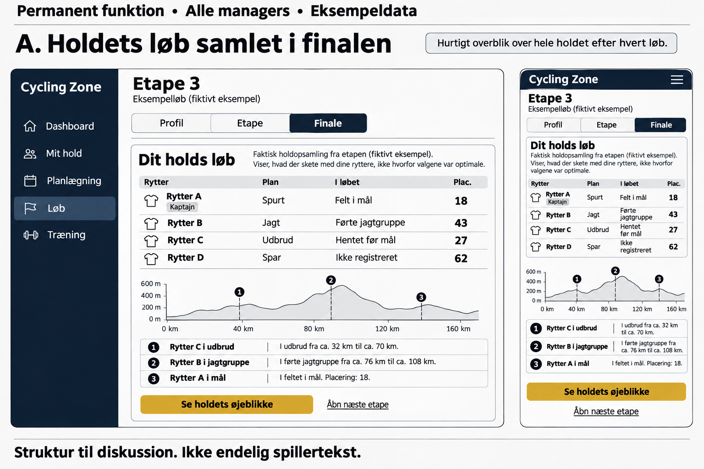
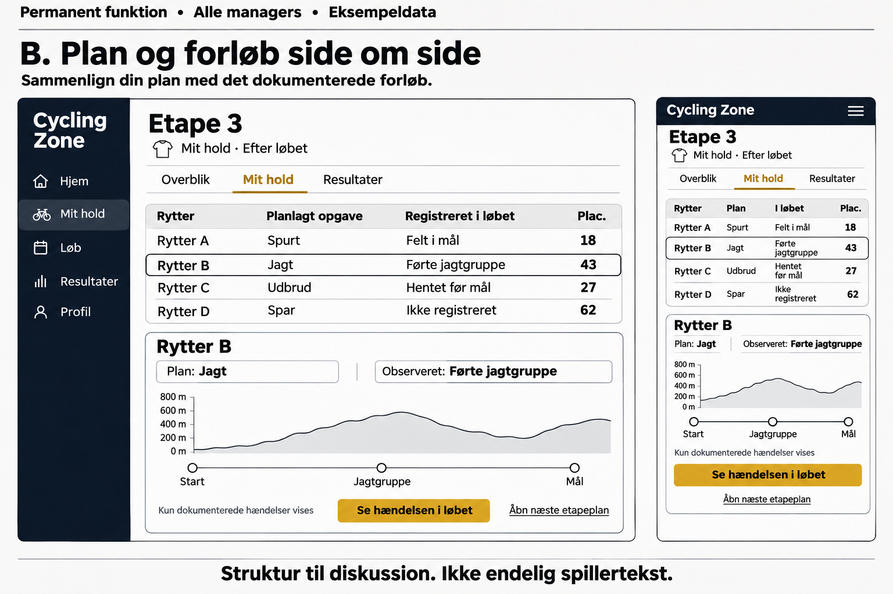

# Vækst og varig spillerfastholdelse

Dato: 4. november 2026. Refs #7495.

Status: beslutningspakke til ejeren og Claude. Ejerens seneste valg er en fælles vurdering af forslagene, derefter afstemte wireframes og spillerfeedback før en beslutning om byg. Ingen af A/B-løsningerne er valgt. Dette dokument giver ikke tilladelse til byg, merge, flagændringer, produktion eller udsendelser.

Privat målegrundlag, priser og foreslåede talmål: `balance-internals/growth/analyse-2026-11-04.md` og `balance-internals/growth/evidence-2026-11-04/`, delt via OneDrive. De private målinger må ikke kopieres til offentlige issues eller PR-kommentarer.

## Problem og retning

Spillet får nye konti, og de fleste bekræftede konti i den undersøgte kohorte får et hold og et løbsresultat. Den svagere del af forløbet er den efterfølgende menneskelige tilbagevenden. Et serverafviklet løb er ikke alene bevis på, at manageren har oplevet eller forstået noget meningsfuldt.

Besøg, signup og aktivitet måles med forskellig dækning. Vi kan ikke beregne én troværdig besøgs-til-betaling-rate ved at dividere Vercel-besøg, PostHog-personer og Postgres-konti med hinanden. Samtykke, identitetskobling og perioder skal følge med hvert tal. Gamle issue-titler og SSOT-tabellers historiske målinger er ikke aktuelle baselines.

Ejerens centrale korrektion den 4. november er bindende: forbedringerne skal give permanent værdi til både nye og nuværende spillere. Onboarding lærer spilleren den fælles spilrytme; den må ikke blive en separat engangsudgave af spillet. Forståelige valg, troværdige konsekvenser, synlig fremgang og noget meningsfuldt at vende tilbage til skal også virke for den erfarne manager.

## Grundlag og kildegrænser

- Postgres er kilden til konti, menneskelige hold, faktisk servermilepæl og den godkendte aktivitets-/retention-definition. Kontrollerede SELECT-resultater er gemt privat.
- PostHog modtager events. Den gamle beskrivelse af et tomt projekt er forældet. En ordnet, identitetsmatchet undergruppe kan måles, men den repræsenterer ikke alle konti.
- Vercel Web Analytics kan læses. Daglige visitor-tal summerer til besøgsdage, ikke til månedens unikke personer.
- Aktuelle Clarity-, GSC- og Ahrefs-målinger kunne ikke opnås med sessionens adgang. Der er ikke købt planer eller oprettet nye konti. Manglende data er ukendt, ikke nul.
- Betalingsadgang kan måles i appens abonnementscache. MRR og cashflow er ikke dermed afstemt mod Alunta og alle udgifter.
- Daterede Discord-snapshots indeholder konkrete spørgsmål om løbsforklaringer, træningsplanlægning og markedsforløb. De er ikke et repræsentativt survey, og de beviser ikke årsagen til kohortens tilbagevenden. Staff-kommentarer indgår ikke som almindelige spillerudsagn.

Et resultat ved snapshot beviser heller ikke, at resultatet var klar, da manageren sidst var online. Ventetid frem til et reelt udtageligt løb og frem til resultatet forbliver en del af den eksisterende måleopgave #5104.

## Eksisterende arbejde skal bruges

Den detaljerede afstemning står i [overlap-auditten](audit-growth-retention-overlap-2026-11-04.md).

- #7266 har allerede kravet om mærkbare og forståelige taktiske ordrer. Det er nærmeste produktramme for den første forbedringsretning.
- #6570 har leveret den nye etapeside med løbsforløb, replay, øjeblikke og referat. #6469 har leveret konkrete forklaringer. En ny parallel replay-visning er ikke foreslået.
- #6350 og #7643 ejer korrektheden af tidslinje, film, resultat og referat. En pænere forklaring må ikke skjule et forkert datagrundlag.
- #1140 ejer indgangen til et rigtigt løb og et eget valg. Første-løbs-kortet er leveret. Ingen fiktiv introduktionskonkurrence eller tvungen lineær tour genindføres.
- #1369 ejer den løbende eksperiment- og målerytme. #4964/#6291 er historisk og metodisk kontekst.
- #3513, #2490, #5180 og de sociale spor rummer allerede dele af den varige fastholdelse. De skal koordineres, ikke dubleres.
- #2806 er lukket efter de leverede Pro-forbedringer. Sæsonhistorik, gemte filtre og konkrete eksempler på Pro-siden er et eksisterende grundlag, ikke nye leverancer i dette forslag.

## Eksperiment 1: forstå eget holds løb

**Ejer-valgt problemretning:** løbsoplevelsen først. **Ejer-valgt princip:** permanent nytte for alle managers. **Åbent:** valg og præcis afgrænsning af den permanente visning.

Hypotesen er, at en tydelig kobling mellem en managers plan og det dokumenterede løbsforløb gør resultatet mere brugbart og gør næste beslutning lettere. Det kan være relevant for både første tilbagevenden og den løbende interesse gennem sæsonen. Hypotesen er ikke bevist af de nuværende kohortetal.

To reviderede wireframe-retninger er vist til ejeren:

- A: en samlet opsamling af eget holds væsentlige hændelser i den eksisterende finalevisning.
- B: planlagt opgave og dokumenteret forløb side om side i den eksisterende holdvisning, med en konkret rytters hændelse foldet ud. Dette er en anbefaling til den fælles vurdering med Claude, ikke et ejer-valg.

De tidligere førstegangs-wireframes er fravalgt som afgrænsning og må ikke bruges som en godkendt produktkontrakt.

### Foreløbige konceptwireframes

Billederne viser struktur med fiktive eksempeldata. De er ikke rigtige produktskærmbilleder, endelig spillertekst eller releasebevis. Nye afstemte wireframes udarbejdes efter ejerens og Claudes vurdering, før de vises til spillerne.

**A: Holdets løb i finalevisningen**

**B: Plan og dokumenteret forløb side om side**

### Datakontrakt

Kun eget holds planer må bruges. Planen skal høre til den afviklede etape og må ikke være en senere ændret plan. Den eksisterende løbsvisning læser allerede egne etapeordrer; den endelige visning skal afstemme provenance, stage scope og historiske fallback-regler.

Observeret forløb kommer fra den gemte tidslinje og de faktiske resultater. En planlagt opgave er ikke i sig selv bevis på udførelse. Et observeret udfald er ikke automatisk bevis på årsag. Manglende eller tvetydige data må ikke blive til en påstand om, at en rytter gjorde noget forkert eller intet gjorde. Ingen hypotetiske sejrsgarantier eller skjulte optimale taktikker udledes.

SSOT: `RACE_ENGINE_RULES.md` om logbaserede forklaringer, `DASHBOARD_RULES.md` ved eventuelle dashboardhenvisninger, `PAGE_TEMPLATES.md` og `TASTE.md` for placering og visuel udformning.

### Måling og foreslået testplan

Nye og etablerede managers måles særskilt. En læsende spillerhandling skal adskilles fra en automatisk servermilepæl. Brug af opsamlingen og relevante løbsøjeblikke, efterfølgende planlægning og senere menneskelig aktivitet er forskellige mål; flere rå klik er ikke i sig selv succes.

Den praktiske succesgrænse og datamængde skal låses før et eventuelt produktionsforsøg. Ens opfølgningsvinduer og sæsonkontekst skal bruges ved kohortesammenligninger. En lille brugertest kan vise forståelse og friktion, men kan ikke alene bevise en retentioneffekt. Rekruttering eller invitationer er ikke godkendt i denne session.

Før build-go kræves en konkret valgt skitse og testplan. En mulig implementering skal kontrollere historiske etaper, manglende logs, etapeplaner med skift, endagsløb og tidskørsler, adgang til egne kontra andres oplysninger, samt genbrug af eksisterende replay. Layout skal vises på mobil og desktop; senere release kræver rigtige preview-/stagingbilleder, ikke disse konceptwireframes. Spillertekst forfattes og godkendes i den eksisterende rollefordeling.

## Eksperiment 2: kvalificeret organisk tilgang

**Forslag, endnu ikke ejer-valgt:** afprøv én tydelig indgang via eksisterende informationssider og en relevant organisk kanal. Søgeattribution er et observeret grundlag; konkret søgeord-/sideprioritering kræver bedre GSC-dækning. Reddit og managerfora har også observerede henvisninger, men de små grupper giver ikke en sikker effekt-rangering.

Hypotese: mennesker, som forstår den vedvarende multiplayer-verden, managerens valg og den praktiske besøgskadence, får et mere korrekt billede af spillet og bliver mere relevante nye managers.

Et forsøg må ikke blive massepostning eller en ny løbende udgift. Indhold og kanal skal vælges, eksisterende lokale communityregler kontrolleres, og ejeren godkender og poster. UTM-disciplin og valgfri selvrapporteret kilde ligger allerede i #3796; GSC-måling i #3797/#1407. En eksisterende informationsside forbedres før en ny generisk sidebunke foreslås.

Målepunkter: sporbar indgang, oprettet menneskehold og senere aktivitet med samme opfølgningsvindue. Pageviews er et hjælpemål. Succesgrænse, varighed og arbejdsindsats er stadig åbne designvalg; de private alternativer står i analysegrundlaget.

## Eksperiment 3: forståelig, fair Pro-værdi

**Forslag, endnu ikke ejer-valgt:** undersøg den oplevede værdi af det eksisterende Pro-grundlag før en prisændring eller et nyt produktlag. De nuværende priser og alternative prisforslag behandles kun privat.

Gratisdelen skal understøtte hele konkurrencen, forståelige konsekvenser og en meningsfuld klub på den godkendte besøgskadence. Den permanente løbsopsamling fra eksperiment 1 er foreslået som en del af denne fælles spiloplevelse, ikke som en fordel købt for bedre resultater.

Mulig Pro-værdi kan ligge i personlig organisering, sæson- og rytterhistorik, gemte visninger og kosmetisk identitet. Grundlæggende beslutningsinformation og forståelse må ikke forringes for gratisbrugere. Betegnelsen analyse eller bekvemmelighed fritager ikke en funktion fra en konkret fairness-vurdering.

Målepunkter skal skelne mellem at forstå et tilbud, bruge en eksisterende Pro-fordel, udtrykke interesse, starte checkout og faktisk betale. Ingen prøveperiode, rabat, prisændring, kundemigration eller afsendelse er godkendt. Betalingssandheden skal efterprøves i Alunta, og ukendte udgifter må ikke tælles som nul.

## Kanalernes roller og indsats

- SEO: vedvarende, relevant søgeintention. Arbejdet prioriteres ud fra faktisk tilgængelig query-/sidedata og eksisterende sider.
- Discord: dialog, hjælp, relationer og grund til at vende tilbage. Det er ikke en erstatning for at måle aktivering i spillet.
- Reddit og fora: få relevante samtaler og selvstændigt nyttigt indhold. Gældende fællesskabsregler styrer, om et opslag overhovedet er passende.
- Influencere/podcasts: mulige relevante samarbejder, men rækkevidde og effekt er ukendt. Ingen betalte aftaler eller kontakter er bestilt.

Forventet effekt er en hypotese; konkret arbejdsindsats og målegrænser ligger privat. Ingen nye løbende udgifter er en bindende ramme.

## Foreløbig 90-dages plan

1. Færdiggør de konkrete ejer-valg, kildeafstemning og testplaner. Luk ikke gamle målehuller med antagelser. Genbrug eksisterende issues.
2. Afprøv efter særskilt build-/release-go den mindste valgte permanente forbedring. Mål nye og etablerede managers separat, og indhent konkret kvalitativ feedback efter kommunikations-go.
3. Afprøv én organisk kanal/indgang ad gangen, med sporbare links og en fælles definition af en relevant ny manager.
4. Undersøg Pro-værdien med det faktiske eksisterende produkt som udgangspunkt. Hold pris, interesse, adgang og betaling adskilt i konklusionerne.
5. Vurder modne kohorter, gentagen brug, faktisk betaling og alle kendte omkostninger. Behold dokumenteret nyttige greb og justér eller stop dem, der alene skaber visninger eller ekstra administration.

Byggestoppet og prioriteringen består. Denne plan er ikke en ny leveringsrækkefølge i MASTERPLAN. PC1 ejer eventuel roadmap-/NOW-opdatering, integration og release.

## Beslutninger der stadig mangler

- Den konkrete permanente visning og afgrænsning for eksperiment 1.
- Kanal, indhold, målegrænse og indsats for eksperiment 2.
- Pro-værdiforslag, eventuelt prisforsøg og mål for eksperiment 3.
- De endelige succesgrænser, nødvendige data og praktiske valideringsforløb.

Der er ikke oprettet nye overlappende issues. Nye, reelt udækkede opgaver skal først gennem dubletkontrollen og får `triage:new`. Endelig spec og PR-body skal skelne mellem ejer-valgt retning, anbefaling, åbent spørgsmål og særskilt build-go.
## Aftalt næste forløb med Claude

1. Ejeren og Claude vurderer forslagene mod de eksisterende issues og det nuværende produkt: hvilken konkret merværdi mangler, og hvad kan genbruges?
2. Vælg eller revidér retningen. Ingen af de nuværende A/B-skitser er godkendt som løsning.
3. Udarbejd afstemte wireframes med et troværdigt eksempel og ærlige datagrænser. Nye og etablerede spillere skal kunne se, hvad funktionen giver dem ved gentagen brug.
4. Ejeren viser de valgte wireframes til spillerne. Se efter forstået nytte, konkrete brugssituationer, manglende oplysninger og overlap med det eksisterende spil, ikke kun hvilken skitse der ser pænest ud. Ingen afsendelse er bestilt til Codex.
5. Revidér efter feedback. Først derefter vælges et eventuelt build-scope, testplan og succesgrænser under de eksisterende ejer-gates.

Eksperiment 2 og 3 samt Pro-prisvalget er forslag til senere samtale. Del B fra det oprindelige mandat, sammenligningen af kerneloopet med andre managerspil og valget af én større mekanik, er endnu ikke udført. Der er derfor ikke oprettet en mekanik-spec eller nye byggeissues på et opdigtet grundlag.