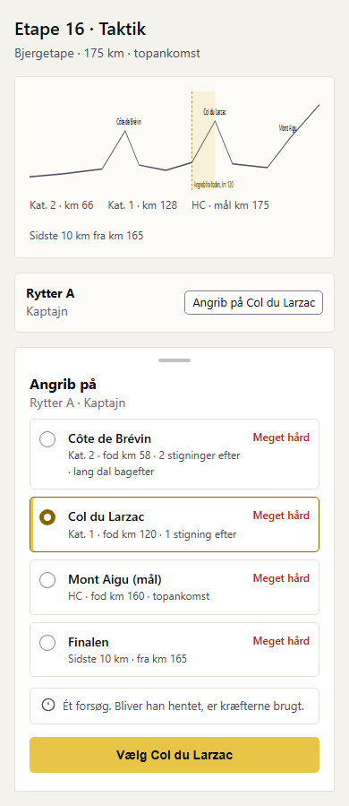
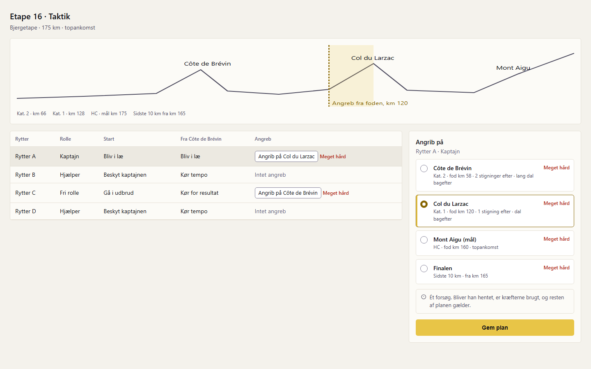

# Taktik: spillernes klager fra S5 og "Angrib på <stigning>" (#7884)

Status: rapport + designforslag + dommer-scenarier (bølge-lane 26/11). Bygger på det merge'de design
`2026-11-12-7884-langt-angreb-design.md` og ejerens valg 11/11, 12/11, 13/11 og 26/11 på #7884.
Repoet er offentligt: spillere står som aliaser (Spiller A, B, ...), ingen balance-tal (hard rule 17).

## 1. Klager om taktik fra S5, uden dubletter

Kilder: GitHub-issues med taktik/tactics/angreb/attack siden S5-start (19/10), de navngivne issues
(#7884, #7885, #5574, #7417, #8458, #7866, #8386) og Discord læst read-only (strategi-kanalerne og
tråden 26/11). Samme klage fra flere kilder er slået sammen til én linje.

| # | Klagen (spillerens ord, kort) | Hvornår, hvem | Status i dag | Hvor den løses |
|---|---|---|---|---|
| K1 | **Kun første og sidste stigning kan vælges.** Midterste stigninger findes ikke i taktikken; "første trin er 0 til 40 km, næste 40 til mål". | 19/11 Spiller A, 26/11 Spiller B + A | Åben. Rodårsag fundet (afsnit 2) | #7884 (ejer 26/11 punkt 1) |
| K2 | **Angreb efter en tidligere stigning giver intet.** Man kan kun reelt angribe på sidste stigning. | 7/11 Spiller B | Åben. Målt i trin 0 (#8061) | #7884 (langt angreb) |
| K3 | **Assistentens angreb 80 km ude på flad vej**; taktikken er så avanceret, at man klikker blindt på assistenten. | 7/11 Spiller B, Spiller C | Delvist: assistenten foreslår aldrig angreb (#7369) | #7885 |
| K4 | **"Kør efter etapesejren" sætter hele holdet til at føre fra første stigning**, og det er uklart. | 26/11 Spiller B | Åben | Ejer 26/11 punkt 2 |
| K5 | **Skift midt på en stigning** ("bliv i læ til 2 km før toppen, angrib så"). | 30/10 to spillere | Åben | #7417 |
| K6 | **Taktiksiden siger, angrebet ikke skete, fordi han blev sat, men han angreb og blev nr. 2.** | 4/11 Spiller B | Lukket (#7706) / filmen #8045 | #8045, #7865 |
| K7 | **"Alt ud" og "Angrib/Work or attack" blandes sammen** mellem plan og løbsfilm. | 5-6/11 | Lukket (#7803, #7707) | |
| K8 | **Rytter på "Bliv i læ" angreb 44 km fra mål.** | 28/10 Spiller D | Lukket (#7333, #7380) | |
| K9 | **Angreb kunne sættes på målstregen** ved "sidste stigning". | 9/11 Spiller D | Lukket (#7965) | |
| K10 | **Delt kaptajn kan ikke få "Kør for etapesejr".** | 23/11 Spiller C | Åben | #8663 |
| K11 | **Udbrud får meget store forspring, og jagten lukker dem ikke**; flere hold burde jage. | 19/10 Spiller B m.fl. | Åben (bag kontakt) | #6912 |
| K12 | **Prisen står ikke ved valget**; en kaptajn på "Kør roligt i mål" kan miste tid uden advarsel. | 4/11, 19/11 | Åben | #7638, #8458, ejer 26/11 punkt 4 |
| K13 | **Efter etapen: hvor mange angreb jeg med, og jagede jeg alene?** | 5/11 | Åben | #7754, #7865 |
| K14 | **Kan ordrer på samme hold støde sammen?** Hjælpen svarer ikke. | 28/10 Spiller B | Åben | #7331 |
| K15 | **Taktikfanen for etape 16 viser etape 14.** Fik K1 til at se værre ud. | 26/11 Spiller B, ejer | Åben, live-fejl | #8800 |
| K16 | **"Kan ikke finde ud af det nye taktik-halløj."** | 4/11 Spiller B | Delvist (#8386 telefon B, #8297) | #8386, #7866 |

Ikke en spillerklage, men samme tema: hvis-så-ordrer (#5574, ejerens idé 23/9).

**Mønster:** K1, K2, K4 og K5 er samme ønske: *"lad mig vælge, hvor på ruten min rytter gør noget"*.
Det er kernen i #7884. K3 og K16 siger, at valget skal være enkelt nok til ikke at blive overladt til
assistenten.

## 2. Rodårsagen til K1 (målt i koden)

Serverens etapeplan kender allerede alle kategoriserede stigninger som skiftepunkt
(`backend/lib/stagePlan.ts`, `stagePlanClimbsFromRaw`, `{ at: "kom", kom_index }`). Det er fladen,
der skærer dem væk: den fælles taktik-komponent deler ruten i tre faste dele, "Til <første stigning>",
"Til <sidste stigning>" og "Sidste 10 km" (`frontend/src/components/tactics/tacticsV6cModel.ts`,
`routeParts`). En etape med tre stigninger viser derfor aldrig den midterste, og den sidste kan kun
bruges som slutpunkt for en del, ikke som sted for et angreb. Desuden er punktet altid stigningens
TOP, og målstigningen ved en topankomst er ikke på listen.

## 3. Designforslag: hvornår angriber min rytter?

Ejeren har låst: én ordre, "Angrib på" + et sted fra ruten, fra foden, alle ryttere, ét forsøg pr.
stigning, ingen lodtrækning, AI foreslår aldrig langt angreb (11/11 til 13/11). Varianterne her er
derfor forskellige måder at fylde **stedlisten** på, ikke forskellige ordrer.

**Variant 1 (anbefalet, bygges nu): stigningen ved navn.** Listen er alle kategoriserede stigninger i
rutens rækkefølge, med samme navne som profilen, også målstigningen, plus "Finalen (sidste 10 km)".
Rytteren sætter af ved foden. Under valget står fakta fra ruten (hvor mange stigninger efter, dal
bagefter) og prisordet "Meget hård". Løser K1, K2 og K5's første halvdel.

**Variant 2: km før mål som steder i samme liste.** "5 km før mål", "10 km før mål", "20 km før mål"
som steder på flade og bølgede afslutninger (ejer 26/11 punkt 3). Samme ordre, samme vælger, bare
flere steder. Kræver eget motortrin (afsæt på flad vej er en anden fysik end en stigning).

**Variant 3: ved en hændelse.** "Når udbruddet er under 1 min", "når kaptajnen er sat". Det er
hvis-så-ordrerne (#5574) og kræver filmens næste trin (#8045). Frarådes nu: det gør valget sværere
(K3, K16).

## 4. Spørgsmål til ejeren (anbefaling først)

1. **Variant 2's km-steder:** A (anbefalet) som ekstra steder i samme "Angrib på"-liste, kun på flade
   og bølgede afslutninger · B som en separat ordre ved siden af.
2. **Stigninger uden navn i profilen:** A (anbefalet) vises med kategori og km, fx "Kat. 3 ved km 87"
   · B vises ikke.
3. **Hvor holdet begynder at føre (punkt 1):** A (anbefalet) samme stedliste og samme vælger som
   angrebet · B kun de faste rutedele som i dag.

## 5. Dommer-scenarier (skrevet før koden)

Kontrakten er `backend/lib/tacticAttackTrigger7884.js`. Hvert scenarie er en test i
`tacticAttackTrigger7884.test.js`, der fejler uden reglen.

**Stedlisten**
- D1 Alle kategoriserede stigninger kommer med i rutens rækkefølge, også de midterste (K1).
- D2 Målstigningen ved topankomst kommer med (den mangler på listen i dag).
- D3 "Finalen" findes på hver vejetape, også uden stigninger.
- D4 Foden er toppen minus stigningens længde, aldrig under 0; uden gyldig længde er stigningen
  ikke et sted (en fod man ikke kender, kan man ikke sætte af ved).
- D5 Ukategoriserede stigninger, toppe efter mål og tidskørsler giver ingen steder.
- D6 To stigninger med samme navn er to forskellige steder (nøglen er stigningens index, navnet er
  kun en etiket).
- D7 Rutens fingeraftryk ændrer sig, når et sted flytter sig, får nyt navn eller forsvinder, og er
  det samme for den samme rute.

**Ordren**
- D8 Kun opgaven "Angrib" kan have et sted som skiftepunkt; formen er præcis
  `{ at: "climb_start", kom_index }` eller `{ at: "finale" }`.
- D9 Alle seks roller må få ordren, også hjælperen og den delte kaptajn (ejer 11/11).
- D10 Et ukendt sted afvises.
- D11 Kronologi på tværs af gamle og nye skiftepunkter: et angreb fra foden skal ligge efter forrige
  leds punkt og før næste leds punkt.
- D12 Ét forsøg pr. stigning: samme sted to gange afvises.
- D13 I nye planer er den gamle top-ordre ("Angrib" fra stigningens top) ikke et valg (ejer 12/11);
  gemte planer kan stadig læses og køres.

**Kontakten**
- D14 Slukket: en plan uden de nye steder kommer ud som præcis samme objekt (bit-identisk), og
  digest over et korpus af planer er lig den frosne digest fra merge-basen.
- D15 Slukket: et angreb på et sted erstattes af den forrige opgave, senere led bevares, to ens led i
  træk bliver til ét, og resultatet er altid en gyldig plan efter de gamle regler.
- D16 Tændt, men motorens trin er ikke bygget endnu: samme som slukket. En kontakt der tændes for
  tidligt, kan aldrig sende en ukendt ordre til motoren.
- D17 Kun den eksakte værdi "on" tænder; alt andet (mangler, "off", true, fejl) er slukket.

**Hvad dette byg ikke er:** ingen motorændring (ingen fil under `backend/lib/engine/` er rørt), ingen
flade, ingen API-ændring. Motortrinnet (afsæt fra foden, fart betalt af reserven, jagten) er trin 4
og 5 i designets byggeplan og får egen PR, egen måling og Fable-dom før merge.

## 6. Trin 2-7 (#8828): dommer-scenarier skrevet før koden

**Gem og læsning (trin 2)**, tests D18-D27 i `tacticAttackTrigger7884.test.js`:
- D18 En stigning uden navn vises med kategori og km (toppens km); finalen for sig.
- D19 Under valget står fakta fra ruten: foden, antal stigninger efter, topankomst.
- D20 Den kanoniske form beholder stigningens index.
- D21 Gem bærer planen uden stederne ved siden af (motoren kører den, når reglen ikke gælder),
  rutens fingeraftryk og de gamle felter fra planen uden stederne.
- D22 Gem med et andet fingeraftryk afvises neutralt (409); planer uden steder røres ikke.
- D23 API'et tager kun imod stederne med kontakten "on", etapeplanens revision OG motorens trin
  tilsluttet; indtil da læses kontakten slet ikke.
- D24 Med stederne åbne valideres og gemmes planen, og motorens ordre-adapter får planen uden stederne.
- D25 "Holdet fører fra" og "km før mål" kan sættes ind som ny opgave/ny art uden omskrivning.
- D26-D27 Slukket er adapterens ordre og API'ets validering/gem bit-identiske med merge-basen
  (frosne digests fra et separat checkout, #7587).

**Motoren (trin 4-6)**, tests M1-M8 i `engine/v4/mechanics/longAttack7884.test.ts`:
- M1 Afsæt fra foden fra den gruppe han sidder i: samme hul som gruppen, ingen flytning frem,
  intet startforspring. Er han alene i gruppen, sker der intet.
- M2 Farten over hans egen evne betales af reserven: tillægget findes kun, mens der er reserve, og
  det koster reserve i forhold til tillægget. En tom reserve giver intet tillæg (så gælder motorens
  almindelige straf for en tømt reserve: han "går død").
- M3 En træt rytter (mindre reserve) får målbart mindre ud af angrebet end en frisk.
- M4 Ingen ny tilfældighed: samme input giver samme output, og mekanikken tager ingen
  tilfældighedsstrøm.
- M5 Ét forsøg: er han hentet (hans gruppe rummer ryttere, der ikke angreb med ham), er angrebet
  slut, og resten af leddet køres som "Følg med" (ejerens valg 4 A).
- M6 At køre op til en gruppe foran er ikke at blive hentet.
- M7 Uden nogen "Angrib på"-ordre i feltet gør mekanikken intet (samme objekter ind og ud).
- M8 Én ejer af gevinsten: en rytter på langt angreb er ikke kandidat til "Alt ud"-gevinsten på
  samme segment.

**Tilslutningen (trin 3, #8828)**, tests W0-W9 i `engine/v4/mechanics/longAttack7884Engine.test.ts` og
startstemplet i `longAttack7884Flag.test.js`:
- W0 Slukket OG tændt uden nogen "Angrib på"-ordre er bit-identiske med en frossen golden skrevet af
  merge-basens kode i et separat checkout (#7587).
- W1 Motorens steder har samme nøgler og fod som API'ets på de samme rå felter.
- W2-W3 Ordre-adapteren bærer planen med stederne ved siden af; motoren kører den kun i et løb stemplet
  til kontakten og kun, når den er gyldig mod motorens egne steder. Ellers planen uden stederne.
- W4 Afsæt ved foden fra hans egen gruppe med samme hul; angrebet gælder stigningen (til toppen, eller
  mål ved topankomst og finalen); indsatsen er ikke "Alt ud" (farten betales af reserven, M8 og valg 3 A),
  men trætheden bagefter kender leddets pris.
- W5 Hentet: ét forsøg, resten af leddet er "Følg med", senere led gælder. Over toppen uden at være
  hentet: samme, uden nyt tillæg.
- W6-W9 Topankomst og finalen holder til mål; et hold styrer aldrig et andet holds rytter; slukket
  kører en gemt plan med steder som planen uden dem; tændt er afsættet ved foden og deterministisk.
- Kontakten bindes til løbet ved første etape (`races.long_attack_7884`), og stemplet læses før
  kontakten (#8801). API'et tager kun imod stederne, når løbet vil køre dem.

Jagten fra holdene (designets trin 5), regnskabet i trætheden (trin 6) og kalibreringen mod benchmark
(privat, `balance-internals/7884/`) er IKKE bygget. Kontakten må ikke tændes, før de er det, og før den
uafhængige dommer og ejeren har set det.
