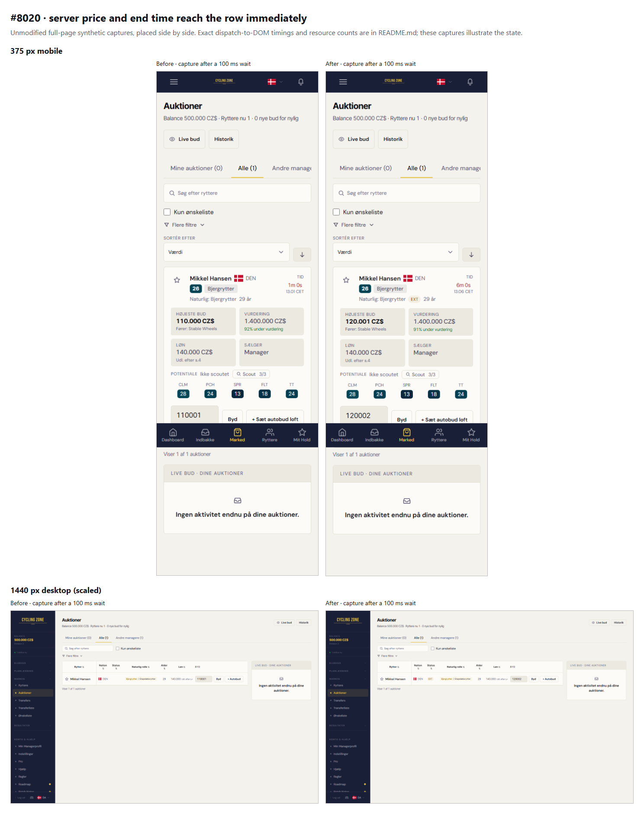

# #8020 realtime review correction

**Scoped P1 working checkpoint.** The broader Query migration remains partial: Dashboard and the separate spec P2s are not claimed complete. The unchanged bundle limit is still exceeded; PC1 owns the #6165/#8040 reduction. No merge/release acceptance.

## Method

Actual production/E2E app builds and Supabase client, authenticated synthetic fixture session, locally mocked Phoenix/Postgres Changes WebSocket frames. The payload contains raw auction columns, not joined rider/team objects. No production API/database traffic or RLS/publication verification. Viewports 375×812 and 1440×900; explicit clock 12 November 2026 12:00 UTC, Europe/Copenhagen.

A visible foreign-owned fixture auction receives a same-bidder price/end update, then completion. A third event is a bid on an unrelated auction. Each interval is observed for approximately 1.3 s (1.2 s for the unrelated bid), excluding warm-up. A frame observer measures dispatch-to-rendered-row text/removal. It includes local message dispatch/render overhead; these are single controlled observations, not field latency percentiles. Screenshots follow a 100 ms wait and are illustrations, not the timing measurement.

Requests count all API/REST methods except CORS OPTIONS; the before total is five GET plus three HEAD reads. WebSocket heartbeats/assets are not counted as data refetches. Own bids/settlements are deliberately separate: private budget data may require targeted server confirmation. Zero-read claims below apply to these foreign/public cases only.

| Width | Event | Price ms before / after | End label ms before / after | Removal ms before / after | API/REST reads before / after |
|---|---|---:|---:|---:|---:|
| mobile | price-and-end | 420 / 11 | 420 / 11 | — | 8 / 0 |
| mobile | completion | — | — | 447 / 5 | 8 / 0 |
| mobile | unrelated-bid | — | — | — | 8 / 0 |
| desktop | price-and-end | 423 / 12 | 423 / 12 | — | 8 / 0 |
| desktop | completion | — | — | 443 / 9 | 8 / 0 |
| desktop | unrelated-bid | — | — | — | 8 / 0 |

## Verification boundary

32 tests use the pinned real QueryClient, deferred reads and injected clocks. They cover scope/disposal, cold and warm reads, tombstones, nullable schema fields, name joins, private-budget confirmation, cancelled receipts, cold remount and snapshot freshness age. Four actual browser cases cover a five-second closing ring at both widths, quiet 429/manual Retry-After recovery, and own-settlement UI/request ordering. No hook-function source extraction. Frontend units: 5626 passed; lint, strict typecheck and build passed. Full-suite/readiness status is reported separately in the PR body; targeted checks are not presented as full E2E.

Own-settlement proof removes the closed row, keeps money visibly pending, holds a second monetary request until fresh team/snapshot responses, then displays the exact server balance. Neither a bid amount nor an auction price is guessed into cash/proxy ceilings.

## Source and bundle

Before entry: `index-BduEkxRP.js`, SHA-256 `dd33c27c08be47a69be339afcee56118d15a3e6e1a9cec5857149a52cfc60aa6`. After entry: `index-DLVkrtaD.js`, SHA-256 `2edbf44fa46f0304794aaca82b7618b245e56967abb024a8b275579125e78f29`. The private 14-file P1-v2 source archive is identified in the JSON. The original paused patch and commit bundle are retained.

Local production/E2E JS bundle: **1442.1 → 1444.8 KB**, against the unchanged **1432.2 KB** limit. The deficit existed before this correction and still blocks the whole PR; no cap increase or new dependency is included.

## Screenshots

Only synthetic fixture data. Unmodified browser captures; no private logs, tokens or real player identities.

| Scenario | 375px before / after | Desktop before / after |
|---|---|---|
| price-progress | [before](before-mobile-price-progress.png) / [after](after-mobile-price-progress.png) | [before](before-desktop-price-progress.png) / [after](after-desktop-price-progress.png) |
| price-settled | [before](before-mobile-price-settled.png) / [after](after-mobile-price-settled.png) | [before](before-desktop-price-settled.png) / [after](after-desktop-price-settled.png) |
| completion-progress | [before](before-mobile-completion-progress.png) / [after](after-mobile-completion-progress.png) | [before](before-desktop-completion-progress.png) / [after](after-desktop-completion-progress.png) |

Corrected own-settlement flow at 375px: [pending server confirmation](own-settlement-pending.png) / [server-confirmed balance](own-settlement-confirmed.png). These are two states of the corrected build, not a pre-correction comparison.

[Exact sanitized measurements and source identities](measurements.json). The earlier night Lighthouse/screenshots remain historical evidence at their recorded revision; this focused realtime probe does not replace a final whole-migration Lighthouse/staging acceptance.
