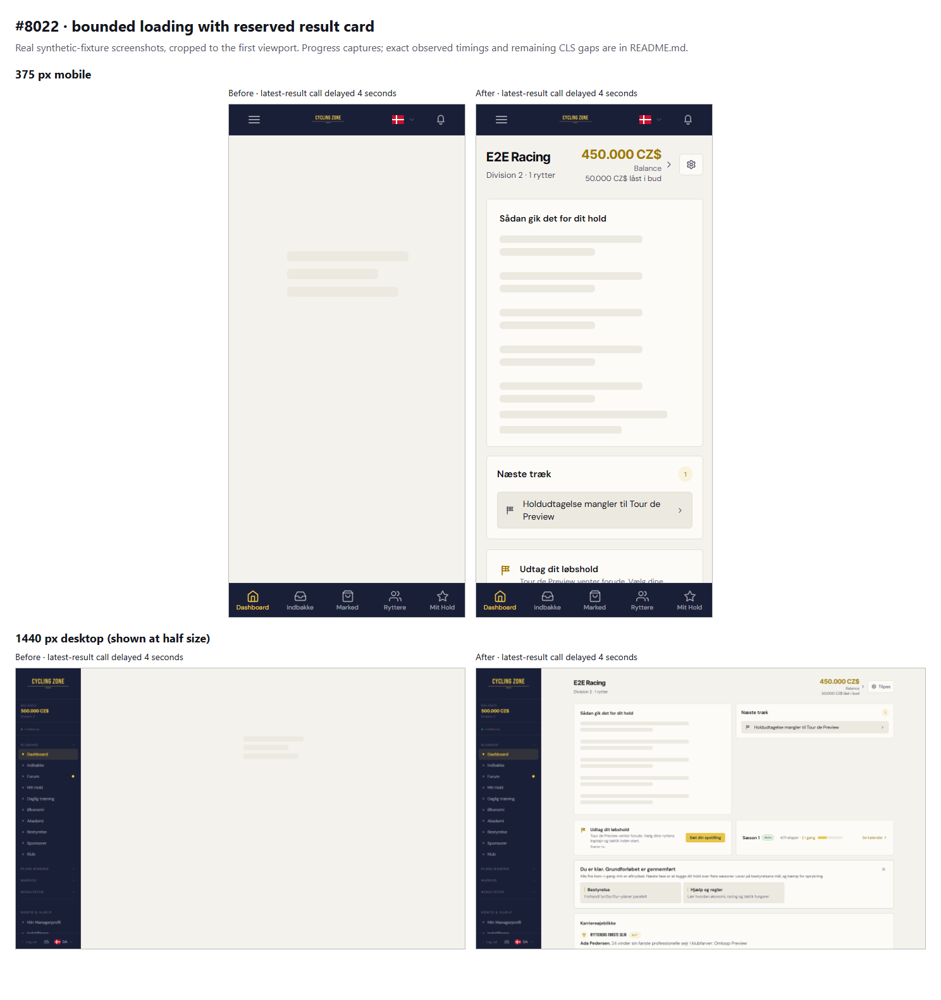

# Review follow-up: bounded dashboard loading

**The latency correction is measured; the original CLS < 0.05 target is not universally met.** 11 of 20 scenarios (18 single-request delays and 2 fast controls) are below the target. No release/merge approval is implied.

Reviewed runtime: `db78ea6e3` (same runtime as reviewed evidence HEAD `1d63b134a`). Corrected runtime: `dc0c611983545a8abdb9737f14964d748c7b3d11`.

Local production/E2E builds with authenticated synthetic fixtures only. Chromium viewports: 375×812 and 1440×900. Explicit fixture dates: 29 September 2026, or 30 September for profile enrichment. Each slow case delays only the first matching request by 4000 ms; all other requests, including any matching successor, respond normally. The dependent-registration case uses a confirmed-empty schedule to isolate that call from the stage strip’s separate registration query. No production traffic or private player data.

**Timing definitions:** useful content is the first visible nonempty settled data region or real race/rider link; the header/skeleton alone does not qualify. FCP is the browser paint metric and is reported separately. The 1500 ms code budget starts at component mount, so navigation-to-content also includes app boot. Visible-loader duration is sampled by animation frames and may exceed 1500 ms by scheduling/render time. The observation window ends about 5500 ms after navigation returns, plus capture overhead; it is not unbounded session CLS. These are single controlled runs, not field percentiles or a causal speed claim.

**CLS limitation:** conditional modules still obey their existing presence rules. A late confirmed-empty stage strip collapses, and valid late conditional content remains visible. The original universal CLS < 0.05 goal must be assessed from the exact results below; it is not inferred from historical uniform-delay runs.

| Viewport | One slow call | Useful content before / after ms | FCP before / after ms | Loader after ms | CLS before / after |
|---|---|---:|---:|---:|---:|
| mobile | fast | 544 / 490 | 452 / 428 | 67 | 0 / 0 |
| mobile | latest | 4469 / 1986 | 440 / 464 | 1526 | 0 / 0 |
| mobile | dependent | 4543 / 2099 | 444 / 568 | 1535 | 0 / 0 |
| mobile | selection | 739† / 2073 | 596 / 564 | 1515 | 0 / 0 |
| mobile | schedule | 5087 / 1956 | 864 / 432 | 1531 | 0 / 0.24327 |
| mobile | profiles | 1270 / 496 | 920 / 424 | 78 | 0 / 0 |
| mobile | onboarding | 4575 / 525 | 532 / 436 | 94 | 0 / 0 |
| mobile | roster | 4591 / 2519 | 496 / 1020 | 1511 | 0 / 0.00068 |
| mobile | board | 4509 / 1986 | 444 / 456 | 1536 | 0 / 0.00068 |
| mobile | team | 5228 / 1911 | 1024 / 400 | 1514 | 0 / 0.24395 |
| desktop | fast | 676 / 451 | 532 / 408 | 50 | 0.05126 / 0.02829 |
| desktop | latest | 4544 / 1938 | 524 / 408 | 1538 | 0.01781 / 0.00907 |
| desktop | dependent | 5012 / 1940 | 676 / 420 | 1530 | 0.03346 / 0.1079 |
| desktop | selection | 5284 / 1928 | 948 / 436 | 1501 | 0.03346 / 0.1079 |
| desktop | schedule | 5005 / 1952 | 876 / 448 | 1511 | 0.01781 / 0.11782 |
| desktop | profiles | 641 / 509 | 520 / 432 | 84 | 0.03205 / 0.03205 |
| desktop | onboarding | 5763 / 497 | 1712 / 428 | 79 | 0.03261 / 0.05394 |
| desktop | roster | 4651 / 2439 | 532 / 944 | 1502 | 0.03346 / 0.12242 |
| desktop | board | 4552 / 1954 | 480 / 456 | 1506 | 0.01781 / 0.12242 |
| desktop | team | 4687 / 1949 | 564 / 420 | 1539 | 0.03346 / 0.22907 |

† Before/mobile/selection issued two matching calls; only the first was delayed, and the successor remained fast. Its 739 ms observation is retained as informational, not a comparable blocked critical path or evidence of a regression/speedup. All other delayed cases matched one request.

## Lighthouse and input measurement

Three navigation runs per route/viewport, medians; simulated mobile/desktop throttling. The auction navigation starts at /auctions and resolves to ?tab=all. INP is a separate trusted Customize/dismiss click or filter typing/clearing observation from the native interaction harness (650 ms uniform request delay, 6500 ms settle), never TBT relabelled as INP. Missing INP means the short interaction did not yield a reportable value. No field-INP claim.

| Viewport | Route | Performance before / after | CLS before / after | LCP before / after ms | Observed INP before / after ms |
|---|---|---:|---:|---:|---:|
| mobile | /dashboard | 46 / 70 | 0 / 0 | 17059 / 16815 | 16 / 16 |
| mobile | /auctions | 49 / 91 | 0.00898 / 0.00898 | 4088 / 1507 | 16 / 16 |
| desktop | /dashboard | 79 / 81 | 0.05126 / 0.05126 | 3521 / 3434 | 16 / 24 |
| desktop | /auctions | 83 / 84 | 0.02119 / 0.02119 | 2792 / 2713 | 24 / 16 |
| mobile | /transfers?tab=market | 73 / 73 | 0.01523 / 0.01523 | 14264 / 14264 | 16 / 16 |
| desktop | /transfers?tab=market | 83 / 83 | 0.01942 / 0.01942 | 2852 / 2851 | 24 / 24 |

The separate native interaction profile also records CLS before input. Its uniform 650 ms delay can exceed the shared loader budget across sequential requests; it is not the same profile as Lighthouse or the single-request table.

| Viewport | Route | Native pre-input CLS before / after |
|---|---|---:|
| mobile | /dashboard | 0 / 0.24327 |
| mobile | /transfers?tab=market | 0.01523 / 0.01523 |
| mobile | /auctions | 0.00898 / 0.00898 |
| desktop | /dashboard | 0.02799 / 0.24346 |
| desktop | /transfers?tab=market | 0.01635 / 0.01635 |
| desktop | /auctions | 0.01635 / 0.01635 |

## Screenshots

Unmodified browser captures; only synthetic fixture identities. The 1800 ms capture is taken after navigation returns and is a progress illustration, not the timing measurement. Actual times above come from in-page observers.

| Scenario | 375px before / after | Desktop before / after |
|---|---|---|
| latest, 1800ms | [before](before-mobile-latest-1800ms.png) / [after](after-mobile-latest-1800ms.png) | [before](before-desktop-latest-1800ms.png) / [after](after-desktop-latest-1800ms.png) |
| latest, settled | [before](before-mobile-latest-settled.png) / [after](after-mobile-latest-settled.png) | [before](before-desktop-latest-settled.png) / [after](after-desktop-latest-settled.png) |
| board, 1800ms | [before](before-mobile-board-1800ms.png) / [after](after-mobile-board-1800ms.png) | [before](before-desktop-board-1800ms.png) / [after](after-desktop-board-1800ms.png) |
| schedule, 1800ms | [before](before-mobile-schedule-1800ms.png) / [after](after-mobile-schedule-1800ms.png) | [before](before-desktop-schedule-1800ms.png) / [after](after-desktop-schedule-1800ms.png) |
| schedule, settled | [before](before-mobile-schedule-settled.png) / [after](after-mobile-schedule-settled.png) | [before](before-desktop-schedule-settled.png) / [after](after-desktop-schedule-settled.png) |
| fast, settled | [before](before-mobile-fast-settled.png) / [after](after-mobile-fast-settled.png) | [before](before-desktop-fast-settled.png) / [after](after-desktop-fast-settled.png) |
| auctions, settled | [before](before-mobile-auctions-settled.png) / [after](after-mobile-auctions-settled.png) | [before](before-desktop-auctions-settled.png) / [after](after-desktop-auctions-settled.png) |
| transfers, settled | [before](before-mobile-transfers-settled.png) / [after](after-mobile-transfers-settled.png) | [before](before-desktop-transfers-settled.png) / [after](after-desktop-transfers-settled.png) |

[Exact sanitized measurements](measurements.json). Raw local logs, request selectors and full Lighthouse reports remain in the private shared handoff. Historical original-night evidence is in the parent directory and applies only to its explicitly recorded runtime.
